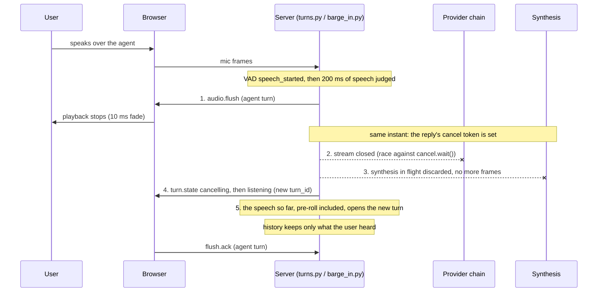

# Vaani — Frontend/Backend Communication Contracts

This document describes the agreed interface between the frontend (Samyak)
and the backend (Aryan). Both sides should update this file when the
contract changes.

Status labels:
- **Agreed** — both sides have confirmed.
- **Proposed** — drafted by one side, awaiting confirmation.
- **Planned** — required by the build plan but not yet specified.

---

## 1. Health Check (Agreed)

Used by the frontend to verify the backend is reachable.

| Field    | Value                |
|----------|----------------------|
| Method   | `GET`                |
| Path     | `/health`            |
| Response | `{ "status": "ok", "version": "<semver>" }` |

Already implemented in `backend/vaani/app.py`.

---

## 2. WebSocket Audio Channel (Agreed)

Real-time bidirectional channel for voice conversation.

| Field       | Value                          |
|-------------|--------------------------------|
| Endpoint    | `ws://<host>/ws/session`       |
| Direction   | Bidirectional                  |
| Initiated by| Frontend                       |

**Current version: SHARED PROTOCOL v0.7.** This file is the source of truth
for version numbers; `backend/vaani/protocol.py` repeats the same history.
Only the PR that changes this file bumps the version.

| Version | Adds | Section |
|---|---|---|
| v0.1 | `session.start`, `session.started`, `session.end`, `error`; 640-byte 16 kHz mic frames | 2.1, 2.3 |
| v0.2 | Server → browser audio (`audio.start`, frames, `audio.end`); flush (`audio.flush`, `flush.ack`); dev-only `dev.flush` | 2.2, 2.3 |
| v0.3 | Transcripts (`transcript.partial`, `transcript.final`); a turn is one utterance; `ASR_FAILED` proposed | 2.4 |
| v0.4 | Agent turn (`turn.state`, `agent.text`, `agent.done`); `LLM_FAILED`, `INPUT_REJECTED` | 2.5 |
| v0.5 | `telemetry` for the Latency HUD (frontend proposal; the backend does not send it yet) | 2.6 |
| v0.6 | `audio.start` carries `sample_rate`; `speaking` starts with the first audio frame; `TTS_FAILED` | 2.2, 2.3, 2.5 |
| v0.7 | Barge-in. No new message. `dev.flush` removed; `audio.flush` can come during `thinking`, after `agent.done`, after `audio.end`; `flush.ack` may name a turn that is no longer current; `cancelling` → `listening` with a new `turn_id` | 2.3, 2.5, 2.7 |

### 2.1 Client → Server: Audio Frames (Agreed / Client Implemented)

The frontend captures microphone audio using AudioWorklet and sends it as binary
WebSocket messages.

| Parameter       | Value                                  |
|-----------------|----------------------------------------|
| Message type    | Binary                                 |
| Encoding        | Raw PCM, 16-bit signed little-endian (Int16LE) |
| Sample rate     | 16,000 Hz                              |
| Channels        | 1 (mono)                               |
| Frame duration  | 20 ms                                  |
| Samples/frame   | 320                                    |
| Bytes/frame     | 640 (320 samples × 2 bytes)            |
| Byte order      | Little-endian                          |
| Expected rate   | ~50 frames/second                      |

Each binary message is exactly 640 bytes. The frontend converts Float32 Web Audio
samples directly to Int16LE inside the dedicated AudioWorklet thread.

### 2.2 Server → Client: Audio Playback — SHARED PROTOCOL v0.6 (Proposed — pending Samyak)

The backend streams audio back as binary WebSocket frames, always between an
`audio.start` and that turn's `audio.end` (or `audio.flush`). The encoding is
the same as the upstream direction; **the sample rate is not fixed**: it is
the `sample_rate` declared by the most recent `audio.start`, and holds for
every frame until the matching `audio.end`.

| Parameter       | Value                                  |
|-----------------|----------------------------------------|
| Message type    | Binary                                 |
| Encoding        | Raw PCM, 16-bit signed little-endian (Int16LE) |
| Sample rate     | The `sample_rate` in `audio.start`: 22050 for the agent's voice (Piper `hi_IN-priyamvada-medium`), 16000 for the dev echo |
| Channels        | 1 (mono)                               |
| Frame duration  | 20 ms at the declared rate (882 bytes at 22050 Hz, 640 at 16000 Hz). Do not rely on the size: decode any even length |
| Bytes/sample    | 2                                      |
| Byte order      | Little-endian                          |

The frontend decodes incoming bytes as `Int16Array`, scales to Float32
(dividing by 32768), and schedules each chunk on the Web Audio clock for
gapless playback, **at the rate `audio.start` declared**. An `AudioBuffer`
can be created at any rate; the browser resamples it to the output device.

> **Frontend gap (2026-10-06)**: `usePlaybackQueue` plays every frame at the
> fixed `AUDIO_SAMPLE_RATE = 16_000` (`frontend/src/config.js`) and does not
> read `audio.start`. The agent's 22050 Hz audio would play about 27% slow and
> low until it does.

### 2.3 Control Messages (Agreed)

Control messages use JSON text frames (not binary).

#### Client → Server

| Type             | Payload                                                   | When                                             |
|------------------|-----------------------------------------------------------|--------------------------------------------------|
| `session.start`  | `{ "type": "session.start", "persona": "default", "audio": { "sample_rate": 16000, "channels": 1, "frame_ms": 20 } }` | After WebSocket connects                         |
| `session.end`    | `{ "type": "session.end" }`                               | User ends conversation                           |
| `flush.ack`      | `{ "type": "flush.ack", "turn_id": "<string>", "client_ts": <number> }` | As soon as the flushed turn's audio has stopped. `client_ts` is the browser's `performance.now()`; the server logs it but never subtracts it from its own clock. v0.7: by then a newer turn is usually current (a barge-in opens one at once); ack the flushed `turn_id` anyway |

`dev.flush` was removed in v0.7: barge-in replaced it. It now gets
`UNKNOWN_MESSAGE_TYPE`.

`persona` must be one of `default`, `tutor`, `support` (config.toml
`[personas]`); anything else gets `BAD_MESSAGE`. `audio` must be exactly
`16000` / `1` / `20`; anything else gets `UNSUPPORTED_FORMAT`.

#### Server → Client

| Type             | Payload                                               | When                              |
|------------------|-------------------------------------------------------|-----------------------------------|
| `session.started`| `{ "type": "session.started", "session_id": "..." }`  | Backend accepted session.start    |
| `error`          | `{ "type": "error", "code": "<code>", "message": "..." }` | A problem report. Non-fatal: the connection stays open. Codes below |
| `audio.start`    | `{ "type": "audio.start", "turn_id": "<string>", "sample_rate": <number> }` | Before a turn's first audio frame. Every frame until the matching `audio.end` belongs to `turn_id` and is at `sample_rate` (v0.6) |
| `audio.end`      | `{ "type": "audio.end", "turn_id": "<string>" }`      | After a turn's last audio frame   |
| `audio.flush`    | `{ "type": "audio.flush", "turn_id": "<string>" }`    | Silence that turn at once: stop scheduled audio, drop its queued frames, fade out within 10 ms, reply `flush.ack`. Replaces `audio.end` for that turn; frames that still arrive for it must be discarded. v0.7: sent on barge-in (§2.7), and may come with no `audio.start` before it (cut while `thinking`), after `agent.done`, or after `audio.end` (all audio sent, still playing): stop playback in every case |

#### Error codes

Shape: `{ "type": "error", "code": "<code>", "message": "..." }`. Every code
is non-fatal and none carries a `turn_id`. `message` is for display; branch
on `code`.

| Code | Meaning | What follows |
|---|---|---|
| `SESSION_NOT_STARTED` | Audio or a message arrived before `session.start` | Nothing; send `session.start` |
| `UNSUPPORTED_FORMAT` | `session.start`'s audio settings are not 16000 / 1 / 20 | No `session.started` |
| `BAD_FRAME_SIZE` | A binary frame is not 640 bytes | The frame is dropped |
| `BAD_MESSAGE` | Not valid JSON, no `type`, a malformed known message, or an unknown persona | The message is dropped |
| `UNKNOWN_MESSAGE_TYPE` | A `type` the server does not handle | The message is dropped |
| `ASR_FAILED` | The turn's final transcript could not be produced (recogniser error, or the `[asr].timeout_s` timeout) | No `transcript.final`; `turn.state idle` |
| `LLM_FAILED` | The agent could not answer: every provider failed, a provider error, the spend cap, or an empty reply | No `agent.done`; `turn.state idle`. Must be shown to the user, never silence. The backend does **not** yet speak an apology; text only |
| `INPUT_REJECTED` | The user's turn was blocked by the input guardrail before reaching the model | `turn.state idle`. The message is deliberately vague ("that turn wasn't processed") |
| `TTS_FAILED` | The reply could not be spoken (speech synthesis failed) | `audio.end` if audio had started, then `error`, then `turn.state idle`; no `agent.done` (v0.6) |

### 2.4 Transcripts — SHARED PROTOCOL v0.3 (Agreed)

Server → client, JSON text frames. Implemented on the backend in
`backend/vaani/protocol.py` (`TranscriptPartial`, `TranscriptFinal`).

| Type | Payload | When |
|---|---|---|
| `transcript.partial` | `{ "type": "transcript.partial", "turn_id": "<string>", "text": "<string>" }` | While the user is still speaking. Each one **replaces** the previous partial for that `turn_id`; it is not appended |
| `transcript.final` | `{ "type": "transcript.final", "turn_id": "<string>", "text": "<string>", "duration_ms": <number>, "language": "<string or null>" }` | Once per turn, after endpointing fires. Replaces the partial |

A final may arrive with no preceding partial, and may differ from the last
partial shown. The browser must handle both.

Backend notes (day 10):
- **A turn is one user utterance.** Its `turn_id` is created when speech
  starts. Partials, the final, and any echo audio for that utterance share it.
  This changes echo mode: `audio.start` / `audio.end` now come **once per
  utterance**, not once per session, and frames between utterances are not
  echoed.
- Partials are **off by default** (`[asr].partial_interval_ms = 0`), so today
  the browser receives finals only.
- A turn that is flushed (`audio.flush`) gets no transcript at all.
- `text` may contain Devanagari and Latin script in the same sentence.
- `duration_ms` is the length of the user's speech in the turn.

### 2.5 Agent turn — SHARED PROTOCOL v0.4 (Proposed — pending Samyak, agree as one block)

Server → client, JSON text frames. Implemented on the backend in
`backend/vaani/protocol.py` (`TurnStateMessage`, `AgentText`, `AgentDone`,
`ErrorCode`). Everything in this section is new in v0.4 and is meant to be
agreed **together**.

| Type | Payload | When |
|---|---|---|
| `turn.state` | `{ "type": "turn.state", "turn_id": "<string or null>", "state": "idle" \| "listening" \| "thinking" \| "speaking" \| "cancelling" }` | On every state change. `turn_id` is `null` only when `state` is `idle` |
| `agent.text` | `{ "type": "agent.text", "turn_id": "<string>", "delta": "<string>" }` | One streamed fragment of the reply. **Append** these (unlike `transcript.partial`, which replaces) |
| `agent.done` | `{ "type": "agent.done", "turn_id": "<string>", "text": "<string>" }` | The reply is complete; `text` is the full reply. A client may ignore it if it accumulated the deltas |

One normal turn traces `listening → thinking → speaking → idle`. The
`turn_id` is the user utterance's id, so the transcript and the reply share it.
A failed turn gets `error` then `turn.state idle`, and **no** `agent.done`. A
barged-in turn (v0.7, §2.7) traces `cancelling`, then `listening` with a
**new** `turn_id`. It gets no `agent.done`, unless the cut landed after
`agent.done` was already sent (the reply was complete but still playing).

Backend notes:
- **v0.6:** `speaking` starts when the reply's first **audio frame** is sent,
  and lasts until the backend estimates the browser has played the last one.
  So `agent.text` deltas arrive while the state is still `thinking`, and the
  text runs ahead of the audio. A spoken turn traces
  `listening → thinking → speaking → idle` with
  `audio.start … frames … audio.end` inside `speaking`.
- **v0.6:** replies are written entirely in Devanagari, English words too
  (the persona asks for it; the Hindi voice cannot read Latin-script
  Hinglish). The user's `transcript.final` stays in whatever script the
  recogniser produced, usually Latin.
- **v0.7:** the backend is no longer half-duplex: speech while the agent is
  thinking or speaking is a barge-in (§2.7). `cancelling` is always
  followed by `listening`; `cancelling → idle` no longer exists.
- `ASR_FAILED`, `LLM_FAILED`, `INPUT_REJECTED` and `TTS_FAILED` are in the
  error-code table in §2.3, with every other code.

### 2.6 Telemetry — SHARED PROTOCOL v0.5 (Proposed — Frontend addition for Latency HUD)

Server → client, JSON text frames. Emitted after each turn or as stage spans settle.
Consumed by the frontend Latency HUD (Week 3, Day 1).

| Type | Payload | When |
|---|---|---|
| `telemetry` | `{ "type": "telemetry", "turn_id": "<string or null>", "stages": { "<stage_name>": <duration_ms> }, "total_ms": <number or null> }` | When a turn completes or stage measurements settle. Updates the frontend Latency HUD live |

Payload schema:
- `type`: Literal `"telemetry"` (also accepts `"telemetry.turn"` or `"telemetry.spans"`).
- `turn_id`: The turn identifier matching `transcript.final` / `agent.done`.
- `stages`: Key-value map of stage names to numeric durations in milliseconds (e.g. `vad`, `endpointing`, `asr`, `llm`, `tts`, `playback`). Can also be passed as an array of `{ name, duration_ms }`.
- `total_ms`: Total end-to-end latency from speech stop to audible response, or `null` if unmeasured.

Stage vocabulary (aligned with `backend/vaani/telemetry.py` constants):
- `vad`: Voice activity detection frame cost (`vad_decision` span).
- `endpointing`: Silence threshold wait (`turn_ended` span minus `speech_ended`).
- `asr`: Speech recognition decode latency (`asr_final` span).
- `llm`: Language model time-to-first-token (`llm_first_token` span).
- `tts`: Speech synthesis first audio chunk latency (`tts_first_audio` span).
- `playback`: Web Audio queue scheduling delay to speaker output (`playback_start` span).

Backend note (2026-10-06): the backend does **not** send `telemetry` yet.
`backend/vaani/protocol.py` has no model for it; the span names above exist
in `backend/vaani/telemetry.py` but are only logged server-side.

### 2.7 Barge-in — SHARED PROTOCOL v0.7 (Proposed — pending Samyak)

No new message. While `turn.state` is `thinking` or `speaking`, the server
judges the user's speech; once it reaches `[barge_in].min_speech_ms` (200 ms
from onset, config.toml) it is an interruption. The browser then receives,
in this order:

1. `audio.flush` for the agent's turn. **First**, because the user judges the
   interruption by when the speaker goes quiet. Stop playback, ack.
2. `turn.state cancelling` (agent's `turn_id`).
3. `turn.state listening` with a **new** `turn_id`: the user's interrupting
   speech is that turn, from its first sound.

No frame for the agent's turn is sent after `audio.flush`. What the browser
must handle that v0.6 never produced:

- `audio.flush` with no `audio.start` before it (cut while `thinking`).
- `agent.done`, then `audio.flush` (the reply was complete, still playing).
- `audio.end`, then `audio.flush` for the same turn (all audio sent, still
  playing): stop it anyway.
- The `flush.ack` names a turn that is no longer current. Send it anyway; the
  server accepts it.

The spec's diagram ("Sequence -- Conversation turn with barge-in", complete
documentation PDF, p. 23) draws "Stop playback" last, after "Cancel stream"
and "Flush queue". This diagram supersedes it; the PDF has not been edited.

---

## 3. Future Contracts (Planned)

These will be specified as their implementation days arrive:

- **Voice enrolment API** — Week 4

---

## Changelog

| Date       | Author  | Change                                                                                  |
|------------|---------|-----------------------------------------------------------------------------------------|
| 2026-09-22 | Samyak  | Initial draft: audio frame format, session lifecycle                                    |
| 2026-09-23 | Samyak  | Day 2 implementation: Int16LE 640B frames via AudioWorklet                              |
| 2026-09-23 | Samyak  | Day 3: fix endpoint to /ws/session, fix session.start payload, document playback format  |
| 2026-09-24 | Samyak  | Day 4: audio.flush and audio.flush.ack specification for immediate playback silencing   |
| 2026-10-02 | Aryan   | Day 10: shared protocol v0.3 transcripts; turn = utterance (echo per utterance); proposed ASR_FAILED |
| 2026-10-02 | Aryan   | Day 11: shared protocol v0.4 (turn.state, agent.text, agent.done); ASR_FAILED, LLM_FAILED, INPUT_REJECTED proposed together in §2.5 |
| 2026-10-05 | Samyak  | Day 15 (W3D1): shared protocol v0.5 telemetry specification for Latency HUD in §2.6     |
| 2026-10-06 | Aryan   | Shared protocol v0.7 (day 13, barge-in): no new message; `dev.flush` removed; `audio.flush` first on barge-in and possible during `thinking`, after `agent.done`, after `audio.end`; `flush.ack` for a turn no longer current is accepted; `cancelling → listening` with a new `turn_id`, `cancelling → idle` removed; §2.7 with the corrected barge-in sequence diagram |
| 2026-10-06 | Aryan   | Shared protocol v0.6: `audio.start.sample_rate` (§2.2 rate no longer fixed at 16000); `speaking` = first audio; `TTS_FAILED`; version table in §2; §2.3 brought in line with protocol.py (`flush.ack` shape, `audio.start`/`audio.end`/`audio.flush` with `turn_id`, `dev.flush`, all error codes); §2.5 stale day-11 notes replaced; §2.6 notes the backend does not send telemetry |
