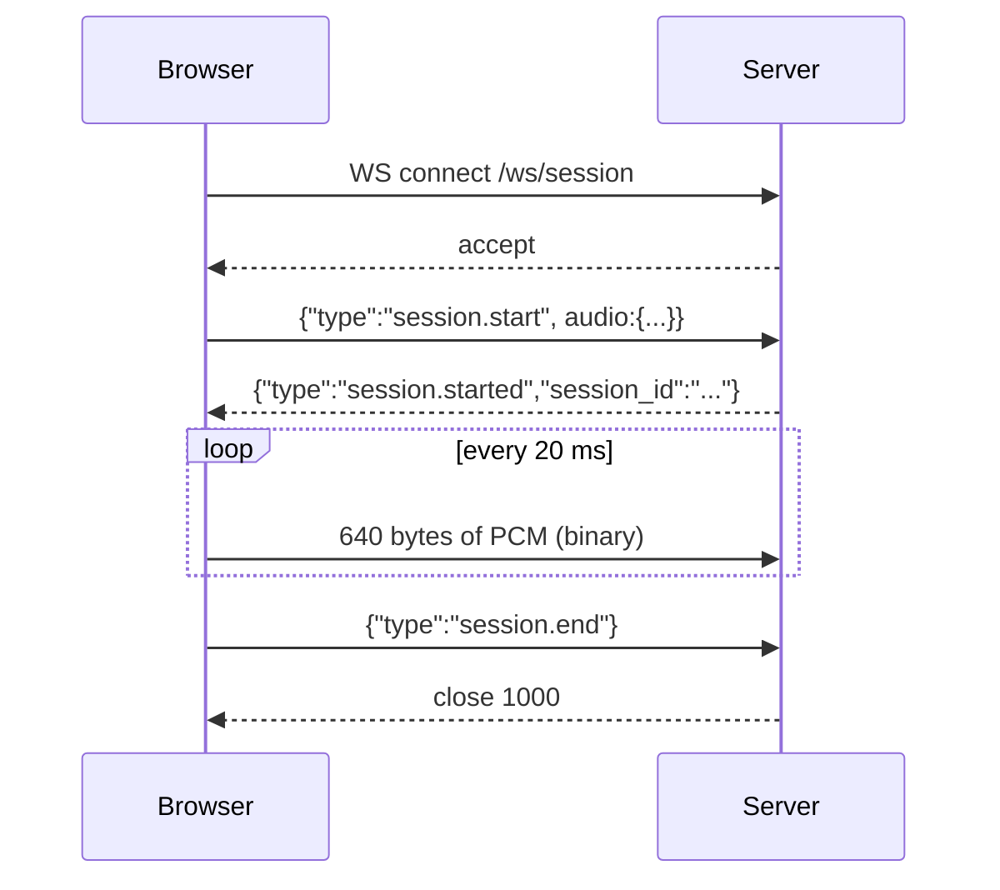

# WebSocket Gateway and Session Lifecycle

## 1. In one minute

This adds the front door of the voice agent: a WebSocket endpoint at
`/ws/session` that a browser opens, keeps open, and streams microphone audio
into. The server accepts the connection, waits for a `session.start` message,
then reads 20 ms audio frames until the client ends the session. It validates
every message as it arrives, reports problems without hanging up, and logs how
many frames came in each second (about 50). The code lives in
`backend/vaani/gateway.py`, `protocol.py`, and `session.py`. Without this there
is no live channel between the browser and the pipeline — nothing to carry
speech in or audio out.

## 2. Files

| File | What it does |
|---|---|
| `backend/vaani/protocol.py` | Every wire message as a Pydantic model + the `ErrorCode` enum. The one place shapes are defined. |
| `backend/vaani/session.py` | The `Session` dataclass: id, persona, start time, frame counters. |
| `backend/vaani/gateway.py` | The `/ws/session` endpoint: accept, receive loop, validation, per-interval logging, cleanup. |
| `backend/vaani/app.py` | Registers the gateway router; adds `_configure_logging()` so our INFO logs show. |
| `backend/vaani/config.py` + `config.toml` | Adds `audio.channels` and `gateway.frame_log_interval_s`. |
| `backend/scripts/fake_client.py` | Stdlib sine-tone client that streams 10 s of frames — demo without a frontend. |
| `backend/tests/test_gateway.py` | Ten tests covering the happy path and every error case. |

## 3. How it works

One WebSocket connection is handled by one `async` function that lives for the
whole connection. FastAPI calls it once per client and it owns everything for
that client.



**The receive loop.** `websocket.receive()` returns a raw event that is either
a disconnect, some `bytes` (an audio frame), or some `text` (a JSON control
message). We branch on which:

```python
event = await websocket.receive()
if event["type"] == "websocket.disconnect":
    break
data = event.get("bytes")
if data is not None:
    ...  # audio frame path
text = event.get("text")
```
(`backend/vaani/gateway.py`)

**Audio frames are validated by length, not by parsing.** A frame carries no
JSON — it is raw samples. So the only checks are "is there a session yet?" and
"is it the exact expected size?":

```python
if session is None:
    await websocket.send_json(error(ErrorCode.SESSION_NOT_STARTED, ...))
    continue
if len(data) != expected:
    await websocket.send_json(error(ErrorCode.BAD_FRAME_SIZE, ...))
    continue
session.record_frame()
```

**Where 640 comes from.** We never write `640`. It is computed from config so
it follows the settings if they change:

```python
samples_per_frame = audio.sample_rate * audio.frame_ms // 1000  # 16000*20/1000 = 320
return samples_per_frame * audio.channels * 2                   # 320 * 1 * 2 = 640
```
The `* 2` is because each sample is a 16-bit integer, which is 2 bytes.

**Control messages are parsed, then dispatched on `type`.** Bad JSON or a
missing `type` is `BAD_MESSAGE`. `session.start` creates the session (or
re-acknowledges an existing one). Anything else before a session exists is
`SESSION_NOT_STARTED`. `session.end` closes the socket with code 1000. An
unrecognised type (with a live session) is `UNKNOWN_MESSAGE_TYPE`.

```python
if mtype == "session.start":
    ...  # validate, check audio matches config, create Session, start logger
if session is None:
    await websocket.send_json(error(ErrorCode.SESSION_NOT_STARTED, ...))
    continue
if mtype == "session.end":
    await websocket.close(code=CLOSE_NORMAL)
    break
await websocket.send_json(error(ErrorCode.UNKNOWN_MESSAGE_TYPE, ...))
```

**Per-second logging runs off the hot path.** A separate background task sleeps
for the configured interval, reads-and-resets the frame counter, and logs it.
The receive loop never waits on logging.

```python
async def _log_frames(session, interval_s):
    while True:
        await asyncio.sleep(interval_s)
        count = session.take_interval_count()
        log.info("session %s: %d frames in last %.3fs", session.session_id, count, interval_s)
```

**Cleanup always happens.** However the loop ends — clean `session.end`, client
disconnect, or an error — a `finally` block cancels the logger task and logs
the session total. The `Session` object is a local variable, so when the
function returns it is simply garbage-collected; nothing leaks between clients.

## 4. New concepts

**WebSocket.** A single long-lived, two-way connection between browser and
server. Unlike an HTTP request (one question, one answer, then closed), a
WebSocket stays open so either side can send at any time — which is exactly
what streaming audio in and out needs.

**Binary vs text frames.** WebSocket messages are tagged as either text or
binary at the protocol level. We send audio as binary (it is just bytes) and
control messages as text holding JSON.

**PCM (pulse-code modulation).** Uncompressed audio: a list of numbers, each
the speaker position at one instant. "16 kHz mono 16-bit little-endian" means
16000 numbers per second, one channel, each number a 2-byte signed integer,
low byte first. 20 ms of that is 320 numbers = 640 bytes.

**Pydantic model.** A class that describes the fields a message must have and
validates incoming data against them. If the JSON is the wrong shape,
constructing the model raises instead of letting bad data through.

**asyncio background task.** `asyncio.create_task(coro)` schedules a coroutine
to run concurrently on the same event loop. We use one for periodic logging so
it does not block the read loop. Because it is single-threaded cooperative
concurrency (one thing runs between `await` points), the logger's
read-and-reset of the counter cannot interleave with the loop's increment, so
no lock is needed.

## 5. Why this and not that

| Choice | Picked | Alternatives | Why not them |
|---|---|---|---|
| Transport | WebSocket | HTTP POST per chunk | HTTP reopens per request and is one-way per call; too slow and clumsy for a live two-way audio stream. |
| Audio encoding | Binary PCM frames | JSON with base64 audio | Base64 inflates size ~33% and costs encode/decode on the latency path. |
| Frame check | Compare byte length | Decode and inspect samples | Length is O(1) and enough to reject malformed frames; decoding on the hot path buys nothing here. |
| Error handling | Send error, keep socket open | Close on any bad message | One stray frame should not kill a live call; the client can recover. |
| Error identity | Fixed enum strings | Free-text messages | The client must branch on the error reliably; parsing prose is fragile. |
| Per-second count | Background task | Count inside the read loop | Keeps logging off the audio path and fires on a real clock, not only when frames arrive. |
| 640 bytes | Computed from config | Hardcode 640 | A config change (e.g. 8 kHz) must not silently break frame validation. |

## 6. When things go wrong

| Situation | What the code does |
|---|---|
| Audio frame before `session.start` | Sends `SESSION_NOT_STARTED`, drops the frame, stays open. |
| Frame not exactly the expected size | Sends `BAD_FRAME_SIZE`, drops it, stays open. |
| `session.start` audio ≠ config | Sends `UNSUPPORTED_FORMAT`, no session created. |
| Text that is not JSON, or has no `type` | Sends `BAD_MESSAGE`, stays open. |
| Known-nothing `type` (with a session) | Sends `UNKNOWN_MESSAGE_TYPE`, stays open. |
| Second `session.start` | Re-sends `session.started` with the same id; no new session. |
| Client vanishes mid-stream | `receive()` reports disconnect (or raises `WebSocketDisconnect`); `finally` cancels the logger and logs the total. |

## 7. Questions you could be asked

**Where is the code that turns 320 samples into 640 bytes?**
`expected_frame_bytes()` in `gateway.py`: `samples_per_frame * channels * 2`.

**Where is a session's state kept, and is it shared?**
In a local `Session` (`session.py`), owned by the connection's coroutine. Never
shared — each connection has its own, cleaned up when the function returns.

**What happens if the client sends a wrong-size frame?**
The server replies with `BAD_FRAME_SIZE`, drops that frame, and keeps the
connection open. A test sends a good frame afterwards to prove it still works.

**What happens if the client disconnects without `session.end`?**
The receive loop sees a disconnect (or `WebSocketDisconnect` is raised); the
`finally` block cancels the logging task and logs the frame total. No leak.

**Why keep the connection open after an error?**
A live voice call should survive one bad frame or message. Closing would drop
the whole conversation over a recoverable glitch.

**Why are error codes an enum of fixed strings, not free text?**
So the client can branch on them programmatically. `StrEnum` makes each member
its own wire string, so it serialises straight to JSON.

**Why is audio binary but control JSON?**
Audio is raw bytes with a fixed layout; wrapping it in JSON/base64 wastes size
and CPU on the latency path. Control messages are rare and structured, so JSON
is convenient and readable.

**Why one task per connection?**
Each call is independent state. One coroutine per socket means no shared
mutable state, no locks, and cleanup is just the function returning.

**Why validate the moment data arrives, not later?**
The ingest point is the one place that sees the raw bytes. Rejecting garbage
here keeps every downstream stage able to assume clean, correctly sized frames.

**(Hardest) How can a background task and the read loop share the frame counter
without a lock?**
Both run on one event loop as cooperative coroutines. Code runs uninterrupted
between `await` points, so the logger's read-and-reset and the loop's increment
never overlap. With real threads this would need a lock; with asyncio it does
not.

## 8. Check yourself

1. Trace a single audio frame from `receive()` to the frame counter. Which
   checks does it pass on the way?
2. A client sends `session.start`, then `session.start` again. What does the
   server return the second time, and why?
3. The config changes to 8 kHz. Which single number changes, and where is it
   computed?
