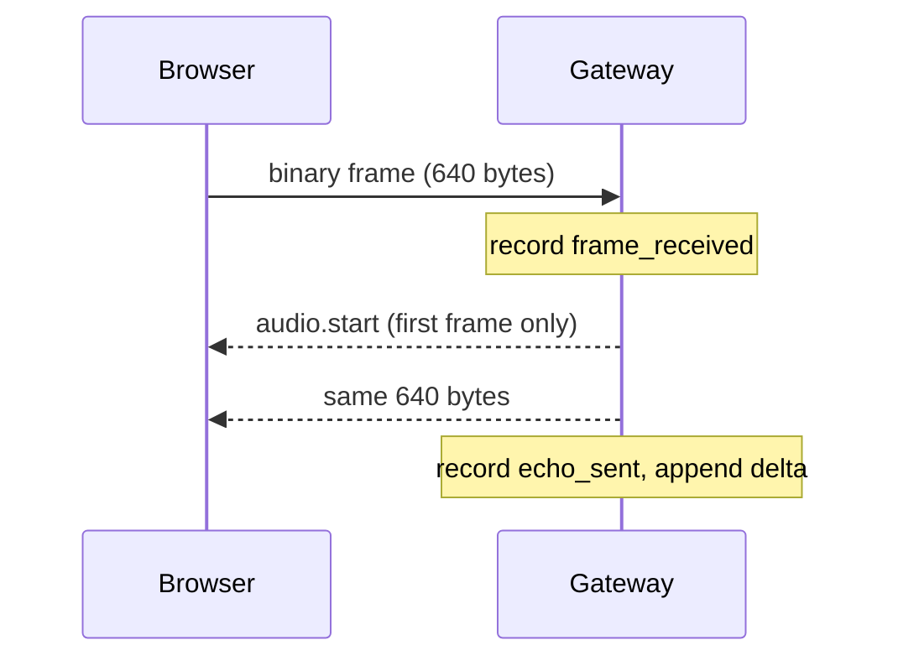

# Echo Path and Telemetry Spans

## 1. In one minute

This closes the audio loop and starts measuring it. While an "echo" flag is on
(default on), every valid frame the server receives is sent straight back to the
browser, bracketed by two new control messages — `audio.start` and `audio.end` —
that carry a `turn_id`. Alongside, a new `telemetry.py` records timing "spans"
and keeps a rolling median and 95th-percentile of the receive-to-send gap over
the last 100 frames, which now appears in the per-second log line. The code lives
in `backend/vaani/telemetry.py`, with edits to `protocol.py`, `gateway.py`,
`config.py`, and `scripts/fake_client.py`. Without this there is no return audio
path to prove end to end, and no numbers to reason about latency with.

## 2. Files

| File | What changed |
|---|---|
| `backend/vaani/protocol.py` | Bumped to SHARED PROTOCOL v0.2; added `AudioStart`/`AudioEnd` models and `audio_start`/`audio_end` helpers. |
| `backend/vaani/telemetry.py` | New. Span-name constants, the `Span` dataclass, and the `Telemetry` per-session recorder + rolling stat. |
| `backend/vaani/gateway.py` | Echo path in the read loop; `audio.end` on clean end; per-second log line now includes echo p50/p95. |
| `backend/vaani/config.py` + `config.toml` | New `gateway.echo_enabled` flag (default `true`). |
| `backend/scripts/fake_client.py` | Now runs a receiver coroutine so the demo consumes the echoed frames. |
| `backend/tests/test_telemetry.py` | New. Spans recorded, rolling stats correct on a known sequence, the min-samples gate. |
| `backend/tests/test_gateway.py` | New echo tests (same bytes, `audio.start` first, `audio.end` on end, echo-off). |

## 3. How it works

The echo happens inside the same read loop that already validates frames, so it
adds nothing new to the connection's structure — just work per frame. When a
valid frame arrives (`backend/vaani/gateway.py`):

```python
session.record_frame()
if echo_enabled and telemetry is not None:
    first_frame = echo_turn_id is None
    if first_frame:
        echo_turn_id = uuid.uuid4().hex
    telemetry.record(FRAME_RECEIVED, echo_turn_id)
    if first_frame:
        await websocket.send_json(audio_start(echo_turn_id))
    await websocket.send_bytes(data)
    telemetry.record(ECHO_SENT, echo_turn_id)
```

Three things are deliberate here. The `turn_id` is minted lazily on the first
frame, so a session that never sends audio owes no `audio.start`. The
`frame_received` span is stamped *before* any send, as early as we can. And
`echo_sent` is stamped *after* `send_bytes` returns, so the measured gap includes
the cost of handing the bytes to the transport, not just our own bookkeeping.

`audio.start` is sent once, before the first frame; every later frame is bare
binary. On a clean `session.end` we owe the closing bracket:

```python
if echo_turn_id is not None:
    await websocket.send_json(audio_end(echo_turn_id))
await websocket.close(code=CLOSE_NORMAL)
```

Note there is no `audio.end` on a hard disconnect — the socket is already gone,
so there is nothing to send it on. **The browser must therefore treat a closed
socket as an implicit `audio.end`** and stop the current turn's playback.

The timing lives in `Telemetry.record` (`backend/vaani/telemetry.py`). A span is
just a named instant; the *duration* is the gap between two of them:

```python
span = Span(name=name, at=monotonic(), session_id=self.session_id, turn_id=turn_id)
if name == FRAME_RECEIVED:
    self._pending_frame_at = span.at
elif name == ECHO_SENT and self._pending_frame_at is not None:
    self._deltas.append(span.at - self._pending_frame_at)
    self._pending_frame_at = None
```

`_deltas` is a `deque(maxlen=100)`: pushing a 101st value drops the oldest, which
gives a fixed-size sliding window for free. `echo_stats_ms()` sorts the window and
returns `(median, p95)` in milliseconds — but only once at least 20 samples exist;
below that it returns `None` and the log prints dashes (see the concepts below for
why). The per-second logger reads that and formats
`… (echo p50=%.1fms p95=%.1fms)`.

Flow of one echoed frame:



## 4. New concepts

**Monotonic clock.** `time.monotonic()` is a clock that only ever moves forward
and is not tied to the calendar. The wall clock (`time.time()`) can jump — NTP
corrections, daylight saving, someone setting the system clock — and a jump
backwards between two readings would produce a negative or nonsense duration. We
only ever *subtract* two readings to get an elapsed gap, so monotonic is the
correct clock; its numbers are meaningless as dates, and that is fine.

**Span.** Our name for a single named point in time, tagged with the session and
(later) the turn it belongs to. It is not a measurement on its own — you need two
spans to get a duration. Defining named points now means every later stage records
against the same vocabulary instead of inventing ad-hoc labels.

**Percentile / p95, and the min-samples gate.** The 95th percentile is the value
below which 95% of samples fall — it describes the slow tail, the frames that took
longest. We compute it by *nearest rank*: sort the samples and take the one at
position `ceil(0.95 × N)`. On a small window this collapses to (nearly) the
maximum — with `N < 20`, `ceil(0.95 × N) == N`, so p95 *is* the largest sample.
That would overstate the tail, so `echo_stats_ms()` withholds all numbers until
20 samples exist rather than show a misleading early figure.

**Turn.** A turn is one stretch of audio belonging to one `audio.start`. **Today a
turn lasts the whole session** — one `turn_id` from the first frame to
`session.end`. That changes on day 4, when a "flush" (end-of-utterance) ends a
turn mid-session and the next audio starts a new one.

## 5. Why this and not that

| Choice | Picked | Alternatives | Why not them |
|---|---|---|---|
| Where to measure | Server-side, receive→send | Only at the speaker | The true latency *is* at the speaker; but the server number is cheap, always-on, and catches server-side regressions. The real number is measured separately during listening tests. |
| Stat reported | Median + p95 | Average | One slow frame drags the average and hides the shape. Median says "typical", p95 says "how bad the tail gets" — both matter for a latency bar. |
| Span names | All 8 defined now | Add each when its stage lands | A fixed vocabulary now means later stages record against agreed strings, and the log/format code doesn't churn every week. |
| Window | `deque(maxlen=100)` | Keep every sample | A session streams 50 frames/s; unbounded growth is a slow leak. A sliding window is O(1) and reflects "recently", which is what we care about. |
| `echo_sent` timing | After `send_bytes` | Before the send | Measuring before excludes the send itself — the one part that actually costs anything here. |

## 6. When things go wrong

| Situation | What the code does |
|---|---|
| Client disconnects mid-stream | No `audio.end` is sent (socket gone). Browser treats the close as an implicit `audio.end`. |
| Fewer than 20 frames echoed | `echo_stats_ms()` returns `None`; the log prints `p50=- p95=-`. |
| Echo disabled by config | No `audio.start`/`audio.end`/echo; frames are still counted and validated. |
| Session ends before any frame | `echo_turn_id` is still `None`, so no `audio.end` is owed or sent. |

## 7. Questions you could be asked

1. **Where is the code that decides the echo `turn_id`?** In `gateway.py`, in the
   binary-frame branch: `if first_frame: echo_turn_id = uuid.uuid4().hex`.
2. **Where is the rolling median computed?** `Telemetry.echo_stats_ms()` in
   `telemetry.py` — it sorts `self._deltas` and calls `statistics.median` and
   `_nearest_rank_p95`.
3. **What happens if the client vanishes mid-turn?** We cannot send `audio.end`;
   the browser must treat the closed socket as an implicit end and stop playback.
4. **What happens for the first 19 frames of a session?** The stats are not yet
   meaningful (nearest-rank p95 would equal the max), so `echo_stats_ms()` returns
   `None` and the log shows dashes.
5. **Why not use `time.time()` for the spans?** It can jump backwards; subtracting
   two readings could give a negative "duration". `monotonic()` only moves forward.
6. **Why measure on the server at all, if the real latency is at the speaker?**
   Because the server number is cheap and always on — it catches server-side
   regressions immediately. The true end-to-end figure is measured by ear/at the
   speaker during listening tests, not from this counter.
7. **Why median and p95 instead of an average?** The average hides shape: one
   240 ms frame among fast ones barely moves it. Median = typical, p95 = the tail.
8. **Why is `echo_sent` stamped after the send?** So the measured gap includes the
   `send_bytes` cost, which is the only part that actually takes time here.
9. **Why is the on-the-wire echo showing ~0.0 ms in the demo?** `send_bytes` just
   enqueues bytes into the transport buffer and returns — it does not wait for the
   browser to receive or play them. That is precisely why the meaningful number is
   the one measured at the speaker.
10. **(Hardest) Could `audio.start` and its frame arrive out of order?** No. Both
    go through the same connection with `await` in sequence — JSON `audio.start`
    then the binary frame — and a WebSocket preserves message order, so the browser
    always sees `audio.start` before the turn's first frame.

## 8. Check yourself

1. Why is a monotonic clock the right one for measuring the echo gap?
2. What does the browser do when the socket closes with a turn still open?
3. Why does the server report nothing for the echo stats until 20 frames?
