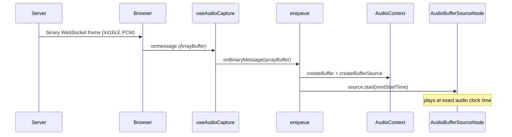

# Gapless Audio Playback Queue

## 1. In one minute

This adds the receiving half of the audio pipeline: a playback queue that
accepts binary PCM chunks arriving from the server over the WebSocket, converts
them to AudioBuffers, and plays them back-to-back with no gap. The scheduling
key is the Web Audio clock — `AudioContext.currentTime` — not JavaScript timers.
The code lives in `frontend/src/hooks/usePlaybackQueue.js`. Without this, the
browser can receive audio from the server but cannot play it.

## 2. Files

| File | What it does |
|---|---|
| `frontend/src/hooks/usePlaybackQueue.js` | The playback queue hook: PCM decode, AudioContext lifecycle, gapless clock-based scheduling. |
| `frontend/src/hooks/useAudioCapture.js` | Updated to accept an `onBinaryMessage` callback and route binary WebSocket frames to it. Also fixes the WebSocket endpoint and `session.start` payload. |
| `frontend/src/pages/ConversationPage.jsx` | Updated to create the playback queue and pass `enqueue` into `startCapture`. Adds a Playback status row. |
| `frontend/src/config.js` | Adds `WS_SESSION_URL` constant for the correct `/ws/session` endpoint. |
| `docs/contracts.md` | Documents the agreed Server → Client playback format and fixes the session handshake spec. |

## 3. How it works



**Receiving the chunk.** In `useAudioCapture.js`, `socket.onmessage` checks
whether the received data is an `ArrayBuffer` (binary) or a string (JSON). Binary
frames go to the `onBinaryMessage` callback:

```js
// useAudioCapture.js
if (event.data instanceof ArrayBuffer) {
  if (typeof onBinaryMessage === 'function') {
    onBinaryMessage(event.data);
  }
  return;
}
```

**Decoding PCM.** `pcm16ToAudioBuffer` in `usePlaybackQueue.js` converts raw
bytes to the Float32 format AudioContext needs:

```js
const int16 = new Int16Array(buffer);
const audioBuffer = audioCtx.createBuffer(1, int16.length, AUDIO_SAMPLE_RATE);
const channelData = audioBuffer.getChannelData(0);
for (let i = 0; i < int16.length; i++) {
  channelData[i] = int16[i] / 32768;  // Int16 → Float32 [-1, 1]
}
```

Dividing by 32768 (not 32767) keeps the mapping symmetric: -32768 maps to
exactly -1.0.

**Gapless scheduling.** The heart of the queue is two lines:

```js
const startAt = Math.max(ctx.currentTime, nextStartTimeRef.current);
source.start(startAt);
nextStartTimeRef.current = startAt + audioBuffer.duration;
```

`nextStartTimeRef` is the audio clock time at which the next chunk should
begin. It starts at 0. On the first chunk, `currentTime > 0`, so we clamp to
`currentTime` and play immediately. After that, each chunk's start is set to the
end of the previous one, giving perfectly back-to-back audio.

**Passing enqueue into startCapture.** The component calls:

```js
// ConversationPage.jsx
onClick={() => startCapture(enqueue)}
```

`startCapture` stores the callback and assigns it to `socket.onmessage`. This
keeps `usePlaybackQueue` and `useAudioCapture` independent — neither knows
about the other.

## 4. New concepts

**AudioContext.** The Web Audio API's entry point. It owns a hardware audio
output thread that runs at a fixed, clock-accurate sample rate. Every audio node
(source, gain, destination) belongs to one context. Creating it does not play
anything — it is just the engine.

**AudioContext.currentTime.** A floating-point number, in seconds, that advances
steadily at the context's sample rate. It reflects the audio hardware clock, not
the JavaScript event-loop clock. It never jumps, drifts, or pauses for garbage
collection. This is why we use it for scheduling.

**AudioBufferSourceNode.** A one-shot playback node. You load an AudioBuffer into
it and call `start(when)`, where `when` is an AudioContext time. The node plays
exactly at that clock tick and cannot be reused — create a new one per chunk.

**Why not setInterval/setTimeout for audio scheduling?** JavaScript timers fire
when the event loop is idle between tasks. Under normal page load that can be
5–50 ms late. For 20 ms audio frames, a 30 ms timer jitter is a 50% overrun —
audible as clicks and gaps. The audio clock fires in the audio hardware interrupt,
not the event loop, so it is never affected by JavaScript work.

## 5. Why this and not that

| Choice | Picked | Alternatives | Why not them |
|---|---|---|---|
| Scheduling | AudioContext clock (`source.start(time)`) | `setTimeout` per chunk | Timers fire from the JS event loop and can be late by tens of milliseconds — audible gaps. |
| PCM format | Int16LE, 16 kHz mono | Opus, MP3, AAC | Opus would need a decoder library. MP3/AAC have variable framing. Int16 PCM is what both the mic and the ASR model use — one format end to end. |
| Queue structure | Simple `nextStartTimeRef` cursor | Array queue | A cursor is sufficient: chunks arrive in order via one WebSocket. No reordering or priority is needed. |
| AudioContext creation | Lazy, on first enqueue | Eager, on hook mount | Browsers block context creation until a user gesture. Creating on first enqueue means the gesture (Start Microphone button) has already happened. |
| Separate hook | `usePlaybackQueue` | Merged into `useAudioCapture` | Separation of concerns: capture and playback are different responsibilities. Each hook is smaller, testable independently, and the interface is one function (`enqueue`). |

## 6. When things go wrong

| Situation | What the code does |
|---|---|
| Server sends no audio (current backend) | `onBinaryMessage` is never called; queue stays empty; no error. |
| AudioContext suspended (browser autoplay) | `getAudioContext()` calls `ctx.resume()` before scheduling. The user gesture (Start button) has already lifted the restriction by the time any audio arrives. |
| Chunk arrives after a gap in server audio | `Math.max(ctx.currentTime, nextStartTime)` clamps to now, so playback resumes immediately without scheduling in the past. |
| Component unmounts mid-session | `useEffect` cleanup runs `cleanup()`, which closes the AudioContext and resets `nextStartTimeRef`. |
| Backend sends malformed binary (odd byte count) | `Int16Array` truncates the last byte. No crash — a partial silence sample is the worst outcome. |

## 7. Questions you could be asked

**Where is the code that converts bytes to playable audio?**
`pcm16ToAudioBuffer` in `frontend/src/hooks/usePlaybackQueue.js`. It wraps the
bytes in an `Int16Array` and fills an `AudioBuffer`'s channel data by dividing
each sample by 32768.

**What is `AudioContext.currentTime` and why does this code use it?**
It is the audio hardware's clock in seconds, advancing steadily regardless of
JavaScript work. We schedule each chunk at a future point on that clock, so the
audio hardware plays them back-to-back with no event-loop jitter.

**What happens if the first chunk arrives and `nextStartTimeRef` is 0?**
`Math.max(ctx.currentTime, 0)` evaluates to `currentTime` (always > 0 after
context creation), so the chunk plays immediately. `nextStartTimeRef` is then
set to `currentTime + duration` for the next chunk.

**What happens if the server sends audio faster than real time?**
`nextStartTimeRef` advances further and further into the future. The audio plays
at the correct rate (sample clock sets pace), but latency grows. The fix (not in
scope for Day 3) is a jitter buffer that drops old chunks.

**Why create a new `AudioBufferSourceNode` for each chunk?**
It is a Web Audio design constraint: once a node's `start()` is called, it
cannot be reset or reused. The API enforces single-use. We create one node per
chunk and let it be garbage collected after playback.

**Why divide by 32768 instead of 32767?**
The Int16 range is [-32768, 32767]. Dividing by 32768 maps -32768 to exactly
-1.0 (clean minimum). Dividing by 32767 would map -32768 to −1.000031, which
clips. Either is inaudible, but 32768 is technically correct.

**Why is `enqueue` passed as a parameter to `startCapture` rather than being
a prop or a context value?**
It avoids coupling the two hooks at the module level. `useAudioCapture` has no
import of `usePlaybackQueue`. The component decides the wiring, keeping each
hook independently usable and testable.

**What does the Playback status row in the UI show?**
"Playback ready" when `wsStatus === 'ready'` (session established), otherwise
"Waiting for session". It confirms the path is live without showing audio
contents.

**(Hardest) Can two `AudioBufferSourceNode` chunks overlap if `enqueue` is
called twice quickly?**
No — `nextStartTimeRef` advances by the first chunk's duration before `enqueue`
returns. The second call reads the updated `nextStartTimeRef` as its start
time, which is in the future. As long as `enqueue` is called from the event loop
(not truly parallel), the cursor cannot be read twice at the same value.

## 8. Check yourself

1. Trace one arriving binary WebSocket frame from `socket.onmessage` to the
   moment `source.start()` is called. Which three functions does it pass
   through?
2. What does `nextStartTimeRef` hold between chunks, and how does it change
   with each call to `enqueue`?
3. Why would replacing `source.start(startAt)` with `source.start()` (no
   argument) cause gaps between chunks?
