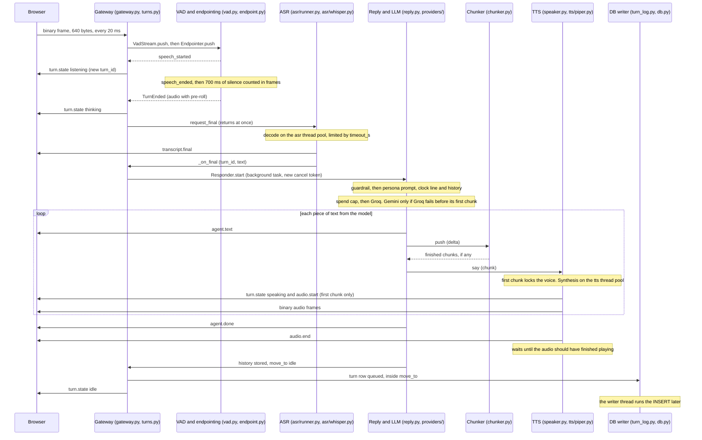

# Backend walkthrough: the Vaani backend in the order it runs

Describes commit `bb6faab` (`dev` on 2026-11-17). If `git log --oneline -1` shows
another commit, check a step against the code before you trust it. Line numbers are
from that commit: a number in brackets after a function name is the line where it is
defined, and `line N` is a line inside it. `[unverified]` marks a statement that was
not checked in our code.

This file answers "what runs, in what order, in which function". It is backend only:
the browser appears only as "this arrives" and "this goes back". It does not repeat:

- every protocol message and field: [`docs/contracts.md`](../contracts.md), and
  [`STACK.md`](STACK.md) sections 2c and 2d;
- every SQL statement: [`STACK.md`](STACK.md) section 4 (S1 to S11);
- why each library was chosen, and the browser's side of a turn:
  [`STACK.md`](STACK.md) and [`PROJECT.md`](PROJECT.md) sections c, d, d2.

Words used below:

- **Event loop**: the one thread that serves every socket. It runs one piece of code
  at a time and switches only at an `await`. Slow work must not run on it.
- **Coroutine / task**: a function that can pause at `await`. A task is a coroutine
  the loop runs in the background while other code carries on.
- **Thread pool**: a fixed set of extra threads for slow work (Whisper, Piper).
- **Cancellation token**: an `asyncio.Event`, a flag. A barge-in sets it; every part of
  a reply checks it before it sends anything.
- **Frame**: 20 ms of audio, one binary WebSocket message. **Turn**: one thing the user
  says plus the reply to it; it has a `turn_id`.

## 1. The 30-second version

1. The backend is one Python process: a FastAPI app served by uvicorn, started from
   `backend/` with `uv run uvicorn vaani.app:app`.
2. At start it loads everything once: settings, the database, the speech detector
   (Silero VAD), the recogniser (Whisper), the two LLM clients (Groq, Gemini) and the voices (Piper).
3. It serves `GET /health`, three sign-in routes under `/auth`, and one WebSocket, `/ws/session`.
4. Each WebSocket is one conversation. The browser sends 20 ms mic frames; the server
   finds speech, decides the user has finished, transcribes, asks the LLM, cuts the
   answer into chunks, speaks each chunk and streams the audio back.
5. Speech over the agent (or a push-to-talk press) stops the reply at once: a barge-in.
6. Every session and turn becomes a row in a SQLite file, written by one separate thread.

## 2. Startup, in order

Everything in steps 4 to 14 runs inside one call, `create_app()`, while the module is
being imported. If any step raises, uvicorn has no app and the server does not start.

1. `uv run uvicorn vaani.app:app` -> uvicorn imports the module `vaani.app` and takes its `app` attribute -> next: Python runs the package first.
2. `vaani/__init__.py` -> sets `__version__` (`"0.1.0"`) -> next: `app.py`'s imports.
3. `vaani/app.py` lines 18-40 -> the imports pull in every `vaani` module except `asr/whisper.py` and `tts/piper.py` (most arrive through `gateway.py` -> `turns.py`), plus httpx, numpy, onnxruntime and google-auth. faster-whisper and Piper are NOT imported yet; those two files load them in steps 11 and 13 -> next: the last line of the file.
4. `vaani/app.py` line 235 -> `app = create_app()` -> next: settings.
5. `vaani/config.py` -> `get_settings` (505) builds `Settings()` once and caches it. `settings_customise_sources` (480) sets who wins, highest first: values passed in code (tests only), real environment variables (`VAANI_` prefix, `__` between levels, e.g. `VAANI_ASR__TIMEOUT_S`), the gitignored `backend/.env`, `backend/config.toml`, then the defaults written in the settings classes. pydantic's secrets-directory source is last and nothing configures it. Sections with no defaults (`vad`, `asr`, `llm`, `tts`, `chunker`, `guardrail`, `personas`) must be present. Four checks run here: the time zone exists (`_known_zone`), every guardrail pattern compiles (`_compiles`), allowlist emails are lowercased (`_lowercase`), and `served_personas` names only `[personas]` keys and is not empty (`_served_are_personas`, 463; unset, it becomes every persona). Unknown keys are ignored -> next: logging.
6. `vaani/app.py` -> `_configure_logging` (50) attaches one handler to the `vaani` logger at INFO -> next: the first startup check.
7. `vaani/auth.py` -> `check_settings` (59), only if `[auth].enabled`: raises `AuthConfigError` naming the missing variable (client ID, session secret, a secret under 32 characters, empty allowlist, empty origin list), never its value -> next: the database.
8. `vaani/db.py` -> `open_db` (75), only if `[db].enabled`: creates the folder and file, sets WAL mode and foreign keys, checks the schema version, runs `schema.sql`. Any problem raises `DbOpenError`. Then `DbWriter.__init__` (118) starts the writer thread `vaani-db-writer`, which waits on an empty queue -> next: the app object.
9. `vaani/app.py` lines 108-126 -> `FastAPI(...)` with the `lifespan` function (101); stores `db`, `settings` and `verify_google` on `app.state`; adds `CORSMiddleware` with `[auth].allowed_origins` -> next: models.
10. `vaani/vad.py` -> `load_model` (72), only if `[vad].enabled`: reads the Silero ONNX file, checks its sha256 against config, builds an onnxruntime session on CPU with one thread. Cached, so it loads once per process -> next: Whisper.
11. `vaani/asr/__init__.py` -> `build_recognizer` (16) -> `_build` (27) -> `vaani/asr/whisper.py` `WhisperRecognizer.__init__` (82), only if `[asr].enabled`: imports faster-whisper, refuses `cuda` without a GPU, loads the model, creates the `asr` thread pool (`[asr].max_concurrent` threads) and runs one tiny decode (`_warm_up`, 127) -> next: the LLM.
12. `vaani/spend.py` `RequestCap` (22) then `vaani/providers/chain.py` `build_chain` (111), only if `[llm].enabled`: for each name in `[llm].provider_order` (groq, gemini) `_require_key` (140) raises `AuthenticationError` if its key is missing; `GroqProvider` and `GeminiProvider` each create one long-lived `httpx.AsyncClient` (`providers/groq.py` line 71, `providers/gemini.py` line 73). No request is sent at startup -> next: voices.
13. `vaani/app.py` lines 163-183 then `vaani/tts/__init__.py` `build_synthesizers` (16) -> `vaani/tts/piper.py` `build_piper` (46), only if `[tts].enabled`: first checks every SERVED persona has a voice for `hi` and `en` (`TtsError` if not), then hands `build_synthesizers` a copy of `[tts]` holding only the served personas' voices, so only those load (each holds about 100 MB of RAM; feat/render-deploy); creates ONE `tts` thread pool; `_load` (71) checks each voice file exists and matches its sha256, builds its ONNX Runtime session with `[tts.piper].intra_op_threads` threads (0 = ONNX Runtime's default), and synthesises one word to warm up -> next: routes.
14. `vaani/app.py` lines 185-203 -> registers `GET /health`, then `gateway.py`'s router (`/ws/session`), then `auth.py`'s router (`/auth/google`, `/auth/me`, `/auth/logout`), then, only if the `[frontend].dist_dir` folder exists (the Docker image), `_serve_frontend` (208): one catch-all `GET` route, added last so every API route is matched first (journey a2). FastAPI's own `/docs` pages are also served `[unverified]` -> next: `create_app` returns.
15. uvicorn starts the event loop and runs `lifespan`: nothing at start; at shutdown it calls `DbWriter.close` (journey i).

Each stage can be switched off with its `enabled` flag. Tests switch off ASR, LLM, TTS,
the database and sign-in (`tests/conftest.py`) and pass stand-ins to `create_app`.

## 3. Request journeys

Each step: what arrives, where it is handled, what changes, what goes back.

### a. `GET /health`

1. In: `GET /health`. Where: `app.py` `health` (186). Does: returns a fixed status and `__version__`; reads no settings, so it cannot leak config. Out: `{"status": "ok", "version": "0.1.0"}` (contracts.md 1). It is a plain `def`, so FastAPI runs it on its own worker threads, not the event loop `[unverified]`.

### a2. Any other `GET` path: the browser app (feat/render-deploy)

Only when `[frontend].dist_dir` (`../frontend/dist`) exists, as in the Docker image; in local development Vite serves the page and this route does not exist.

1. In: `GET /`, `GET /talk`, `GET /assets/index-abc.js` and so on. Where: `app.py` `_serve_frontend` (208), the route `frontend`. FastAPI tries it last, after every API route.
2. Does: a first path segment `auth`, `ws` or `health` (`API_PREFIXES`) -> 404, so a mistyped API path never gets the page. A file that exists inside the dist folder -> that file. Anything else -> `index.html`, and the browser's router draws the page. The resolved path must stay inside the folder, so `..` cannot reach other files.
3. Out: the file, with its content type. Never touches settings or secrets.

### b. Sign-in routes (contracts.md 2.9)

`POST /auth/google`:

1. In: JSON `{credential}`. Where: FastAPI checks it against `GoogleSignIn` (`auth.py` 178) before our code runs; a bad body gets FastAPI's own 422 `[unverified]`.
2. Where: `auth.py` `google_sign_in` (187). Does: auth disabled -> 404. `origin_allowed` (123) compares the `Origin` header with `[auth].allowed_origins`, exact match. Out on failure: 403 `AUTH_BAD_ORIGIN`.
3. Does: `asyncio.to_thread` (198) runs `verify_google` (148) on a worker thread, because google-auth downloads Google's certificates with a blocking call. Out on failure: 503 `AUTH_UNAVAILABLE` (Google unreachable) or 401 `AUTH_INVALID_TOKEN`.
4. Does: needs `email_verified`, then the lowercased email in `[auth].allowed_emails`. Out on failure: 403 `AUTH_EMAIL_UNVERIFIED` or 403 `AUTH_NOT_ALLOWED`.
5. Does: `sign_cookie` (87) builds `sub|email|expiry|name`, base64url, plus an HMAC-SHA256 signature under the session secret. State: nothing is stored on the server. Out: 200 `{email, name}` and the `vaani_session` cookie.

`GET /auth/me`:

1. Where: `auth.py` `me` (233). Does: auth disabled -> 200 with nulls. Otherwise `read_cookie` (98) checks the signature (constant-time compare), the expiry and the allowlist. Out: 200 `{email, name}` or 401 `AUTH_REQUIRED`.

`POST /auth/logout`:

1. Where: `auth.py` `logout` (244). Does: checks `Origin` when auth is on (403 `AUTH_BAD_ORIGIN`). Out: 204 and the cookie deleted in the browser. The signed value itself stays valid until it expires.

### c. WebSocket handshake (contracts.md 2.9)

1. In: an HTTP upgrade request for `/ws/session`. Where: `gateway.py` `session_endpoint` (130). Does: reads settings from `app.state`; `expected_frame_bytes` (72) works out the frame size from config (640 bytes).
2. Where: `auth.py` `handshake_refusal` (128), called at `gateway.py` line 141. Does: auth disabled -> accept. Else the `Origin` must be allowed and `read_cookie` must accept the `vaani_session` cookie. Local work only, no network.
3. Refused: logs a warning and closes before accepting (`gateway.py` lines 142-145). Out: no socket; the comment there and `tests/test_auth_gateway.py` say uvicorn answers HTTP 403 `[unverified]`.
4. Accepted: `websocket.accept()` (line 148). State: `session`, `telemetry`, `pipeline` and `log_task` are all `None`, and `end_reason` is `"disconnect"`. No `Session` object exists yet; it is made at `session.start`.
5. Does: the read loop starts (line 158). It handles ONE message at a time, in the order they arrive; every later journey starts from this loop.

Before `session.start`, a binary frame or any other message gets `SESSION_NOT_STARTED` (`gateway.py` lines 169, 290).

### d. `session.start` (contracts.md 2.3)

1. In: a JSON text message. Where: `gateway.py` lines 188-203. Does: parses it. Out on failure: `BAD_MESSAGE` (not JSON, or no `type`).
2. Where: `protocol.py` `SessionStart` (170), validated at `gateway.py` line 209. Does: `persona` defaults to `"default"`, `mode` must be `vad` or `ptt`, `reply_language` must be `any`, `en` or `hi`. Out on failure: `BAD_MESSAGE`.
3. A session already exists (`gateway.py` line 217). Out: the same `session.started` again; nothing changes.
4. Does: `_audio_matches` (85) compares the claimed audio format with `[audio]`; the persona must be a key of `[personas]`, and (v0.12, line 241) one of `served_personas`. Out on failure: `UNSUPPORTED_FORMAT`, `BAD_MESSAGE` (not a persona at all) or `PERSONA_NOT_SERVED` (a persona this server did not load); for each, no session starts and the socket stays open.
5. State: `Session` (`session.py` 32) is created with a new `session_id`, the persona, the mode and the reply language, all fixed for the connection. `Telemetry` (`telemetry.py` 137) is created for timings.
6. Where: `turns.py` `TurnPipeline.__init__` (65). Does: builds this session's chain of stages, each only if the one before it exists: `TurnStateMachine` (state `idle`), `Echo`, `VadStream`, then `Endpointer` in a `vad` session or `PttBuffer` in a `ptt` session, `AsrRunner`, `Responder`, `BargeIn`, `TurnLog`. The models, the LLM chain and the database writer are the shared ones from startup; the voices are the persona's pair (`gateway.py` line 264).
7. Where: `reply.py` `Responder.__init__` (71). Does: looks up the persona's system prompt once; `reply_language` `en` or `hi` becomes the forced voice, `any` leaves the voice to each reply's first chunk.
8. Where: `turn_log.py` `TurnLog.__init__` (80). Does: queues the session's row (`DbWriter.insert_session`) and hooks itself into the state machine (`turns.py` line 152).
9. Does: starts the background task `_log_frames` (`gateway.py` 101), which logs the frame count every `[gateway].frame_log_interval_s`. Out: `session.started` with `session_id`, `mode`, `reply_language`.

### e. One hands-free turn (contracts.md 2.1 to 2.5)

1. In: a binary frame. Where: `gateway.py` lines 167-185. Does: wrong size -> `BAD_FRAME_SIZE`, frame dropped. Else `Session.record_frame` counts it and `TurnPipeline.on_frame` gets it.
2. Where: `turns.py` `on_frame` (162) -> `vad.py` `VadStream.push` (185). Does: turns the bytes into floats and adds them to a buffer; each time 512 samples have built up, `_infer` (204) runs Silero and gives a speech probability. `Hysteresis.update` (125) turns that into events: `speech_started` after `[vad].start_frames` (4) speech frames in a row, `speech_ended` after `[vad].end_frames` (10) silent ones. This runs on the event loop and is timed (`Telemetry.record_vad_decision`).
3. Where: `turns.py` `on_frame` lines 183-193. Does: the routing choice. State `thinking` or `speaking` -> journey g. Otherwise `_endpoint` (250).
4. Where: `endpoint.py` `Endpointer.push` (167). Does: while nobody speaks, frames only refill the pre-roll (`[endpoint].preroll_ms`, 300 ms). On `speech_started` the utterance opens with that pre-roll in front, so the first syllable is kept.
5. Where: `turns.py` `_open_turn` (317). State: `Session.open_turn` makes a new `turn_id`; the state machine moves to `listening`. Out: `turn.state listening`.
6. Where: `Endpointer.push`, every later frame. Does: keeps the frame and counts it if voiced. `speech_ended` starts a silence window; `speech_started` inside it cancels the window. After `[endpoint].end_of_turn_silence_ms` (700 ms, counted as 35 frames) `_finish` (249) closes the utterance.
7. Too short: fewer voiced frames than `[endpoint].min_utterance_ms` (40 ms) -> `turns.py` `_discard_turn` (367). Out: `turn.state idle`. Too long: `[endpoint].max_utterance_ms` (30 s) forces an end (`_force_while_speaking`, 282).
8. Where: `turns.py` `_end_turn` (323). Does: stamps the `turn_ended` and `speech_end` spans, closes the turn, moves to `thinking`, and calls `AsrRunner.request_final`, which returns at once. Out: `turn.state thinking`.
9. Where: `asr/runner.py` `request_final` (119) -> `_drain` (170) -> `_run` (183). Does: a background task takes the job, stamps `asr_start`, and waits at most `[asr].timeout_s` (5 s) for the recogniser.
10. Where: `asr/whisper.py` `transcribe` (170) -> `_decode` (147). Does: the decode runs on the `asr` thread pool, so frames keep flowing meanwhile.
11. Where: `asr/runner.py` `_emit` (206). Does: drops the result if the job was abandoned; else stamps `asr_final`. Out: `transcript.final`. Then it calls `turns.py` `_on_final` (392).
12. Where: `turns.py` `_on_final` -> `_reply` (417). Does: puts any carried words (journey g) in front of the transcript. No text -> `idle`. Else `Responder.start`.
13. Where: `reply.py` `start` (119). State: a NEW cancellation token for this reply, a `ReplyRecord`, a `Speaker`. Does: starts `_answer` (165) as a background task and returns.
14. Where: `reply.py` `_answer` -> `persona.py` `looks_like_injection` (22). Does: the guardrail checks the raw transcript against `[guardrail].patterns` before it goes into any prompt (failure: journey h).
15. Where: `persona.py` `assemble` (57). Does: builds the request: the persona prompt, then the clock line (`clock_line`, 32, the time now in `[llm].timezone`), then a "Reply language" line if the session forces `en` or `hi`; then the history; then this transcript. The history window is `Session.history`, already cut to the last `[llm].history_turns` (6) exchanges when each was stored (`session.py` `remember`, 95).
16. Where: `providers/chain.py` `ProviderChain.stream` (64). Does: tries Groq first. `providers/groq.py` `GroqProvider.stream` (78) first calls `RequestCap.check_and_count` (`spend.py` 33), the spend cap, then sends the request through `providers/streaming.py` `stream_lines` (80). If Groq is rate-limited, times out or is down BEFORE its first chunk, the chain tries Gemini (`providers/gemini.py` `GeminiProvider.stream` (81)). After a first chunk there is no failover.
17. Where: `reply.py` `_answer`, the loop at lines 207-235. Does, per chunk of text: on the first one stamps `llm_first_token` and records which provider and model answered. Out: `agent.text`. Then `chunker.py` `ClauseChunker.push` (52) may return finished chunks: the first is cut at the earliest sentence end or comma, later ones at sentence ends.
18. Where: `speaker.py` `Speaker.say` (118). Does: the first chunk picks the voice (`_lock_voice`, 200): the forced language if there is one, else the chunk's script (`language.py` `reply_language`, 31: any Devanagari is `hi`). The voice is locked for the whole reply. Then `tts/piper.py` `synthesize` (156) runs the chunk on the `tts` thread pool.
19. Where: `speaker.py` `_start` (231), first audio only. State: moves to `speaking`. Out: `turn.state speaking`, `audio.start` with the voice's sample rate, then binary frames of 20 ms; the token is checked before every frame. After the first frame `tts_first_audio` is stamped.
20. Where: `reply.py` `_answer` lines 236-284. Does: `ClauseChunker.flush` (68) gives the last chunk, which is spoken. Out: `agent.done`, then `audio.end` (`speaker.py` `Speaker.finish` (188)). `finish` then waits until the audio should have finished playing in the browser (an estimate).
21. Where: `reply.py` `remember` (154). State: the exchange (transcript, full reply) goes into `Session.history`. Then `TurnStateMachine.move_to` (`turn_state.py` 68) checks the move is legal and sets `idle`.
22. Where: `turn_log.py` `state_changed` (97) -> `_write` (137), called inside `move_to` before its send. Does: builds the turn's row (outcome `replied`, texts, provider, five timings from the spans) and puts it on the writer's queue (`DbWriter.insert_turn`). Out: `turn.state idle`.
23. Where: `db.py` `DbWriter._run` (157), on the writer thread. Does: runs the INSERT some moments later. A failed write is logged and the row is lost.

With `[tts]` off there is no `Speaker`: the reply is text only, `thinking` then `idle`.

### f. A push-to-talk turn (contracts.md 2.8)

A session started with `"mode": "ptt"` has a `PttBuffer` and NO `Endpointer` (`turns.py` lines 95-120).

1. In: `ptt.start`. Where: `gateway.py` lines 309-319. Does: in a `vad` session -> `BAD_MESSAGE`. Else `turns.py` `on_ptt_start` (196).
2. Where: `on_ptt_start`. Does: a press already open -> ignored. Agent `thinking` or `speaking` -> `_interrupt` at once (journey g, no speech judging). Else `_open_turn`. Then `VadStream.reset` (`vad.py` 163) wipes Silero's memory of the last press and `PttBuffer.press` (`ptt.py` 56) opens the press. Out: `turn.state listening`.
3. In: frames. Where: `on_frame` -> `VadStream.push`, then `PttBuffer.push` (`ptt.py` 62). Does: VAD still runs, only to count voiced frames. With no press open the frame is dropped. A press that reaches `[endpoint].max_utterance_ms` ends as if stop were pressed.
4. In: `ptt.end`. Where: `turns.py` `on_ptt_end` (217) -> `_release` (358) -> `PttBuffer.release` (`ptt.py` 78). Does: no press open -> ignored. Too few voiced frames -> `_discard_turn`, no transcription. Else `_end_turn`, and steps 8 to 23 of journey e run unchanged.

What changes against hands-free: no pre-roll, no 700 ms silence wait, silence never ends
the turn, and an interruption happens on the press, not after 200 ms of speech.

### g. Barge-in (contracts.md 2.7)

1. In: frames while the state is `thinking` or `speaking`. Where: `turns.py` `_watch` (274) -> `barge_in.py` `BargeIn.push` (77). Does: holds every frame. After `speech_started` it counts frames whose probability reaches `[barge_in].threshold`; at `[barge_in].min_speech_ms` (200 ms) the speech is an interruption. A `speech_ended` first means a noise: the reply goes on.
2. Where: `turns.py` `_barge_in` (285) -> `_interrupt` (293) -> `barge_in.py` `stop_reply` (155). Does, in this order: stamps the `barge_in` span; `Responder.cancel` (`reply.py` 145) sets the reply's token, with no `await` before it, so from this line no more audio can be sent; `Session.flush` (`session.py` 108) marks the turn flushed. Out: `audio.flush`, the first message.
3. LLM cancel: `providers/streaming.py` `until_cancelled` (43) is racing every network wait against the token, so the HTTP response is closed at once (`stream_lines`, lines 109-116). `reply.py` `_answer` sees the token and returns without `agent.done`.
4. TTS discard: `speaker.py` `say` checks the token before starting, after synthesis and before every frame. A Piper call already running finishes on its thread and its audio is thrown away (`tts/piper.py` lines 165-170).
5. History: `barge_in.py` `heard_text` (126) estimates how much of the reply had played, from each chunk's play-out window (`Speaker.spoken`). Heard something -> `Responder.remember` stores the transcript with only the heard part. Heard nothing -> the transcript is returned as CARRIED WORDS and kept in `TurnPipeline._carried`.
6. Where: `turns.py` `_interrupt` lines 310-313. State: moves to `cancelling` (the cut turn's row is queued here, outcome `cut`), then `_open_turn` gives a new `turn_id`. Out: `turn.state cancelling`, then `turn.state listening`.
7. Where: `turns.py` `_barge_in` lines 290-291. Does: replays the held frames into the endpointer, so the new turn starts at the user's first sound. From here it is journey e, step 6.
8. Carried words: the next reply answers them together with the new transcript (`_reply`, `join_speech`). If the new speech was too short to be a turn, `_discard_turn` answers the carried words alone.
9. The flushed-turn race fix: a turn cut while still being transcribed keeps its transcription. If that transcript arrives while `audio.flush` or `cancelling` is still being sent, the cut turn is still the current one. `_on_final` (line 399) checks `Session.is_flushed` and carries the words instead of answering the cut turn; `_interrupt` resets `_answer_carried` before its first `await` (line 300).
10. In: `flush.ack`. Where: `gateway.py` lines 296-307 -> `session.py` `handle_flush_ack` (143). Does: logs the round trip. An ack nobody waits for is logged and ignored.

If the reply ends while a speech is still being judged, that speech becomes the user's
next turn, first frames included (`turns.py` lines 188-192).

### h. Failure paths

Every failure sends `error` and then `turn.state idle`; the socket stays open. Codes
and what follows: contracts.md 2.3. The row is written by `turn_log.py` `_write`.

| Failure | Where it is caught | What goes back | Row |
|---|---|---|---|
| ASR timeout | `asr/runner.py` `AsrRunner._run`, lines 191-196: the wait ends after `[asr].timeout_s`, then `_fail` (248) | `ASR_FAILED`, then `idle` (`_on_final` gets no text) | `failed`, `ASR_FAILED` |
| ASR error | `_run` catches `AsrError`, then `_fail` | same | same |
| LLM timeout, connect error, HTTP 429 or 5xx, before the first chunk | `providers/streaming.py` lines 117-124 and `_error_for` in `providers/groq.py` and `providers/gemini.py` raise typed errors; `providers/chain.py` lines 86-105 fail over to the next provider | nothing if the next provider answers; else `LLM_FAILED` | `replied`, or `failed`, `LLM_FAILED` |
| The same, after the first chunk | `providers/chain.py` re-raises, lines 88-96; `reply.py` `_answer`, lines 242-250 | `LLM_FAILED`; text already sent stays on screen | `failed`, `LLM_FAILED` |
| Bad key, bad request, unknown model | not in `_FAIL_OVER_ON` (`providers/chain.py` line 48), so no failover; `reply.py` line 242 | `LLM_FAILED` | `failed`, `LLM_FAILED` |
| Spend cap hit | `spend.py` `RequestCap.check_and_count` raises before the request is built; no failover; `reply.py` line 242 | `LLM_FAILED` | `failed`, `LLM_FAILED` |
| Empty reply | `reply.py` lines 265-272 | `LLM_FAILED` | `failed`, `LLM_FAILED` |
| TTS failure | `tts/piper.py` `PiperSynthesizer.synthesize` raises `TtsError`; `reply.py` lines 251-261 | `audio.end` if audio had started, then `TTS_FAILED` | `failed`, `TTS_FAILED` |
| Guardrail match | `reply.py` lines 178-183; the model is never called | `INPUT_REJECTED`, a vague message on purpose | `failed`, `INPUT_REJECTED` |

- A failed or rejected turn is never stored in `Session.history`.
- One exception to "then `idle`": if words were carried from a cut turn, a failed transcript does not go idle; the carried words are answered (`turns.py` `_reply`).
- After an ASR timeout the decode still holds its thread; this session's next decode waits for it (`asr/runner.py` lines 194-195).
- A failover costs a second request against the cap: each provider counts its own.
- If a barge-in lands while the error is being sent, the error still goes out but the move to `idle` does not (`reply.py` `_error_then_idle` (286)).
- Open problems with these paths: [`PROJECT.md`](PROJECT.md), "Known gaps on dev".

### i. Disconnect

1. In: one of three endings. Where: `gateway.py`. The socket closes (line 163 or 335): `end_reason` stays `disconnect`. `session.end` arrives (line 321): `client_end`, `TurnPipeline.on_session_end`, then the server closes with code 1000. The loop raises (line 338): `error`, and the exception is re-raised.
2. Where: `gateway.py`, the `finally` block of `session_endpoint` (lines 341-357). Does: cancels and awaits the `_log_frames` task, then `TurnPipeline.close` (`turns.py` 229).
3. Where: `turns.py` `close`. Does: `Responder.cancel` sets the current reply's token, and `Responder.wait` waits for every reply task, so each HTTP stream is closed. `AsrRunner.close` (`asr/runner.py` 141) empties its queue, abandons the running job and cancels its task; a decode already on a thread runs on and nobody reads it. `Endpointer.close` or `PttBuffer.close` only log what was thrown away.
4. Where: `turn_log.py` `session_closed` (117). Does: if the state is not `idle`, a turn was live: its row is queued with outcome `closed`. Then the session's end (time and `end_reason`) is queued.
5. Server shutdown: `app.py` `lifespan` -> `db.py` `DbWriter.close` (139) lets the writer finish its queue for at most `[db].close_timeout_s` (2 s) and logs what was not written.

Nothing is sent during cleanup: the socket may already be gone.

## 4. Journey e as a diagram

## 5. Concurrency map

On the event loop (one thread):

- One coroutine per socket: `gateway.py` `session_endpoint`. It owns the `Session`, so nothing in a session needs a lock.
- Per frame, inline: Silero inference (`vad.py` `_infer`), endpointing, barge-in judging, push-to-talk buffering.
- Per reply, inline: guardrail, prompt assembly, chunking, building the turn's row, every send.
- Background tasks: `_log_frames` per session (`gateway.py` line 279); the ASR drain task and its inner transcribe task (`asr/runner.py` lines 162, 185); one `_answer` task per reply (`reply.py` line 139).

On threads:

- `asr` pool, `[asr].max_concurrent` (2) threads (`asr/whisper.py` line 114): Whisper decodes (`_decode`). One job at a time per session.
- `tts` pool, `[tts].max_concurrent` (2) threads, shared by all voices (`tts/piper.py` line 51): Piper synthesis (`_run`), which also logs each chunk's real-time factor (synthesis time / audio length).
- `vaani-db-writer`, one thread (`db.py` line 125): every database write, in queue order.
- asyncio's default executor (`auth.py` line 198, `asyncio.to_thread`): the Google token check.
- At startup, before the loop serves anything: all model loading (section 2).

Where cancellation is checked:

- `reply.py` `_answer`: before starting, on every chunk of text, after the stream (before `agent.done`), before waiting for play-out, before history is stored (lines 175, 209, 263, 277, 279).
- `providers/chain.py` `ProviderChain.stream`: between providers (line 70). Each provider: before counting the request (`providers/groq.py` line 81, `providers/gemini.py` line 85).
- `providers/streaming.py` `until_cancelled` (43): races every wait (headers, each line) against the token.
- `speaker.py` `Speaker.say`: before synthesis, after synthesis, before every frame (lines 120, 162, 175); `finish` waits on the token itself (line 198).
- `asr/whisper.py` (line 163) and `tts/piper.py` (line 136): a `threading.Event` the worker reads between segments or sentences; the work itself cannot be stopped part-way.
- `asr/runner.py`: each job has its own token and an `abandoned` flag, checked right before each send (lines 210, 245, 259).

## 6. File index

Every tracked file under `backend/`: 100 here, 7 in the excluded list. Names starting
with `_` are private to their file.

### backend/ (root)

- `config.toml` - every non-secret runtime setting, each with the reason for its value. One table per stage, plus `[personas]` (the system prompts).
- `pyproject.toml` - the package, its dependencies, the `gpu` extra, dev tools, ruff and pytest settings (tests marked `slow` are skipped by default).
- `.env.example` - a template for the gitignored `backend/.env`: the names of the secret variables (LLM keys, Google client ID, session secret, allowlist). No values are repeated here.
- `.python-version` - the Python version uv uses (3.11).

### backend/vaani/

`__init__.py` - the package; holds the app version.
- `__version__` - `"0.1.0"`, returned by `/health`.

`app.py` - builds the FastAPI app; all of startup (section 2).
- `_configure_logging` - makes the project's INFO logs visible.
- `_serve_frontend` - serves the built browser app at `/` when `frontend/dist` exists (journey a2).
- `create_app` - runs every startup step and returns the app; takes test stand-ins.
- `lifespan` (inside `create_app`) - at shutdown, stops the database writer.
- `health` (inside `create_app`) - `GET /health`.
- `app` - the module-level app uvicorn serves.

`auth.py` - Google sign-in, the session cookie, the handshake check. The only file that imports google-auth.
- `AuthConfigError`, `GoogleUnavailable` - the two errors of this file.
- `check_settings` - startup check that the auth settings are complete.
- `_signature` - HMAC-SHA256 of the cookie payload.
- `sign_cookie` - builds the signed cookie value.
- `read_cookie` - returns `{email, name}` for a valid, unexpired, allowed cookie, else `None`.
- `origin_allowed` - exact match of an `Origin` against the allowed list.
- `handshake_refusal` - why a WebSocket upgrade must be refused, or `None`.
- `verify_google` - checks a Google ID token (blocking; run on a thread).
- `GoogleSignIn` - the body of `POST /auth/google`.
- `_fail` - builds an HTTP error answer in the socket's error shape.
- `google_sign_in`, `me`, `logout` - the three routes.

`barge_in.py` - judges an interruption and works out what the user heard.
- `BargeIn` - the judge: `push` (feed a frame, true when it becomes an interruption), `take` (hand over held frames), `judging`, `_log_judged`.
- `heard_text` - the part of the reply played by the time of the cut.
- `stop_reply` - sets the token, sends `audio.flush`, fixes history, returns words to carry.
- `join_speech` - joins two pieces of the user's speech.

`chunker.py` - cuts the streamed reply into pieces to speak.
- `ClauseChunker` - `push` (add text, get finished chunks), `flush` (the last chunk), `_find_cut`, `_boundaries`, `_last_space`.

`config.py` - the typed settings object.
- `AudioSettings` ... `AuthSettings` (18 classes) - one per `config.toml` table.
- `Settings._served_are_personas` - fills in and checks `served_personas`.
- `LLMSettings._known_zone`, `GuardrailSettings._compiles`, `AuthSettings._lowercase` - checks run at load.
- `Settings` - the whole config plus the three secrets.
- `Settings.settings_customise_sources` - the precedence order.
- `get_settings` - builds `Settings` once and caches it.

`db.py` - opens the SQLite file and writes to it on one thread.
- `INSERT_SESSION`, `END_SESSION`, `INSERT_TURN` - the three write statements.
- `DbOpenError` - the database could not be opened at startup.
- `resolve` - turns `[db].path` into a file path under `backend/`.
- `open_db` - opens the file, sets WAL, applies and checks the schema.
- `DbWriter` - `insert_session`, `end_session`, `insert_turn` (each only queues), `close` (finish and stop), `_run` (the thread's loop).

`echo.py` - development loopback, off by default (`[gateway].echo_enabled`).
- `Echo` - `start`, `frame`, `end`: sends a turn's own frames back.

`endpoint.py` - decides when the user's turn is over, and keeps its audio.
- `TurnEnded` - one finished turn: frames, duration, audio, timings.
- `ms_to_frames` - milliseconds to whole frames, rounded up.
- `UtteranceBuffer` - the utterance's frames and the rolling pre-roll: `add_idle`, `open`, `add`, `snapshot`, `take`.
- `Endpointer` - `push` (one frame in, maybe a `TurnEnded` out), `utterance_open`, `speaking`, `frames_since_start`, `min_frames`, `snapshot`, `close`, `_finish`, `_force_while_speaking`.

`gateway.py` - the `/ws/session` endpoint: handshake, validation, dispatch, cleanup.
- `expected_frame_bytes` - the valid frame size, from config.
- `_audio_matches` - does the client's audio format match ours.
- `_fmt_ms` - formats p50 and p95 for the log.
- `_log_frames` - background task logging frame counts and VAD cost.
- `session_endpoint` - one connection's whole life.

`language.py` - which language a text is in, by its script.
- `LANGUAGES` - `("hi", "en")`.
- `reply_language` - `hi` if the text has any Devanagari, else `en`.
- `latin_words` - the Latin-letter words in a text.

`persona.py` - the guardrail and the prompt.
- `looks_like_injection` - true if a guardrail pattern matches.
- `clock_line` - the date and time line.
- `REPLY_LANGUAGE_LINES` - the line added for a forced reply language.
- `assemble` - system prompt, history and transcript as one request.

`protocol.py` - every JSON message shape and the error codes.
- `ErrorCode`, `TurnState`, `ReplyLanguage` - the fixed wire values.
- `AudioParams`, `SessionStart`, `SessionEnd`, `PttStart`, `PttEnd`, `FlushAck` - client messages.
- `SessionStarted`, `ErrorMessage`, `AudioStart`, `AudioEnd`, `AudioFlush`, `TranscriptPartial`, `TranscriptFinal`, `TurnStateMessage`, `AgentText`, `AgentDone` - server messages.
- `session_started`, `error`, `audio_start`, `audio_end`, `audio_flush`, `transcript_partial`, `transcript_final`, `turn_state`, `agent_text`, `agent_done` - build each outgoing payload.

`ptt.py` - push-to-talk: keeps one press's frames.
- `PttBuffer` - `holding`, `press`, `push`, `release` (a `TurnEnded` or `None`), `close`.

`reply.py` - one turn's reply, start to finish.
- `Responder` - `start` (begin a reply in the background), `cancel` (set the token), `remember` (store an exchange), `wait` (wait for all reply tasks), `_answer` (the reply itself), `_error_then_idle`, `_first_token`, `_log_first_cut`.

`schema.sql` - the two tables (`sessions`, `turns`), one index, schema version 1.

`session.py` - one connection's state.
- `Session` - `record_frame`, `take_interval_count`, `open_turn`, `close_turn`, `remember` (history, trimmed), `is_flushed`, `flush` (mark, then send `audio.flush`), `handle_flush_ack`.

`speaker.py` - turns chunks into audio messages.
- `Spoken` - one chunk sent and when it should play.
- `Speaker` - `say` (synthesise and send one chunk), `end_audio`, `finish` (`audio.end`, then wait for play-out), `_lock_voice`, `_start`, `_first_audio`.

`spend.py` - the spend cap.
- `SpendCapExceededError` - raised before a request is sent.
- `RequestCap` - `check_and_count`: counts one paid request or raises.

`telemetry.py` - named timing points and two rolling statistics.
- `FRAME_RECEIVED` ... `FLUSH_ACKED` - the span names.
- `Span` - one named point in time.
- `_nearest_rank_p95` - the p95 rule.
- `RollingStat` - `add`, `stats_ms`: median and p95 of the last 100 values.
- `Telemetry` - `record`, `pop_turn`, `record_vad_decision`, `echo_stats_ms`, `vad_stats_ms`.

`turn_log.py` - builds the database rows.
- `STAGES` - which two spans make each of the five timings.
- `ReplyRecord` - what one reply did, filled in by `reply.py`.
- `utc_now` - wall-clock time for the session row.
- `TurnLog` - `__init__` (queues the session row), `state_changed` (called on every state move), `session_closed`, `_write` (builds and queues one turn's row).

`turn_state.py` - the turn state machine.
- `_LEGAL` - every allowed move between the five states.
- `IllegalTransition`, `check_transition` - refuse any other move.
- `TurnStateMachine` - `move_to`: the only way the state changes; sends `turn.state`.

`turns.py` - one session's pipeline: routes frames, opens and ends turns.
- `TurnPipeline` - `on_frame`, `on_ptt_start`, `on_ptt_end`, `on_session_end`, `close`.
- `_endpoint` - agent idle: endpointing opens and ends turns.
- `_watch` - agent busy: is this speech an interruption.
- `_barge_in`, `_interrupt` - stop the reply, open the user's new turn.
- `_open_turn`, `_end_turn`, `_release`, `_discard_turn` - a turn's life.
- `_on_final` - receives the transcript; answers it or carries it.
- `_reply` - joins carried words and starts the reply.

`vad.py` - speech detection.
- `SpeechEvent` - `speech_started` or `speech_ended`, with its frame and time.
- `load_model` - loads and checks the Silero file once.
- `Hysteresis` - `update`: per-frame yes/no into the two events.
- `VadStream` - `push` (one frame in, maybe an event out), `reset`, `probability`, `_infer`.

### backend/vaani/asr/

`__init__.py` - picks the recogniser named by `[asr].engine`.
- `build_recognizer`, `_build` - build it once per process (cached).

`base.py` - the interface every recogniser implements.
- `Transcript`, `AsrError`, `Recognizer` (`transcribe`).

`runner.py` - schedules one session's transcriptions.
- `_Job` - one transcription to run.
- `AsrRunner` - `request_partial`, `maybe_request_partial`, `request_final`, `abandon_turn`, `close`, `_abandon`, `_kick`, `_next_job`, `_drain` (the background loop), `_run` (one job with its timeout), `_emit` (send the result), `_fail` (send `ASR_FAILED`).

`whisper.py` - faster-whisper behind that interface.
- `_add_windows_cuda_dll_dirs` - makes the NVIDIA DLLs findable on Windows.
- `pcm_to_float` - PCM bytes to float samples.
- `WhisperRecognizer` - `__init__` (load, pool, warm-up), `_warm_up`, `_decode` (on a pool thread), `transcribe`.
- `_ignore_result` - quiets an abandoned decode's error.

### backend/vaani/providers/

`__init__.py` - package note only.

`base.py` - the interface every LLM provider implements.
- `Message`, `TextChunk` - our own shapes for a message and a piece of text.
- `ProviderError` and its six subclasses - the typed failures.
- `Attempt` - what one provider did before the chain gave up on it.
- `LLMProvider` - `stream`, `aclose`.

`chain.py` - tries providers in order.
- `_FAIL_OVER_ON` - the three errors that allow failover.
- `ProviderChain` - `stream` (failover only before the first chunk), `aclose`.
- `build_chain` - builds the chain from `[llm].provider_order`.
- `_require_key` - refuses a provider with no API key.

`gemini.py` - Gemini over plain HTTP.
- `GeminiProvider` - `stream`, `aclose`, `_parse_line`, `_error_for`, `_redact`.
- `_request_body`, `_error_detail` - build the request; read an error body.

`groq.py` - Groq over plain HTTP.
- `GroqProvider` - `stream`, `aclose`, `_parse_line`, `_error_for`, `_redact`.
- `_request_body`, `_describe`, `_error_detail` - build the request; read an error body.

`streaming.py` - the shared HTTP streaming code, with cancellation.
- `Cancelled` - internal signal; never leaves this file.
- `until_cancelled` - waits for something or for the token, whichever is first.
- `stream_lines` - sends one request and yields the body line by line.

### backend/vaani/tts/

`__init__.py` - picks the synthesiser named by `[tts].engine`.
- `build_synthesizers`, `_build` - build the voices once per process (cached).

`base.py` - the interface every synthesiser implements.
- `TtsError`, `Synthesizer` (`synthesize`, `sample_rate`).

`piper.py` - Piper behind that interface.
- `build_piper` - one pool, each voice file loaded once, one synthesiser per persona and language.
- `_load` - checks, loads and warms up one voice, with `[tts.piper].intra_op_threads` ONNX Runtime threads.
- `PiperSynthesizer` - `_run` (on a pool thread), `synthesize`.
- `_ignore_result` - quiets an abandoned synthesis's error.

### backend/tests/

One line per file, from each file's own header and test names.

- `__init__.py` - marks the folder as a package.
- `conftest.py` - turns ASR, LLM, TTS, the database and sign-in off for the test process.
- `fake_asr.py` - stand-in recogniser with Whisper's threading behaviour.
- `fake_tts.py` - stand-in synthesiser with Piper's threading behaviour.
- `test_ask.py` - `scripts/ask.py`'s check that a persona never gives itself a name.
- `test_asr_gateway.py` - transcription inside the gateway, real VAD, fake recogniser.
- `test_asr_runner.py` - `AsrRunner` scheduling: finals, abandoned jobs, timeout.
- `test_asr_whisper.py` - what `WhisperRecognizer` asks faster-whisper for; real-model tests are `slow`.
- `test_auth.py` - the cookie, the three routes and the startup check; never calls Google.
- `test_auth_gateway.py` - the sign-in check on the WebSocket handshake.
- `test_barge_in.py` - barge-in through the gateway with scripted VAD.
- `test_chain.py` - `ProviderChain`'s failover decisions and the shared cap.
- `test_chunker.py` - clause chunking of text fed a few characters at a time.
- `test_config.py` - settings defaults, environment overrides, secrets not exposed.
- `test_cut_turn_race.py` - a transcript arriving during its own turn's barge-in is carried.
- `test_db.py` - the database file, the writer thread and `turn_stats.py`.
- `test_endpoint.py` - turn boundaries, pre-roll and the length cap.
- `test_endpoint_gateway.py` - endpointing in the gateway: a short pause does not end a turn.
- `test_fake_client.py` - `scripts/fake_client.py --barge-in-after` over a real socket.
- `test_flush.py` - the `audio.flush` / `flush.ack` round trip.
- `test_gateway.py` - session start, frame validation, error codes, session end.
- `test_gemini.py` - `GeminiProvider` on a stubbed HTTP layer.
- `test_groq.py` - `GroqProvider` on a stubbed HTTP layer.
- `test_health.py` - `/health` answers and leaks no config.
- `test_persona.py` - the clock line and the reply-language line.
- `test_ptt.py` - push-to-talk presses, empty presses, press as barge-in.
- `test_reply_language.py` - `reply_language` through the gateway: prompt line and voice.
- `test_session.py` - `Session`'s flush state.
- `test_streaming.py` - a cancel really closes the HTTP connection, over a real socket.
- `test_telemetry.py` - spans and the rolling statistic.
- `test_tts_piper.py` - the real Piper voice; needs the fetched voice files.
- `test_turn_llm.py` - the state machine and a text reply through the gateway.
- `test_turn_log.py` - the rows real turns write.
- `test_turn_tts.py` - the reply chunked, synthesised and sent as audio.
- `test_vad.py` - hysteresis, the real Silero model, sessions kept apart.
- `test_vad_gateway.py` - VAD inside the gateway and its on/off flag.
- `test_voice_route.py` - each reply spoken by the voice of its script.

### backend/scripts/

One line per file, from each file's own header: what it does, and when to run it.

- `ask.py` - ask the LLM chain one question; run to see streaming, failover or cancel by hand.
- `barge_in_sweep.py` - replay logged speech through `BargeIn`; run when tuning `[barge_in]`.
- `fake_client.py` - a WebSocket client with no browser; run to exercise the gateway.
- `fetch_models.py` - download and check the Piper voices; run once per machine and in CI.
- `hinglish_tts.py` - what the Hindi voice does with Hinglish; run when judging reply script.
- `make_speech_fixture.ps1` - regenerate the speech fixture WAV; run only if it must change (Windows).
- `measure_asr.py` - time transcription on WAV clips; run after an ASR change.
- `measure_assemble.py` - time `persona.assemble`; run after a prompt-assembly change.
- `measure_endpointing.py` - time last word to turn end; run after a VAD or endpoint change.
- `measure_llm.py` - first-token time per provider; run when choosing or checking a model.
- `measure_on_frame.py` - cost of `on_frame`; run after any change to the per-frame path.
- `measure_short_answers.py` - voiced frames of short words; run when tuning `min_utterance_ms`.
- `measure_tts.py` - Piper's time per chunk length; run after a TTS or chunker change.
- `measure_turn.py` - whole-turn timing over a real socket; run for a before/after on the turn path.
- `measure_turn_log.py` - cost of recording a turn; run after a `turn_log.py` or `db.py` change.
- `measure_voices.py` - load cost and speed of voices; run when choosing a voice.
- `persona_clips.py` - one clip per persona and language; run to listen to the configured voices.
- `probe_replies.py` - ask every persona a fixed question set; run after a prompt change.
- `record_fixture.ps1` - record a real mic clip to a WAV; run to make a new test clip (Windows).
- `replay_first_chunk.py` - replay logged replies through the chunker; run when tuning `[chunker]`.
- `run_log.py` - helper imported by the measure scripts: prints and saves a run's output.
- `turn_stats.py` - p50 and p95 per stage from the database; run any time, even with the server up.

The scripts that open `/ws/session` send no cookie, so their server needs sign-in off
([`PROJECT.md`](PROJECT.md), "Known gaps on dev").

### Excluded (7)

- `backend/uv.lock` - lockfile, generated by uv.
- `backend/tests/fixtures/speech_16k_mono.wav` - fixture audio.
- `backend/models/silero_vad.onnx` - model binary.
- `backend/models/*.onnx.json` (4 files) - Piper voice data, shipped with each voice.

## 7. Dead or unused code

How it was checked: every name defined in `backend/vaani/` was searched as a whole word
across `vaani/`, `scripts/` and `tests/`. Nothing here was removed.

Nothing in the server uses these:

- `Settings.secret_key` (`config.py`): read only by `tests/test_config.py`.
- `protocol.PttStart` and `protocol.PttEnd`: referenced nowhere. `ptt.start` and `ptt.end` are parsed in `gateway.py` `session_endpoint` (130), at lines 309-319: the code compares the message's `type` string, checks `session.mode`, and calls `TurnPipeline.on_ptt_start` or `on_ptt_end`. They have no field but `type`, so no model is built.
- `protocol.SessionEnd`: referenced nowhere, for the same reason; `session.end` is matched by its `type` string at `gateway.py` line 321.
- `telemetry.PLAYBACK_START`: never recorded; only the browser knows when playback starts.
- `Session.created_at` (`session.py`): set, never read.
- `TurnEnded.forced` (`endpoint.py`, `ptt.py`): set, read only by `tests/test_endpoint.py`. `turns.py` tells a forced end by `speech_ended_at is None`.
- `LLMProvider.aclose`, `ProviderChain.aclose` and the two providers' `aclose`: called only by `scripts/ask.py`, `scripts/measure_llm.py` and tests. The server never closes its HTTP clients at shutdown.
- `PiperSettings.voices_url`: read only by `scripts/fetch_models.py`.
- The return values of `Session.flush` and `Session.handle_flush_ack`: used only by tests.
- `BargeIn` in a `ptt` session: built (`turns.py` line 147) but never fed a frame.

Live code that committed config switches off:

- `echo.py`, the `frame_received` and `echo_sent` spans, `Session.late_frames_dropped`: need `[gateway].echo_enabled = true`.
- Partial transcripts (`AsrRunner.request_partial`, `maybe_request_partial`, `protocol.transcript_partial`, the `asr_partial` span): need `[asr].partial_interval_ms` above 0.

Stale comments, not code: `protocol.py` lines 43-44 and 143-144 say the legal state
moves are decided in `turns.py`; they are in `turn_state.py`.

## 8. Where to look for X

| Question | File and function |
|---|---|
| Where does the server start? | `app.py` `create_app`, called at line 235 |
| Where is the settings precedence decided? | `config.py` `Settings.settings_customise_sources` |
| Where is a frame's size checked? | `gateway.py` `session_endpoint`, line 174; size from `expected_frame_bytes` |
| Where is sign-in checked on the socket? | `auth.py` `handshake_refusal`, called at `gateway.py` line 141 |
| Where is the cookie made and read? | `auth.py` `sign_cookie`, `read_cookie` |
| Where is a session created? | `gateway.py` `session_endpoint`, line 250; `session.py` `Session` |
| Where is hands-free or push-to-talk chosen? | `turns.py` `TurnPipeline.__init__`, lines 95-120 |
| Where is speech detected? | `vad.py` `VadStream.push`, `Hysteresis.update` |
| Where does a turn end? | `endpoint.py` `Endpointer.push` and `_finish`; `turns.py` `_end_turn` |
| Where is a too-short utterance dropped? | `endpoint.py` `_finish`, `ptt.py` `PttBuffer.release`, `turns.py` `_discard_turn` |
| Where does the pre-roll come from? | `endpoint.py` `UtteranceBuffer` |
| Where is the ASR timeout? | `asr/runner.py` `AsrRunner._run` |
| Where does Whisper run? | `asr/whisper.py` `WhisperRecognizer._decode`, on the `asr` pool |
| Where is the transcript sent? | `asr/runner.py` `AsrRunner._emit` |
| Where is the guardrail? | `persona.py` `looks_like_injection`, called in `reply.py` `_answer`, line 178 |
| Where is the system prompt built? | `persona.py` `assemble` and `clock_line` |
| Where is history kept and trimmed? | `session.py` `Session.remember`; called from `reply.py` `Responder.remember` |
| Where is failover decided? | `providers/chain.py` `ProviderChain.stream`, `_FAIL_OVER_ON` |
| Where is the spend cap? | `spend.py` `RequestCap.check_and_count`, called in `providers/groq.py` `GroqProvider.stream` and `providers/gemini.py` `GeminiProvider.stream` |
| Where is an HTTP error turned into our error type? | `providers/groq.py` `_error_for`, `providers/gemini.py` `_error_for`; `providers/streaming.py` `stream_lines` |
| Where is the LLM stream cancelled? | `providers/streaming.py` `until_cancelled` |
| Where is the reply cut into chunks? | `chunker.py` `ClauseChunker._find_cut` |
| Where is the voice picked? | `speaker.py` `Speaker._lock_voice`; rule in `language.py` `reply_language` |
| Where does audio leave the server? | `speaker.py` `Speaker.say`, line 177 |
| Where does `speaking` start? | `speaker.py` `Speaker._start` |
| Where does barge-in happen? | `turns.py` `_watch`, `_barge_in`, `_interrupt`; `barge_in.py` `BargeIn.push`, `stop_reply` |
| Where is "what the user heard" worked out? | `barge_in.py` `heard_text` |
| Where are carried words kept and used? | `turns.py` `_carried`, `_on_final`, `_reply`, `_discard_turn` |
| Where is the flushed-turn race guard? | `turns.py` `_on_final`, line 399, and `_interrupt`, line 300 |
| Where are the legal state moves? | `turn_state.py` `_LEGAL`, `TurnStateMachine.move_to` |
| Where are turns written to the database? | `turn_log.py` `TurnLog._write` (queued); `db.py` `DbWriter._run` (written) |
| Where is the session row written? | `turn_log.py` `TurnLog.__init__` and `session_closed` |
| Where are the error messages sent? | `reply.py` `_error_then_idle`; `asr/runner.py` `_fail`; `gateway.py` for protocol errors |
| Where is a disconnect cleaned up? | `gateway.py` `session_endpoint`, its `finally` block; `turns.py` `TurnPipeline.close` |
