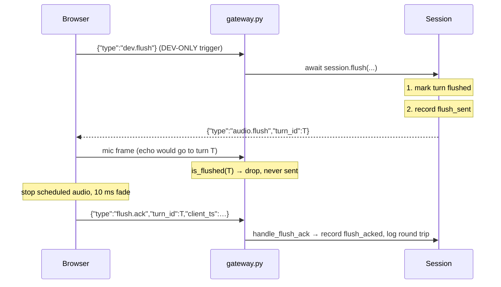

# Flush and Acknowledgement

## 1. In one minute

A **flush** is the server telling the browser "stop playing this turn, now".
The server sends `audio.flush` with a `turn_id`, stops sending that turn's
frames, and records the time. The browser silences its speaker and replies
`flush.ack`; the server records that time too and logs the round trip in
milliseconds. It lives mostly in `backend/vaani/session.py`, with a guard in
`gateway.py`. Barge-in (week 3) will be built on this: without flush, an
interrupted agent would keep talking over the user.

## 2. Files

| File | What changed |
|---|---|
| `backend/vaani/protocol.py` | `AudioFlush`, `FlushAck`, and `DevFlush` (marked DEV-ONLY), plus an `audio_flush()` helper. |
| `backend/vaani/session.py` | Now owns turn state: `open_turn`, `is_flushed`, `flush`, `handle_flush_ack`. |
| `backend/vaani/gateway.py` | Late-frame guard before `send_bytes`; handles `dev.flush` and `flush.ack`; no `audio.end` for a flushed turn. |
| `backend/vaani/telemetry.py` | `FLUSH_SENT` / `FLUSH_ACKED` span names; clock switched to `perf_counter` (see §4). |
| `backend/scripts/fake_client.py` | `--flush-after SECONDS`; replies `flush.ack`; discards late frames. |
| `backend/tests/test_flush.py` | New. Flush through the real socket: frames stop, ack recorded, bad acks ignored. |
| `backend/tests/test_session.py` | New. Mark-before-send order; round trip measured on the server clock. |

## 3. How it works



**Step 1 — mark and stamp, then send** (`backend/vaani/session.py`):

```python
self._flushed_turns.add(turn_id)
span = telemetry.record(FLUSH_SENT, turn_id)
self._awaiting_ack[turn_id] = span.at
await send_json(audio_flush(turn_id))
```

Everything that records the flush happens *before* the `await`. This order is
the most important thing in this change.
`await` is a pause: while the flush message is being sent, the event loop is
free to run other code (see §4). If any other code runs during that pause and
is about to send a frame for turn T, it must *already* see T as flushed. Mark
after the await, and there is a window where the flush has been decided but a
frame can still go out. `test_flush_marks_turn_before_sending` checks this by
looking at `is_flushed` from inside the fake `send_json`.

The `flush_sent` stamp goes before the `await` for the same reason. If an ack
were handled during the pause (impossible today, but possible once acks are
read by a separate task), it must find the turn in `_awaiting_ack`, or it would
be wrongly ignored. The cost: the round trip now also counts the time spent
inside the send itself, so it reads **slightly pessimistic** — a little higher
than the pure network-and-browser time. For a latency number, reading high is
the safe direction: we may worry about a problem that isn't there, but we will
never miss one that is.

`flush()` returns `None` and sends nothing if no turn is open or the turn was
already flushed, so flushing twice is safe.

**Step 2 — the late-frame guard** (`backend/vaani/gateway.py`):

```python
if session.is_flushed(turn_id):
    session.late_frames_dropped += 1
    continue
await websocket.send_bytes(data)
```

There is no `await` between the check and the send, so nothing can flush the
turn in between. Every frame is either checked-and-sent before the flush, or
checked-and-dropped after it.

**Echo mode only:** after a flush, the flushed turn stays current, so echo is
silent for the rest of the session. This is what makes "press flush while
speaking → silence" visible. It is *not* how real turns will work: in week 3 a
barge-in ends one turn and the agent's next reply starts a new turn with its
own `audio.start`.

**Step 3 — the ack** (`backend/vaani/session.py`):

```python
if turn_id != self.current_turn_id or turn_id not in self._awaiting_ack:
    log.warning(...)
    return None
sent_at = self._awaiting_ack.pop(turn_id)
span = telemetry.record(FLUSH_ACKED, turn_id)
round_trip_ms = (span.at - sent_at) * 1000.0
```

An ack for a turn that is not current, never flushed, or already acked is
logged and ignored — no error goes back. `pop` removes the entry, so a
duplicate ack falls into the ignore branch. `client_ts` is logged but never
used in the arithmetic: it is the browser's clock, which started at a
different moment from ours, so subtracting the two gives nonsense.

**Measured** (localhost, Windows, `fake_client.py`, 3 × 10 s per run, medians
of the per-second rolling stats):

| Run | echo p50 | echo p95 |
|---|---|---|
| Before (no flush code), 3 runs | 0.061 / 0.070 / 0.075 ms | 0.115 / 0.176 / 0.177 ms |
| After (with guard), 2 runs | 0.068 / 0.077 ms | 0.169 / 0.177 ms |
| `is_flushed()` alone (`timeit`) | ≈ 50 ns per call (≈ 20 ns of that is call overhead) | — |

The guard costs tens of nanoseconds; the run-to-run spread is ~60,000 ns. No
measurable regression. Flush round trip over 5 runs of `--flush-after 3`:
0.359–0.905 ms, median 0.529 ms. (Before `flush_sent` moved ahead of the send
it was 0.220–0.353 ms, median 0.288 ms. The difference is the send itself,
now counted — the pessimistic reading described in Step 1.)

### The four questions this design turns on

**Why does the browser acknowledge instead of the server assuming?**
When `send_json` returns, the bytes are only in our operating system's send
buffer. They may still be in the network, the browser tab may be in the
background and running late, or the handler may have thrown. Only the browser
knows when `stop()` actually ran. The ack gives us proof and a measurement. It
also gives week 3 something to act on if an ack never comes (not built yet).

**Why stop scheduled audio, not just clear a queue?**
The browser's player (`frontend/src/hooks/usePlaybackQueue.js`) plays each
chunk as it arrives with `source.start(startAt)`, at a *future* time on the
audio clock. Once scheduled, the chunk belongs to the browser's audio thread
and will play whatever JavaScript does next. Speech is generated faster than
real time, so seconds of audio can already be scheduled. Emptying a JavaScript
array touches none of it. Each scheduled source has to be stopped, with a
10 ms fade so the cut does not click (see
`../frontend-learning/04-playback-flush.md`).

**Why must the browser ALSO discard late frames?**
Today the server guard is airtight: one loop does both the flushing and the
sending. That depends on how the server is built, and it will change. When
text-to-speech runs in its own task with an outgoing buffer, a frame can pass
the check, sit in the buffer, and be written after `audio.flush` has gone out.
The browser is the last step before the speaker, so it is the only place that
can *guarantee* a flushed turn is never heard. This is the "end-to-end"
principle: put the guarantee at the end that cares. Check in both places.

**Why is this round trip not the barge-in number?**
Barge-in latency is measured at the speaker. It runs from the user starting to
speak until the agent's voice stops. That includes mic buffering, uploading the
frames, voice activity detection (VAD) deciding it is speech, our flush, and
the sound device emptying its output buffer. Our ~0.5 ms includes only the
flush and the ack. It also counts the ack's trip back, which comes after the
silence and so is not part of what the user hears. It ends when JavaScript called
`stop()`, not when the speaker went quiet.

**What can still be heard after a flush completes?** (1) The 10 ms fade.
(2) Audio already handed to the operating system / sound device output buffer —
typically tens of ms on wired output and more on Bluetooth; **we have not
measured it on our devices.** (3) In real mode (not echo), the *next* turn's
audio, which is correct behaviour.

## 4. New concepts

**`await` as a pause point.** Our server runs one event loop: one thread takes
turns running coroutines. A coroutine only gives up control at an `await`.
So code between two `await`s runs without interruption, and code *across* an
`await` can have anything happen in the middle. That is why the flush mark
goes before the `await`, and why the guard has no `await` before `send_bytes`.

**Acknowledgement (ack).** A reply that says "I received and acted on your
message". Sending a message is not proof it arrived or was acted on; only the
receiver's reply is.

**Round trip time.** Time from sending a message to receiving its reply,
measured on *one* clock (ours). Using one clock is what makes it valid.

**Idempotent.** Doing it twice has the same effect as doing it once. A
second `dev.flush` or a duplicate ack changes nothing.

**Clock resolution, and `perf_counter`.** A clock's resolution is its
smallest tick. On Windows, `time.monotonic()` ticks every 15.6 ms, so every
Day 3 echo gap read as 0.0 ms. `time.perf_counter()` also only moves forward,
but ticks every 0.1 µs. Telemetry now uses it.

## 5. Why this and not that

| Choice | Picked | Alternatives | Why not them |
|---|---|---|---|
| Order in `flush()` | Mark, then send | Send, then mark | A frame could go out during the send's `await`. |
| When to stamp `flush_sent` | Before the send's `await` | After it returns (like `echo_sent`) | An ack handled during the `await` would find no entry and be ignored. Cost: round trip reads slightly high. |
| Round trip clock | Server `perf_counter` both ends | `client_ts − server time` | Different clocks with different zero points; the difference is meaningless. |
| After flush in echo mode | Turn stays closed, echo silent | Open a new turn on next mic frame | Echo would restart within ~20 ms; the flush would sound like a click, not silence. |
| Unknown / stale ack | Log and ignore | Send an `error` | A late or duplicated ack is normal network behaviour, not a broken client. |
| How `Session` sends | Takes the `send_json` function | Stores the websocket | Tests can pass a fake function; no socket needed. |
| Where frames are stopped | Inline check before `send_bytes` | Separate sender task with an outgoing queue | Echo is sent inline today; a queue is an abstraction with no current need. The check moves unchanged into a sender task later. |
| Test trigger | `dev.flush` over the same socket | HTTP `POST /dev/flush` | HTTP would need to look up a session by id across connections; the socket already *is* the session. |

## 6. When things go wrong

| Situation | What the code does |
|---|---|
| `flush.ack` never arrives | Nothing. The turn stays flushed; `_awaiting_ack` keeps the entry until the session ends. **No timeout or retry exists yet.** |
| Ack for unknown / stale / already-acked turn | `log.warning(...)`, ignored, no reply. |
| Ack missing `turn_id` or `client_ts` | `BAD_MESSAGE` error; socket stays open. |
| `dev.flush` before any audio | Info log, nothing sent. |
| Second `dev.flush` | Ignored (idempotent). |
| `session.end` after a flush | No `audio.end`; the flush already ended the turn. Close 1000. |
| Browser still sends old `audio.flush.ack` | `UNKNOWN_MESSAGE_TYPE`. Expected until the frontend moves to v0.2. |
| Socket drops during the flush send | Same as any other send in the loop; not specifically tested. The turn is already marked. |

## 7. Questions you could be asked

1. **Where is the code that stops late frames?** `gateway.py`, binary branch:
   `if session.is_flushed(turn_id): ... continue` directly before `send_bytes`.
2. **Where is the round trip computed?** `Session.handle_flush_ack` in
   `session.py`: `(span.at - sent_at) * 1000.0`.
3. **What happens if the ack never comes?** The turn stays flushed (no audio
   leaks), but nothing notices. There is no timeout — a known gap.
4. **What happens if an ack arrives for an old turn?** Warning log, ignored.
5. **Why not subtract `client_ts` from the server time?** Two clocks with
   different zero points; the result would be meaningless. It is logged only for
   lining up browser and server logs.
6. **Why mark flushed before awaiting the send?** The `await` lets other code
   run. A frame send starting during it must already see the mark.
7. **Why doesn't echo restart after a flush?** It is an echo-mode choice, so the
   flush can be heard. Real turns in week 3 end and the next one starts normally.
8. **Why switch to `perf_counter`?** On Windows `monotonic` ticks every
   15.6 ms, so sub-millisecond gaps read as 0.0. The Day 3 numbers were not
   real on this machine.
9. **Why no `audio.end` after a flush?** The flush *is* the turn's ending.
   Sending both would give the browser two endings for one turn.
10. **(Hardest) If the server guard is correct, why does the browser need its
    own discard?** The guard is only correct because of how the code is built
    *today* (one loop, sending inline). The browser's discard stays correct
    however the server changes, because it sits right before the speaker.

## 8. Check yourself

1. Explain why the order "mark, then `await` send" matters, using the word
   *event loop*.
2. Name three things that make real barge-in latency larger than our ~0.5 ms.
3. Why can't clearing a JavaScript queue silence audio that is already
   scheduled?
