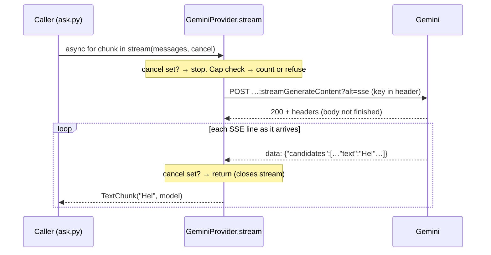

# Language Model Provider Layer: Gemini

## 1. What we built in this branch

Branch: `feat/provider-gemini`.

The backend can now ask a language model a question and receive the answer
*as it is being written*, chunk by chunk, instead of waiting for all of it.
There is one provider-neutral interface (`providers/base.py`), one real
implementation for Google Gemini (`providers/gemini.py`), four typed errors, a
per-process request cap, and `scripts/ask.py` to watch it stream. It is not yet
connected to the WebSocket — no conversation uses it yet.

## 2. What we used to build it

- **httpx** — an HTTP client library for Python that supports `async`.
  *Here:* sends the request to Gemini and reads the response body piece by
  piece. *Why:* already in our lockfile, and it lets us own the stream: closing
  it aborts the connection, which cancellation needs.
- **`httpx.AsyncClient`** — a long-lived client object that keeps connections
  open between requests. *Here:* one per provider. *Why:* reusing an open
  connection skips the TCP and TLS setup (the encrypted handshake) on every
  call, which saves latency.
- **`httpx.MockTransport`** — part of httpx; a fake "network" that hands each
  request to a function we write. *Here:* every test. *Why:* tests run with
  no network and no key, and need no extra library.
- **Gemini REST API, `streamGenerateContent?alt=sse`** — Google's HTTP
  endpoint for streamed answers. *Here:* the only vendor call. *Why:* plain
  HTTP + JSON, so no vendor SDK is needed.
- **Server-Sent Events (SSE)** — a text format for streaming: the server
  writes lines `data: {json}` separated by blank lines. *Here:* how Gemini
  delivers each chunk. *Why:* it is what `alt=sse` gives us; it is simple
  enough to parse in ten lines.
- **`thinkingConfig.thinkingLevel`** — a Gemini setting for how much the model
  reasons before answering. *Here:* set to `"minimal"` from config. *Why:*
  see §5.
- **`abc.ABC` / `@abstractmethod`** — Python's way to declare an interface: a
  class that cannot be used directly and forces subclasses to supply the
  marked methods. *Here:* `LLMProvider`. *Why:* the rest of the system codes
  against it, not against Gemini.
- **Async generator** — an `async def` function that uses `yield`. *Here:*
  `GeminiProvider.stream`. *Why:* the caller gets each chunk the moment it
  exists, with `async for`.
- **`asyncio.Event`** — a standard-library on/off flag coroutines can share.
  *Here:* the cancellation token. *Why:* no custom class needed.
- **`@dataclass(frozen=True)`** — a class generated from its fields, which
  cannot be changed after creation. *Here:* `Message`, `TextChunk`. *Why:* a
  chunk that was received is a fact; nothing should edit it.
- **pydantic `SecretStr`** — a string wrapper that prints as `**********`.
  *Here:* the API key. *Why:* an accidental `print(settings)` or log line
  cannot reveal it.
- **pydantic-settings `env_file`** (backed by python-dotenv, already
  installed) — reads `backend/.env` into settings. *Here:* the key during
  local development. *Why:* `.env.example` already told developers to use a
  `.env`, but nothing read it.
- **`time.perf_counter`** — a high-resolution clock that only moves forward
  (see `04-flush.md`). *Here:* time-to-first-token in `ask.py`.
- **`traceback.format_exception`** — produces the full text Python would
  print for an error, including errors chained behind it. *Here:* the
  key-leak test searches that text.

## 3. Alternatives we rejected

| Decision | What we chose | Alternatives | Why not them | What we gave up |
|---|---|---|---|---|
| How to call Gemini | httpx + REST | Google GenAI SDK | The SDK hides the HTTP stream, so we cannot be sure closing it aborts the connection; its exception types would need translating anyway; a heavy extra dependency. | We own the JSON format; if Google changes it, we fix it. No built-in retries or Vertex AI support. |
| Parsing SSE | ~10 lines by hand | `httpx-sse` library | Gemini sends only single-line `data:` events. | A multi-line SSE event would break our parser. |
| Test fake | `httpx.MockTransport` | `respx` library | Built into httpx; no new dependency. | `respx` has nicer route matching. |
| Key location in request | `x-goog-api-key` header | `?key=` in the URL (also accepted) | httpx logs full URLs at INFO, and URLs appear in exception text. | Nothing real. |
| Cancellation token | `asyncio.Event` | Custom `CancelToken` class; `task.cancel()` only | A custom class would wrap Event with no extra behaviour. `task.cancel()` alone is not an explicit token, which CLAUDE.md requires. | See §5: cannot interrupt a wait. |
| Stream return type | `TextChunk(text, model)` | Plain `str` | We need to see which model actually answered, per call. A value on the provider object would be wrong if two calls ran at once. | Callers write `chunk.text`. |
| Model ID | Exact `gemini-3.5-flash-lite` | `gemini-flash-lite-latest` alias | An alias can move to a new model overnight and change our latency numbers. | We must edit config to upgrade. |
| 2.5 fallback | None | Add a 2.5 model | Google now limits 2.5 to keys that already used it; ours likely cannot. | No fallback model yet. |
| Spend check | Request counter, per process | Full cost ledger now | The ledger (tokens, money, persistence) is its own design task. | A counter is not money: 200 short and 200 long answers count the same. |
| Where `SpendCapExceededError` lives | `vaani/spend.py`, not a `ProviderError` | Make it a fifth provider error | Future failover retries on provider errors; it must never "fail over" past a spend cap. | Callers catch two families of error. |
| Config defaults | None in code for `[llm]` | Pydantic defaults mirroring the TOML | A model ID in code is a hardcoded model ID. | `Settings()` fails if `config.toml` lacks `[llm]`. |

## 4. Where things live

| What | File | Function or class |
|---|---|---|
| The interface | `backend/vaani/providers/base.py` | `LLMProvider.stream`, `aclose` |
| Message and chunk shapes | `backend/vaani/providers/base.py` | `Message`, `TextChunk` |
| Error types (defined) | `backend/vaani/providers/base.py` | `ProviderError` and 4 subclasses |
| Errors raised | `backend/vaani/providers/gemini.py` | `stream`, `_error_for`, `_parse_line`, `__init__` |
| Gemini request body | `backend/vaani/providers/gemini.py` | `_request_body` |
| Config read | `backend/vaani/config.py` | `LLMSettings`, `GeminiSettings`, `Settings.gemini_api_key` |
| Config values | `backend/config.toml` | `[llm]`, `[llm.gemini]` |
| Where the key comes from | env `VAANI_GEMINI_API_KEY` or `backend/.env` | `Settings` |
| Spend check (state) | `backend/vaani/spend.py` | `RequestCap.check_and_count` (a counter in memory) |
| Validation | Settings: pydantic. Gemini's JSON: **not** validated by a model — read with `.get()`, bad JSON → `ProviderFailedError` | `_parse_line` |
| Logging | `gemini.py` logs a warning for each HTTP error | `_error_for` |
| Command-line tool | `backend/scripts/ask.py` | `ask` |
| Tests | `backend/tests/test_gemini.py`, `test_config.py` | — |
| Database layer | Does not exist yet. | — |
| Telemetry span | Not emitted: nothing on the conversation path calls this yet. `LLM_FIRST_TOKEN` in `telemetry.py` is waiting for it. | — |

## 5. How it works



**Streaming at the HTTP level.** A normal HTTP response carries its total
length up front, and the client waits for all of it. A streamed response
starts with headers only, then sends the body in pieces as they are produced.
In HTTP/1.1 this is "chunked transfer encoding". SSE is just a text format
for those pieces. A model writes its answer word by word over several
seconds, so streaming means we get the first sentence long before the last.
Text-to-speech can start on that first sentence, so the number that counts
against our 1,000 ms budget is **time to first token**, not total time.

The request, in `backend/vaani/providers/gemini.py`:

```python
if cancel.is_set():
    return
self._cap.check_and_count()

headers = {"x-goog-api-key": self._api_key.get_secret_value()}
body = _request_body(messages, self._settings.thinking_level)
```

The order is deliberate: a cancelled call is neither sent nor counted, and
the spend check runs *before* anything leaves the machine.
`get_secret_value()` is the only place the key is unwrapped, and it goes
straight into a header.

```python
async with self._client.stream(
    "POST", self._url, params={"alt": "sse"},
    headers=headers, json=body, timeout=self._timeout,
) as response:
    if response.status_code != 200:
        await response.aread()
        raise self._error_for(response)
    async for line in response.aiter_lines():
        if cancel.is_set():
            return
        for chunk in self._parse_line(line):
            yield chunk
```

`client.stream(...)` returns once the *headers* arrive. `aiter_lines()` then
hands us each line as the network delivers it. Leaving the `async with` —
here via `return` — closes the response, which closes the HTTP stream.

**Cancellation, and what it cannot do.** The token is checked before the
request and between lines. It *cannot* interrupt `aiter_lines()` while it is
waiting for the next line: if Gemini goes quiet for 3 s, we notice the cancel
3 s late. Week 3 pairs the token with task cancellation (`task.cancel()`),
which breaks into that wait immediately.

**Thinking level and latency.** Gemini 3.x models can reason internally
before writing the first word. That reasoning happens *before* the first
token, so every second of it adds directly to time to first token — the delay
the user hears. We set `thinking_level = "minimal"`, the lowest level this
model accepts (Google's docs say it cannot be switched off). The docs
disagree on the default, so setting it explicitly also keeps our numbers
stable.

**Errors are typed.** `_error_for` turns an HTTP status into one of four
types: 429 → `RateLimitedError`; 401/403 → `AuthenticationError`; 504 or an
httpx timeout → `ProviderTimeoutError`; everything else →
`ProviderFailedError`. Why types rather than raw exceptions: callers need to
*decide* things (wait and retry? fix the key? try another provider?). With
raw httpx errors, every caller would re-parse status codes and Google's JSON,
and a second provider would bring a different set. Types make the decision
one `except` clause, identical for every vendor.

**Why an interface rather than calling Gemini directly.** The conversation
code will call `provider.stream(...)` and never see a URL, JSON field, or role
name like `"model"`. Adding a second vendor, or failing over to one, then
means one new class and zero edits to callers. CLAUDE.md also requires it:
vendors are configuration, not code dependencies.

**Why the key never reaches config.toml or a log.** `config.toml` is
committed: anything in it is in git history forever, readable by anyone with
the repo. Logs are copied, shared, and pasted into chats. A leaked key lets
anyone spend our money until it is revoked. Four defences: the key comes only
from the environment or the gitignored `.env`; it is a `SecretStr`; it travels
in a header, never the URL; and any error text is passed through `_redact`
in case Google echoes it. `test_key_never_in_logs_or_exceptions` checks all
of this, including one error body that deliberately contains the key.

**The request cap — a stopgap.** `RequestCap` counts every dispatched request
in this process and refuses past `max_requests_per_process` (200). **This is
not the cost ledger CLAUDE.md requires.** It does not know tokens or money,
and it resets when the process restarts. It exists so a runaway loop cannot
make unlimited paid calls before the ledger is built.

**Measured.** We have no key in this environment, so there are **no real
Gemini numbers yet**. Against a local stand-in server sending six chunks
300 ms apart, `ask.py --timings` printed chunks at +466, +778, +1091, +1389,
+1700 and +1984 ms — proof that `ask.py` prints as data arrives, not at the
end. It is not a Gemini latency figure.

## 6. When things go wrong

| What fails | What the code does | What the user sees (ask.py) |
|---|---|---|
| No key set | `ask.py` checks before building the provider | `VAANI_GEMINI_API_KEY is not set`, exit 2 |
| Key set but empty | `GeminiProvider.__init__` raises `AuthenticationError` | `error: AuthenticationError: …empty` |
| Wrong key (401/403) | `AuthenticationError`, warning logged | `error: AuthenticationError: gemini: HTTP 401 …` |
| Rate limited (429) | `RateLimitedError`; no retry | `error: RateLimitedError: …` |
| No byte for `timeout_s` | `ProviderTimeoutError` | `error: ProviderTimeoutError: …within 10.0s` |
| Credits depleted (402), bad model ID (404), 5xx | `ProviderFailedError` with Google's status | `error: ProviderFailedError: gemini: HTTP …` |
| Network down | `ProviderFailedError("gemini: ConnectError")` | same form |
| Prompt blocked by safety filter | `ProviderFailedError("…prompt blocked (SAFETY)")` | same form |
| Cap used up | `SpendCapExceededError`, nothing sent | `error: SpendCapExceededError: request cap reached` |
| Cancel set mid-answer | Stops at the next line; stream closed | (not reachable from ask.py) |

## 7. New terms

- **Abstract base class (ABC).** A class that only describes methods; it
  cannot be used directly. Ours is `LLMProvider`.
- **Async generator.** A function with `async def` and `yield`. The caller
  loops over it with `async for`, receiving values as they are produced.
- **Cancellation token.** An object passed into a long operation that the
  caller can flip to ask it to stop early. Ours is an `asyncio.Event`.
- **Chunked transfer encoding.** The HTTP/1.1 way of sending a body in pieces
  without knowing its total length in advance.
- **Connection reuse (keep-alive).** Keeping a TCP/TLS connection open for
  the next request, to skip the setup cost.
- **HTTP 429.** "Too Many Requests" — the server's rate limit.
- **Redaction.** Replacing a secret in text with a placeholder before the
  text is shown or stored.
- **REST API.** A web API used with plain HTTP methods and JSON bodies.
- **SDK.** A vendor's own library wrapping its API.
- **Server-Sent Events (SSE).** A streaming text format: `data: …` lines
  separated by blank lines.
- **Thinking level.** How much a model reasons internally before answering;
  more thinking = later first token.
- **Time to first token (TTFT).** Time from sending the request to receiving
  the first piece of text. The latency that matters for speech.
- **Typed error.** An exception class that names *what kind* of failure
  happened, so callers can branch on the type.

## 8. Questions you could be asked

1. **Where is the code that turns a 429 into our error?**
   `GeminiProvider._error_for` in `providers/gemini.py`.
2. **Where does the API key come from?** `Settings.gemini_api_key` in
   `config.py`, filled from `VAANI_GEMINI_API_KEY` in the environment or
   `backend/.env`. Never `config.toml`.
3. **What happens if the user interrupts while Gemini is silent between
   chunks?** The token is only checked when a line arrives, so we stop late.
   Week 3 adds task cancellation to break into the wait.
4. **What happens if Gemini is rate-limiting us?** `RateLimitedError`, no
   retry. Retrying or failing over is not built yet.
5. **Why not use Google's SDK?** It hides the HTTP stream, so we could not
   guarantee cancellation closes it; we would translate its exceptions
   anyway; it is a large dependency.
6. **Why not put the key in the URL, since Google accepts that?** httpx logs
   URLs, and URLs appear in exception messages. Headers do not.
7. **What does "streaming" mean at the HTTP level?** The response starts with
   headers only; the body follows in pieces as it is produced, and the
   client reads each piece on arrival.
8. **What does time to first token mean, and why do we care more about it
   than total time?** The wait until the first text arrives. Speech can start
   then, so it is what the user hears as delay.
9. **Why is `thinking_level` in our latency budget?** The model thinks before
   its first token; thinking time is added straight onto TTFT.
10. **Is our spend cap enough?** No. It counts requests, not money, and resets
    on restart. The real ledger is a separate task.
11. **(Hardest) The tests use a fake transport — how do you know the real
    Gemini works?** We don't yet. The tests prove our parsing, error mapping,
    cancellation and key handling against Gemini's documented format. The
    first real `ask.py` run with a key is the proof against the real service.

## 9. Check yourself

1. Explain why `ask.py` shows text before the answer is finished, starting
   from what the server sends.
2. Name the four provider errors and one situation that raises each.
3. List two places the API key could have leaked, and what stops each.
