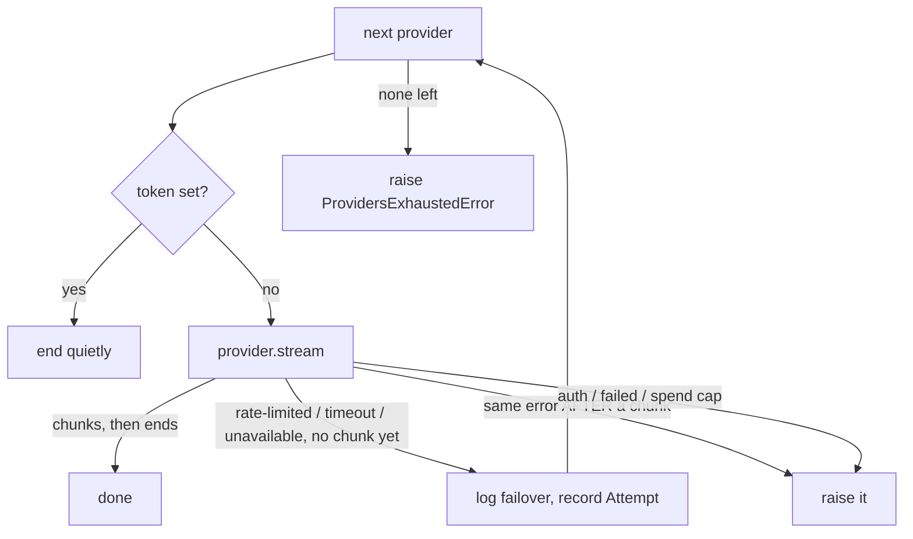

# Real Cancellation and the Provider Failover Chain

## 1. What we built in this branch

Branch: `feat/provider-cancel-failover`.

Three things. **Cancellation now really aborts**: the moment the token is set,
the HTTP connection is closed, even if we are in the middle of waiting for the
model. **A second provider, Groq**, sits behind the same interface as Gemini.
**A failover chain** tries Gemini, then Groq. It moves on when Gemini's side is
broken and reports the error when ours is wrong. `ask.py` now goes through the
chain and can fake a 429 or cancel mid-answer. The WebSocket does not use any of
this yet.

## 2. What we used to build it

- **`asyncio.Event`**: an on/off flag that coroutines can `await` until it turns
  on. *Here:* the cancellation token (unchanged from doc 05). *Why:* `cancel.wait()`
  is itself awaitable, so it can be raced against a read. A plain `bool` cannot
  be awaited.
- **`asyncio.ensure_future` / tasks**: turns an awaitable into a *task*, a
  piece of work the event loop runs on its own. *Here:* the read and the
  `cancel.wait()` each become a task. *Why:* only tasks can run side by side
  and be cancelled individually.
- **`asyncio.wait(..., return_when=FIRST_COMPLETED)`**: waits for a set of
  tasks and returns as soon as any one finishes. *Here:* the race between
  "data arrived" and "token set". *Why:* it is the standard-library way to say
  "whichever comes first".
- **`task.cancel()`**: throws a `CancelledError` into a task at the line where
  it is waiting. *Here:* stops the losing read. *Why:* it is the only way to
  interrupt a wait that is already in progress.
- **`httpx` `client.send(request, stream=True)`**: sends a prepared request
  and returns as soon as the headers arrive. *Here:* replaces
  `async with client.stream(...)`. *Why:* `send` returns an awaitable we can
  race; an `async with` cannot be raced.
- **`contextlib.aclosing`**: guarantees `aclose()` is called on an async
  generator when a block exits. *Here:* around every nested stream. *Why:* see §5.4.
- **Groq's OpenAI-compatible API**: Groq copies the request and response
  shape of OpenAI's `/chat/completions`. *Here:* the second provider. *Why:*
  it is fast, cheap, reachable with plain HTTP, and a genuinely different
  shape from Gemini (§5.5).
- **`asyncio.start_server`**: a real TCP server built into the standard library.
  *Here:* `tests/test_streaming.py`. *Why:* to prove at the socket level that we
  hung up. A mock transport can only show that a Python method was called.

## 3. Alternatives we rejected

| Decision | What we chose | Alternatives | Why not them | What we gave up |
|---|---|---|---|---|
| Interrupting a blocked read | Race each wait against `cancel.wait()` | (a) Caller runs `task.cancel()` on the whole stream; (b) short read timeout plus polling the flag | (a) every caller would need to own a task, and we would have two cancel mechanisms. (b) up to one poll interval of delay on every barge-in, and "slow" gets confused with "cancelled" | Two tasks per line, measured at ~13 µs each |
| What to do on cancel | **Close** the connection | **Drain**: read the rest and throw it away | Draining keeps paying for tokens nobody hears, and holds the socket for seconds | The socket cannot be reused. The next call pays a new TLS handshake (~40–160 ms in our traces) |
| Which errors fail over | Rate-limited, timeout, unavailable | Fail over on every `ProviderError` | Hides a bad key, bad model ID or bad request behind a working fallback (§5.3) | A misconfigured Gemini stops the answer instead of quietly using Groq |
| When failover is allowed | Only before the first chunk | Restart on the next provider mid-answer | The user would hear a sentence twice or two contradictory answers, and we would pay twice (§5.3) | A mid-answer outage ends that answer early |
| Shape of the chain | The chain *is* an `LLMProvider` | A failover `for` loop in each caller | Every caller (ask.py, the gateway) would copy the rules | One more layer to read through |
| Shared HTTP code | `streaming.py`, used by both vendors | Copy the send/race/close code into each vendor file | Two copies of cancellation code will drift apart | Vendor files no longer read top to bottom alone |
| Missing key for a listed provider | Fail fast at startup | Skip that provider with a warning | A silently missing key is an our-side problem, which we never hide | ask.py refuses to start without every key |
| Groq model | *Pending: set after measuring the models our key returns* | `llama-3.1-8b-instant` vs `openai/gpt-oss-20b` | See §5.6 | |

## 4. Where things live

| What | File | Function or class |
|---|---|---|
| The race: wait OR token | `backend/vaani/providers/streaming.py` | `until_cancelled` |
| Send, read lines, close on cancel | `backend/vaani/providers/streaming.py` | `stream_lines` |
| Mapping httpx timeouts / connection errors | `backend/vaani/providers/streaming.py` | `stream_lines`, `except` blocks |
| Error types incl. new ones | `backend/vaani/providers/base.py` | `ProviderUnavailableError`, `Attempt`, `ProvidersExhaustedError` |
| Gemini request + parse | `backend/vaani/providers/gemini.py` | `GeminiProvider.stream`, `_parse_line`, `_error_for` |
| Groq request + parse | `backend/vaani/providers/groq.py` | `GroqProvider.stream`, `_request_body`, `_parse_line`, `_error_for` |
| Failover rules | `backend/vaani/providers/chain.py` | `ProviderChain.stream`, `_FAIL_OVER_ON` |
| Building the chain from config | `backend/vaani/providers/chain.py` | `build_chain`, `_require_key` |
| Config read | `backend/vaani/config.py` | `GroqSettings`, `LLMSettings.groq`, `Settings.groq_api_key` |
| Config values | `backend/config.toml` | `[llm]`, `[llm.groq]` |
| Spend cap (shared by all providers) | `backend/vaani/spend.py` | `RequestCap.check_and_count` (unchanged) |
| Demo script | `backend/scripts/ask.py` | `--simulate-429`, `--cancel-after-ms` |
| Tests | `backend/tests/test_streaming.py`, `test_chain.py`, `test_groq.py` | |

Not in this change: no database, no WebSocket wiring, no telemetry spans
(failover timings go to logs and `Attempt.elapsed_ms`; spans need a session).

## 5. How it works

### 5.1 Closing versus draining

A streamed answer arrives over one TCP connection. When the user interrupts,
we can do one of two things with that connection:

- **Drain** it: keep reading until the server finishes, then throw the text
  away. The connection ends cleanly and can be reused. But the model keeps
  generating, and **we are billed for every output token**, heard or not. On a
  long answer that can take seconds.
- **Close** it: hang up now. The vendor sees the client disconnect and can stop
  generating. The cost is that the socket is gone, so the next request pays a
  new TCP + TLS handshake.

For barge-in, closing is the only option. Draining ties the old turn to the
connection until the model finishes, and the user is already speaking again.
httpcore closes rather than drains when a half-read response is closed
(`httpcore/_async/http11.py:238-250`: if both sides are not `DONE`, it calls
`self.aclose()`).

### 5.2 The race

The old code checked `if cancel.is_set()` *between* lines. That check only
runs when a line arrives, so a model that paused for 3 s ignored a cancel for
3 s. Now every wait is a race:

```python
# backend/vaani/providers/streaming.py — until_cancelled
work = asyncio.ensure_future(awaitable)
stop = asyncio.ensure_future(cancel.wait())
try:
    await asyncio.wait({work, stop}, return_when=asyncio.FIRST_COMPLETED)
...
if work.done():
    return work.result()
work.cancel()
await asyncio.wait({work})
...
raise Cancelled
```

If the work finished first, we return its result. If the token won, we cancel
the work. That throws `CancelledError` into httpcore mid-read, and httpcore
closes the socket. We then **wait for that cleanup** (`asyncio.wait({work})`),
so the connection really is gone before we return. `Cancelled` is internal and
never leaves `streaming.py`: to callers, a cancelled stream just ends.

`stream_lines` races the three waits a request has:

```python
# backend/vaani/providers/streaming.py — stream_lines
response = await until_cancelled(client.send(request, stream=True), cancel)
try:
    if response.status_code != 200:
        await until_cancelled(response.aread(), cancel)  # small error body
        raise error_for(response)
    lines = response.aiter_lines()
    while (
        line := await until_cancelled(anext(lines, None), cancel)
    ) is not None:
        yield line
finally:
    await response.aclose()
```

The header wait matters most. While the model is "thinking" nothing arrives,
so this is often the longest wait. `finally` closes the response on *every*
exit: normal end, cancel, error, or the caller walking away.

### 5.3 The chain



```python
# backend/vaani/providers/chain.py
_FAIL_OVER_ON = (RateLimitedError, ProviderTimeoutError, ProviderUnavailableError)
...
            except _FAIL_OVER_ON as exc:
                elapsed_ms = (perf_counter() - started_at) * 1000
                if yielded:
                    ...
                    raise
                attempts.append(Attempt(name, type(exc).__name__, str(exc), elapsed_ms))
```

**The rule: fail over when their side is broken; surface it when our side is
wrong.** A 429, a timeout, a refused connection or a 5xx means the vendor is
busy or down, and another vendor may be fine. A 401/403 means *our key* is
wrong. If we failed over, Groq would answer, everything would *sound* fine, and
nobody would notice Gemini was dead until Groq also broke, or until the bill
showed every request going to the fallback. The same logic covers 400 (our
request is malformed), 404 (our model ID is wrong), 402 (our account is out of
credit) and blocked prompts (going around a safety block by asking another
vendor is not something to do silently). That is why the old catch-all
`ProviderFailedError` was split in two: `ProviderUnavailableError` fails over,
`ProviderFailedError` does not.

**Why no mid-stream failover.** Once a chunk has been yielded, later stages
(text-to-speech, the speaker) may already be playing it. Restarting on Groq
means either repeating the opening ("The sky is blue because… The sky is blue
because…") or, worse, a *different* opening that contradicts what was heard.
We would also pay for both answers. A clean error lets the conversation layer
say something honest instead.

**Cancel is not a failure.** A cancelled provider returns without raising, so
the chain hits `return` and never tries the next provider.

**Spend cap across the chain.** Each provider calls the *same* `RequestCap`
before sending. A failover is just another counted request.
`SpendCapExceededError` is not a `ProviderError`, so it is not in
`_FAIL_OVER_ON` and passes straight through.

### 5.4 Why `aclosing` everywhere

The chain wraps the provider's generator, which wraps `stream_lines`. If a
caller stops early (`break`), Python closes only the **outermost** generator
straight away. The inner ones are closed later, "whenever the garbage collector
gets round to it", and until then the socket stays open.
`async with aclosing(inner)` closes the inner one the moment the outer block
exits, all the way down.

### 5.5 Groq: first test of the interface

Groq is the first API the `LLMProvider` interface was not designed around.
**Nothing in the interface had to change**: `stream(messages, cancel)`,
`Message`, `TextChunk(text, model)` and `aclose()` fit as they were. The
differences all stayed inside `groq.py`:

| | Gemini | Groq (OpenAI shape) |
|---|---|---|
| URL | `/models/{model}:streamGenerateContent?alt=sse` | `/chat/completions` |
| Model chosen in | URL path | body `"model"` |
| Streaming switched on by | `?alt=sse` | body `"stream": true` |
| Auth header | `x-goog-api-key: <key>` | `Authorization: Bearer <key>` |
| System text | separate `systemInstruction` field | an ordinary message, role `"system"` |
| Assistant role name | `"model"` | `"assistant"` |
| Text lives at | `candidates[0].content.parts[].text` | `choices[0].delta.content` |
| End of stream | body just ends | literal `data: [DONE]` |
| Hidden reasoning | `thought: true` parts | `delta.reasoning` field |
| Extra error codes | 504 | 498 ("flex capacity exceeded") |

An honest note: our `Message` roles (`system/user/assistant`) are OpenAI's
names, so Gemini was the provider that needed translating. The interface was,
if anything, slightly **OpenAI-shaped**, not Gemini-shaped. Two things do *not*
fit yet. (1) Reasoning text has no place in `TextChunk`; both providers drop it
on purpose, because it must never be spoken. (2) Neither provider reports token
usage through the interface, and the real cost ledger will need it. That will
probably be the first real interface change.

What did change was shared **plumbing**: the send/race/close code moved out of
`gemini.py` into `streaming.py` once a second vendor needed the same thing.

### 5.6 Groq model choice

*Pending.* This is filled in once `VAANI_GROQ_API_KEY` is set and
`GET /openai/v1/models` shows which models our key can use. Plan: use
`llama-3.1-8b-instant` if listed (it does no reasoning, so there is no thinking
time before the first token). Otherwise use `openai/gpt-oss-20b` with
`reasoning_effort = "low"`. Measure time-to-first-token for both if both are
reachable.

### 5.7 Measured

| What | Result |
|---|---|
| Gemini time-to-first-token, before (n=10) | P50 1414 ms (934–5783) |
| Gemini time-to-first-token, after, via the chain (n=14 successful) | P50 1291 ms (1110–1837). No regression; the gap is network noise |
| Cost of the race per wait (20,000 awaits, local) | ~13 µs |
| Cancel → stream ended, live Gemini (6 runs) | 2.1–4.9 ms |
| Cancel → stream ended, socket test (bound) | < 500 ms asserted |
| Gemini "no headers within 10 s" | Intermittent while testing. Also hit plain httpx with the old `client.stream` code (1 of 6 in an A/B), so it is Gemini's side, not the race |

So a hung Gemini costs the **full 10 s** before Groq is tried (§6).

## 6. When things go wrong

| What fails | What the code does | What the user sees |
|---|---|---|
| Gemini 429 / 5xx / connection refused | Logs `failover: gemini RateLimitedError after N ms -> groq`, tries Groq | Answer from Groq, slightly later |
| Gemini sends no headers for 10 s | Timeout, then failover | 10 s of silence, then Groq. **Too slow for voice**: needs a short first-byte timeout (a budget call for you; not done here) |
| Bad or missing key | `AuthenticationError`, no failover. A missing key fails at startup | The error. The fallback does not mask it |
| Wrong model ID (404), bad request (400) | `ProviderFailedError`, no failover | The error |
| Gemini fails after text started | Error raised, no restart | A partial answer, then the error |
| Every provider fails | `ProvidersExhaustedError`, listing each provider, error and time | Today in ask.py: one line naming each failure. With the WebSocket (not built yet), the turn must say something short out loud, e.g. "Sorry, I can't answer right now", because silence reads as a hang |
| Spend cap reached mid-chain | `SpendCapExceededError`, no further provider tried | The error; nothing more is sent |
| User cancels | Read aborted, socket closed, stream ends quietly | Output stops within milliseconds |

## 7. New terms

- **`aclosing`**: a context manager that calls an async generator's
  `aclose()` on exit, so nested streams shut down immediately (§5.4).
- **Async generator**: a function with `async def` and `yield`. It hands out
  values one at a time and can `await` between them. Every `stream()` here is one.
- **Barge-in**: the user starting to speak while the agent is talking. The
  agent must stop at once; this is what the cancellation token serves.
- **Drain vs close**: finishing reading a response you no longer want, versus
  hanging up on it (§5.1).
- **Failover**: moving to the next provider when the current one fails.
- **Header wait / first byte**: the time between sending a request and
  receiving the response's status line and headers. For an LLM it includes the
  model's thinking time.
- **HTTP 498**: Groq-specific, "flex tier capacity exceeded". They are full.
- **OpenAI-compatible API**: an API that copies OpenAI's URL, JSON and
  streaming shape, so one client works with many vendors.
- **Race**: running two waits at once and acting on whichever finishes first.
- **TLS handshake**: the exchange that sets up encryption on a new HTTPS
  connection, a few round trips. It is paid again when a connection is closed.
- **`[DONE]`**: the literal line OpenAI-style APIs send to mark the end of a
  stream.

## 8. Questions you could be asked

1. **Where is the code that actually closes the connection on cancel?**
   `stream_lines` in `providers/streaming.py`. `until_cancelled` cancels the
   pending read, and the `finally: await response.aclose()` closes the response.
   httpcore then closes the socket because the response was unfinished.
2. **How do you know it's closed and not drained?**
   `tests/test_streaming.py` runs a real TCP server that sends one event and
   then never finishes. The test asserts the server read end-of-file (we hung
   up) while `finished_sending` was still False, and that we stopped in under
   500 ms. On the old code the same test hangs and fails.
3. **Where are the failover rules?** `_FAIL_OVER_ON` and
   `ProviderChain.stream` in `providers/chain.py`.
4. **What happens if Groq's key is wrong but Gemini works?** Nothing, until
   Gemini fails. Then Groq raises `AuthenticationError`, which is not failed
   over, so the caller sees it. A *missing* key fails at startup.
5. **What happens if both providers are down?** `ProvidersExhaustedError`,
   whose `.attempts` lists each provider, its error type, message and elapsed ms.
6. **Why not fail over on a 401?** It means our key is wrong. A fallback would
   hide it: the product keeps working on the backup, and nobody fixes the
   primary until the backup breaks too. Fail over when their side is broken;
   surface it when ours is wrong.
7. **Why not restart on Groq if Gemini dies mid-sentence?** The user has heard
   the first half. A restart repeats or contradicts it, and costs two answers.
8. **Can failover get around the spend cap?** No. Both providers share one
   `RequestCap` and check it before sending. `test_spend_cap_covers_the_whole_chain`
   uses cap=1: Gemini's 429 uses it up, and Groq is refused before any traffic.
9. **What does `asyncio.wait(FIRST_COMPLETED)` do?** It waits on several tasks
   and returns when any one finishes, leaving the others running. That is why
   we cancel the loser explicitly.
10. **Why is closing better than draining for cost?** Output tokens are billed
    as they are generated. Draining lets the model finish an answer nobody
    hears. Closing lets the vendor stop.
11. **Hardest: after a cancel, is anything still running?** Our read task is
    cancelled and awaited before we return. The vendor's model may run a little
    longer on their side, until it notices the disconnect. We cannot control
    that, and we don't know exactly how quickly each vendor stops billing after
    a disconnect.

## 9. Check yourself

1. Explain, without the doc, why a between-chunks `if cancel.is_set()` was not
   enough, and what the race changes.
2. Name the three errors that fail over and two that don't, and the one-line rule.
3. A user interrupts after Gemini has said five words. Trace what happens to
   the socket, the chain and the spend cap.
