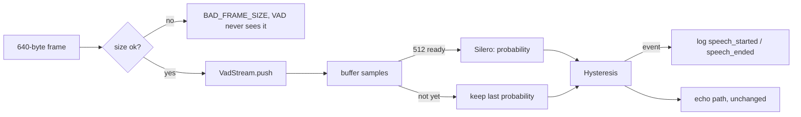

# Voice Activity Detection (VAD)

## 1. What we built in this branch

Branch `feat/vad`. Until now the gateway only counted and forwarded audio frames.
This is the first stage that looks *inside* a frame. It asks, for every 20 ms
frame, "is someone speaking?", and turns the answers into two events:
`speech_started` and `speech_ended`. It uses the Silero VAD model on the CPU through
ONNX Runtime. The model loads once per process (about 40 ms), and each session keeps
its own small piece of model memory. The server can now log when a user starts and
stops talking, which endpointing (day 9) and barge-in will build on. Echo is unchanged.

## 2. What we used to build it

**Silero VAD (v6.2.3 model file)**
- *What it is:* a small neural network (about 2.3 MB) trained to answer one
  question: how likely is it that this bit of audio is human speech (0 to 1)?
- *What it does for us:* it produces the per-frame speech probability.
- *Why:* it runs on a CPU in about 0.1 ms per call, handles noise far better
  than an energy or WebRTC detector (section 3), is MIT-licensed, and needs no
  internet connection.

**ONNX and ONNX Runtime (`onnxruntime` 1.30)**
- *What it is:* ONNX is a file format for trained models. ONNX Runtime is a
  library that runs such a file, without PyTorch.
- *What it does for us:* it runs `silero_vad.onnx`, through one shared
  `InferenceSession`.
- *Why:* the alternative, the `silero-vad` pip package, *requires* `torch`,
  even in its ONNX mode. On Linux CI that means the CUDA build of torch, about
  2 GB of GPU libraries we are not allowed to use. ONNX Runtime adds about 15 MB.

**NumPy**
- *What it is:* fast fixed-type arrays for Python.
- *What it does for us:* turns the frame's bytes into float32 samples, buffers
  them, and holds Silero's memory (the `state` and `context` arrays).
- *Why:* ONNX Runtime takes its inputs as NumPy arrays and returns them the same way.

**`hashlib.sha256`** checks that the model file is the exact file we pinned (section 4).
**`functools.lru_cache`** makes `load_model` run once per process.
**`time.perf_counter`** is the clock for VAD cost (see `03-echo-telemetry.md`).

**Windows speech synthesiser (System.Speech)**: this produced the test clip
`tests/fixtures/speech_16k_mono.wav` ("Hello, this is a short test of voice
activity detection for the Vaani project"). `scripts/make_speech_fixture.ps1`
regenerates it, and the output is byte-for-byte identical each time
(sha256 `6d5e9f23…0548`).

## 3. Alternatives we rejected

| Decision | What we chose | Alternatives | Why not them | What we gave up |
|---|---|---|---|---|
| Detector | Silero neural VAD | **Energy threshold** ("loud = speech"); **WebRTC VAD** (Google's classic detector, rules plus a small statistical model) | Energy fires on a fan, a door or music, and misses quiet talkers. WebRTC VAD is fast but marks a lot of noise and music as speech, and only offers four fixed "aggressiveness" levels | About 1 ms of CPU per frame (an energy check would take microseconds), and a model file to manage |
| How to load Silero | ONNX file plus `onnxruntime`, our own ~15-line call | **`silero-vad` pip package**; **`torch.hub.load`** | The pip package requires torch (~200 MB CPU build, or ~2 GB CUDA on Linux) and keeps its memory *inside* the model object, so a shared model would mix users. `torch.hub` downloads and runs code from GitHub on first load, and only works offline if the cache survives | We maintain the calling code, and we update the model file by hand |
| Where the model file comes from | Committed to git, sha256 checked at load | Download at first run | A download needs the network at startup and can change silently | A 2.3 MB binary in the repo |
| 512-sample chunks vs 20 ms frames | Buffer inside `VadStream` | Change our frame size to 32 ms | The frame size is a protocol contract with the frontend | Up to 12 ms of extra delay before a frame's audio is judged |
| Turning yes/no into events | Hysteresis (N=4 start, M=10 end) | Emit on every flip; smooth the probability with an average | Every flip means a cough starts "speech". An average still flickers near the threshold and hides the timing | Speech is reported 80 ms late, and its end 200 ms late |
| Where VAD runs | Inline on the event loop | A worker thread (`run_in_executor`) | A thread handoff has its own cost (not measured here) and frames could finish out of order; inline is simpler and fits the budget | While VAD runs (~1.2 ms), the other sessions on that loop wait |
| Test speech | Recorded TTS clip | Synthetic tone or vowels | Tested: Silero gives a 440 Hz sine 0.00. Formant-synthesised vowels start near 0.98, then drop to 3–13% of chunks as Silero's memory decides they are artificial | A committed WAV, regenerable only on Windows |

## 4. Where things live

| What | File | Function or class |
|---|---|---|
| VAD config (flag, threshold, N, M, model path, sha256) | `backend/config.toml` `[vad]` | read into `VadSettings` in `backend/vaani/config.py` |
| Model file | `backend/models/silero_vad.onnx` | — |
| Model load, checksum check, load-time log | `backend/vaani/vad.py` | `load_model` |
| Called at startup | `backend/vaani/app.py` | `create_app` → `app.state.vad_model` |
| Bytes → float32, 512-sample regrouping, per-session memory | `backend/vaani/vad.py` | `VadStream.push`, `VadStream._infer` |
| Hysteresis and events | `backend/vaani/vad.py` | `Hysteresis.update`, `SpeechEvent` |
| Per-session `VadStream` created | `backend/vaani/gateway.py` | `session_endpoint`, on `session.start` |
| VAD called per frame, events logged | `backend/vaani/gateway.py` | `session_endpoint`, binary path |
| VAD cost span and rolling p50/p95 | `backend/vaani/telemetry.py` | `Telemetry.record_vad_decision`, `RollingStat` |
| Per-second log line | `backend/vaani/gateway.py` | `_log_frames`, `_fmt_ms` |
| Speech/silence test driver | `backend/scripts/fake_client.py` | `alternating_frame`, `load_speech_frames` |
| Tests | `backend/tests/test_vad.py`, `test_vad_gateway.py`, `test_telemetry.py` | — |

Model source: `https://raw.githubusercontent.com/snakers4/silero-vad/v6.2.3/src/silero_vad/data/silero_vad.onnx`
sha256: `1a153a22f4509e292a94e67d6f9b85e8deb25b4988682b7e174c65279d8788e3`.
To update it, download the new tag, and put its sha256 into `config.toml` in the
same commit. No database layer or new error code exists in this change.

## 5. How it works



**Load once, at startup.** `create_app` calls `load_model`. The model file is read,
hashed and compared with `config.toml` before ONNX Runtime ever sees it:

```python
# backend/vaani/vad.py — load_model
actual = hashlib.sha256(data).hexdigest()
if actual != model_sha256:
    raise ValueError(...)
opts.intra_op_num_threads = 1
```

`@lru_cache` means the second call returns the *same* session object. Loading once
matters because loading takes about 40 ms. Doing it per frame would be impossible
(40 ms per 20 ms frame), and doing it per session would add 40 ms to every
connection. One thread per call, because this model is so small that splitting it
across threads costs more than it saves.

**One `VadStream` per session.** Silero is a *recurrent* network: each call
returns a new `state` that must be passed into the next call. That state is its
memory of the last few hundred ms. We keep it in the session's `VadStream`, never in the
shared model:

```python
# backend/vaani/vad.py — VadStream._infer
x = np.concatenate((self._context, chunk[np.newaxis, :]), axis=1)
out, self._state = self._model.run(
    None, {"input": x, "state": self._state, "sr": self._sr}
)
self._context = x[:, -CONTEXT_SAMPLES:]
```

Silero also wants the last 64 samples of the previous chunk (`context`) glued in
front of the new 512, so it can see across the boundary. This matches the upstream
`OnnxWrapper.__call__` in silero-vad v6.2.3. The test
`test_two_sessions_sharing_the_model_do_not_affect_each_other` interleaves a
speech session and a silent session on one model. It asserts that each produces
exactly the probabilities it gets when run alone.

**Regrouping 20 ms into 32 ms.** Silero accepts exactly 512 samples at 16 kHz, and
our frame is 320:

```python
# backend/vaani/vad.py — VadStream.push
samples = np.frombuffer(frame, dtype="<i2").astype(np.float32) / 32768.0
self._pending = np.concatenate((self._pending, samples))
while len(self._pending) >= CHUNK_SAMPLES:
    ...
    self._probability = self._infer(chunk)
is_speech = self._probability >= self._threshold
```

`"<i2"` means little-endian 16-bit signed integer, our wire format. Dividing by
32768 maps it to −1…1, the scale Silero was trained on. Every 8 frames, 5 run the
model and 3 only buffer and reuse the last probability.

**Hysteresis.** A single "yes" never counts:

```python
# backend/vaani/vad.py — Hysteresis.update
if is_speech == self.in_speech:
    self._run = 0
    return None
self._run += 1
needed = self._end_frames if self.in_speech else self._start_frames
```

`_run` counts consecutive frames that *disagree* with the current state. Four
disagreeing frames in a row start speech, and ten end it. One agreeing frame resets
the count to zero. Without this, a click would produce `speech_started`, the next
frame would produce `speech_ended`, and day-9 endpointing would see a flood of fake turns.

**Gateway.** VAD runs after the size check and before echo. It is timed on every frame:

```python
# backend/vaani/gateway.py — session_endpoint
vad_started = perf_counter()
event = vad.push(data)
telemetry.record_vad_decision(vad_started)
```

### Measured (this laptop, Windows, 20 s of 3 s speech / 2 s silence)

| | VAD off | VAD on |
|---|---|---|
| Frames per second (min–max) | 50.1 (49–51) | 50.1 (49–51) |
| Echo p50 / p95, median of per-second values | 0.35 / 0.57 ms | 0.45 / 0.85 ms |
| VAD cost per frame p50 / p95 | — | **1.24 / 1.70 ms** (worst p95 2.03 ms) |
| Model load | — | 38–40 ms |

**Does VAD fit in the 20 ms frame budget? Yes.** The worst per-second p95 was
2.03 ms, about 10% of the budget. Two caveats. First, back-to-back in a loop the
same `push()` costs about 0.10 ms. When paced at real time (one call every 20 ms)
it costs about 1.3 ms, and even buffer-only frames go from 0.004 to 0.12 ms. So most of the
live cost is the CPU waking from idle between frames, not the model. Second, the echo
number does **not** include VAD, because `frame_received` is stamped *after* VAD
(section 8). Adding the two medians gives a rough receive-to-echo time of about 1.7 ms with VAD on. That is an estimate, not a measured percentile.

Event timing from the same run: the client switched to silence at 3.00 s, and
`speech_ended` was logged at 3.22 s (M = 200 ms plus the model's own fall-off). Speech
began at 5.00 s (the clip opens with ~0.16 s of silence), and `speech_started` came
at 5.26 s. Inside every clip there is also a `speech_ended`/`speech_started` pair
at the comma after "Hello". That is VAD being right: it was a 350 ms pause. It is
exactly why VAD is not endpointing.

## 6. When things go wrong

| What fails | What the code does | What the user sees |
|---|---|---|
| Model file missing | `load_model` raises `FileNotFoundError` at startup | Server does not start; clear error in the console |
| Model file changed or corrupt | sha256 mismatch → `ValueError` at startup | Server does not start; message shows both hashes |
| Audio config not 16 kHz mono | `VadStream` raises `ValueError` | Session fails at start (only if config.toml changes; clients with other formats are already refused) |
| Wrong-size frame | Rejected before VAD with `BAD_FRAME_SIZE` | Error message; the session continues |
| Background noise or music | Silero gives low probability to most steady noise and music; singing or a TV voice *is* speech to it | A TV in the room can produce `speech_started` |
| VAD too slow (e.g. overloaded CPU) | Nothing yet: it slows the whole event loop | Would show as rising VAD p95 and frame rate below 50 in the log |
| `[vad].enabled = false` | No model load, no `VadStream`; log shows `(vad off)` | No speech events |

## 7. New terms

**Chunk**: the block of 512 samples Silero reads per call. Different from our
*frame* (320 samples).
**Context (Silero)**: the last 64 samples of the previous chunk, fed in again so
the model can see across the chunk boundary.
**Endpointing**: deciding the user has finished their *turn* (day 9). It uses VAD
events plus rules about how long a pause means "done".
**Hysteresis**: requiring a signal to stay changed for a while before believing it,
so small flickers are ignored. Here: N speech frames to start, M silence frames to end.
**Inference**: one run of a trained model on one input. Here, one Silero call.
**ONNX / ONNX Runtime**: a model file format / the library that executes it without PyTorch.
**Recurrent state**: numbers a model passes from one call to the next, its short-term memory.
Silero's is a `(2, 1, 128)` float array.
**sha256 / checksum**: a 64-character fingerprint of a file. Any changed byte changes it.
**Speech probability**: Silero's output, 0 to 1. Compared with `threshold` (0.5).
**Threshold**: the probability at or above which a frame counts as speech.
**VAD (voice activity detection)**: telling speech apart from non-speech in audio.
It does **not** tell us who is speaking, what they said, or whether they have
finished their turn.

## 8. Questions you could be asked

1. **Where is the code that turns bytes into what Silero needs?**
   `VadStream.push` in `backend/vaani/vad.py`: `np.frombuffer(..., "<i2")`, divide by
   32768, buffer to 512 samples. `_infer` adds the 64-sample context and the state.
2. **Where is the model loaded, and how often?** `load_model` in `vad.py`, called by
   `create_app` in `app.py`. It is wrapped in `lru_cache`, so it loads once per
   process, about 40 ms.
3. **What happens if two users talk at the same time?** They share the model
   weights but each has its own `VadStream` with its own `state`, `context` and
   buffer. A test proves their outputs match their solo runs exactly.
4. **What happens if someone coughs?** A cough is one or two speech frames. Hysteresis needs 4 in a
   row, so no `speech_started`.
   (`test_isolated_speech_frame_does_not_start_speech`,
   `test_one_real_speech_frame_in_silence_does_not_start_speech`.)
5. **What happens with background music or a TV?** Steady noise and most music stay
   below 0.5, but a voice on TV *is* speech to Silero. VAD cannot tell our user from
   another voice. That would need speaker verification, which is out of scope.
6. **Why not an energy threshold?** Loudness is not speech: a fan is loud and a
   whisper is quiet. Silero learned what speech sounds like, not how loud it is.
7. **Why not the `silero-vad` package?** It requires torch (the CUDA build on
   Linux, which breaks our no-GPU rule). It also stores state inside the model, so one
   shared model would mix users.
8. **Why can't VAD tell us the turn is over?** It only says "no speech right now".
   People pause mid-sentence: our own clip has a 350 ms pause after "Hello", and
   VAD correctly reported `speech_ended` there. Whether a pause ends the turn
   depends on how long it is and on context. That is endpointing, day 9.
9. **What does "p95 1.7 ms" mean?** 95% of the last 100 frames spent at most
   1.7 ms in VAD. The p95 shows the slow frames, which the median (p50) hides.
10. **Why is the live cost 12× the benchmark?** Between real-time frames the CPU
    idles. Waking up (power states, cold caches) costs more than the model itself. A
    tight loop never idles, so it looks faster than reality.
11. **Hardest: VAD runs on the event loop. Isn't that blocking?** Yes, by design,
    for ~1.2 ms per frame. A thread hop has its own (unmeasured) cost and could
    reorder frames. Revisit when the log shows VAD p95 above a few ms or the frame rate
    below 50 with several sessions. We have not load-tested many sessions yet.
12. **What is still unmeasured?** Many concurrent sessions, and Samyak's page
    with a real microphone (not run by me).

Known gap: the echo span `frame_received` is stamped *after* VAD, so echo p50/p95
leave VAD out. Moving it earlier is a one-line change that changes what the day-3
metric means, so it is not done here. The decision is Aryan's.

## 9. Check yourself

1. Why does `VadStream` keep `_state` itself instead of letting the model keep it?
2. Walk through what happens to one 640-byte frame from the socket to a possible
   `speech_started`, naming each function.
3. With N=4 and M=10, how late is `speech_started` after speech really begins, and
   why is that worth it?
