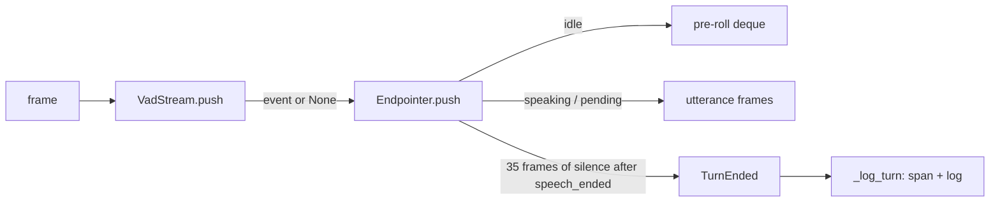

# Endpointing

## 1. What we built in this branch

Branch `feat/endpointing`. VAD (day 8) says "speech is happening" or "speech
stopped". It fires `speech_ended` at every comma and every "umm". This branch adds
the layer above it: it decides when the user has **finished their turn**. It
emits one `turn_ended` event per turn. That event carries the turn's first and last
frame, its length, and its audio, including 300 ms of **pre-roll** from before speech was
detected. Tomorrow's speech recognition will need exactly that audio. The gateway now
logs each turn and stamps a `turn_ended` span. It also fixes `fake_client.py`, which had
been committed with unresolved stash conflict markers.

**The headline number:** from the user's last audible word to `turn_ended` takes
**980 ms (p50 and p95)**. That is **98% of our 1,000 ms budget**, spent before
recognition, the LLM or speech synthesis have even started (section 5).

## 2. What we used to build it

**Endpointing (the technique)**
- *What it is:* deciding that a speaker has finished their turn, so the system may reply.
- *What it does for us:* turns a stream of `speech_started` / `speech_ended`
  events into one `turn_ended`.
- *Why:* without it the agent would either reply at every pause (interrupting you
  mid-sentence) or never know when to reply at all.

**A silence timer counted in frames**
- *What it is:* "wait 700 ms" implemented as "wait 35 more frames", because a frame
  arrives every 20 ms.
- *What it does for us:* this is the end-of-turn window.
- *Why:* no timers, no background task and no clock, so it is exact and easy to test
  (section 3 has the downside).

**`collections.deque(maxlen=N)`**
- *What it is:* a Python list-like container. When it is full, appending an item
  silently drops the oldest one.
- *What it does for us:* holds the pre-roll, which is always just the last 15 frames (300 ms).
- *Why:* it gives a rolling window in one line, with no manual trimming. Dropping from
  the front is O(1) (constant time) for a deque, unlike a list.

**`dataclass(frozen=True)`** makes `TurnEnded` read-only, because a finished turn is
a fact. **`math.ceil`** rounds millisecond settings *up* to whole frames, so a window
is never shorter than configured. **`Hysteresis`** (from `vad.py`) is reused in the
tests to produce realistic events. **Windows System.Speech** generated 12
measurement sentences (not committed).

## 3. Alternatives we rejected

| Decision | What we chose | Alternatives | Why not them | What we gave up |
|---|---|---|---|---|
| End-of-turn rule | Fixed 700 ms silence after `speech_ended` | **Reuse VAD's 200 ms**; **semantic endpointing** (a model that reads the words) | 200 ms ends the turn at every comma. Semantic needs a transcript first, which we don't have until day 10, and usually a network call, which is banned in the endpointing hot path | ~700 ms of dead air on every turn, and it still fails in the two ways in section 5 |
| Where the 700 ms starts | At `speech_ended` (the brief's rule) | At the first silent frame, i.e. back-dated by VAD's 200 ms | Aryan chose to follow the brief and measure first | About 200 ms: total silence is ~900 ms, not 700 |
| Clock | Count frames | A wall-clock `asyncio` timer | A timer needs a background task, has to be cancelled when speech resumes, and makes tests timing-dependent | If frames stop arriving (mic muted, network stall), the turn never ends |
| Short-sound filter | `min_utterance_ms` on the span `speech_started`..`speech_ended` | Measure the real speech length by subtracting VAD's lag | Simpler, and matches the brief's "start and end frame" | The span reads 140 ms longer than the real speech, so the cut-off is really ~160 ms of speech |
| Memory bound | Cap at 30 s; force a turn end | Unbounded list; drop the oldest audio | Unbounded: a stuck VAD (a TV left on) grows memory forever. Dropping old audio silently loses the start of what was said | A 31-second monologue is split into two turns |
| Cap while silent | Checked only while speaking | Checked on every frame | A test caught it: an utterance just under the cap was marked "forced" a few frames into its silence window, because the window's frames were counted too | Worst-case memory is pre-roll + 30 s + the 700 ms window (1,550 frames, ~970 KiB), not exactly 30 s |
| Where the audio lives | Inside `Endpointer` (`UtteranceBuffer`) | A separate buffer module fed by the gateway | The endpointer already knows when each utterance opens, resumes and closes | `endpoint.py` does two jobs (232 lines, still under ~300) |

## 4. Where things live

| What | File | Function or class |
|---|---|---|
| Config values | `backend/config.toml` `[endpoint]` | read into `EndpointSettings`, `backend/vaani/config.py` |
| Turn decision (3 states) | `backend/vaani/endpoint.py` | `Endpointer.push` |
| Pre-roll and utterance audio | `backend/vaani/endpoint.py` | `UtteranceBuffer` |
| Too-short check, turn built | `backend/vaani/endpoint.py` | `Endpointer._finish` |
| Length cap | `backend/vaani/endpoint.py` | `Endpointer._force_while_speaking` |
| ms → frames | `backend/vaani/endpoint.py` | `ms_to_frames` |
| Endpointer created per session | `backend/vaani/gateway.py` | `session_endpoint`, on `session.start` |
| VAD → endpointer routing (week-3 barge-in seam) | `backend/vaani/gateway.py` | `session_endpoint`, binary path |
| Turn log line + span | `backend/vaani/gateway.py` | `_log_turn` |
| Span name | `backend/vaani/telemetry.py` | `TURN_ENDED` |
| Logs: short utterance ignored, forced end, discard at close | `backend/vaani/endpoint.py` | logger `vaani.endpoint` |
| Scripted test pattern | `backend/scripts/fake_client.py` | `turn_test_frames`, `--turn-test` |
| Latency measurement | `backend/scripts/measure_endpointing.py` | `measure` |
| Tests | `backend/tests/test_endpoint.py`, `test_endpoint_gateway.py` | — |

There is no database layer, no new error code and no protocol change: the browser is
not told about turns yet.

## 5. How it works



**VAD vs endpointing: two questions, two thresholds.** VAD's `end_frames` (200 ms)
answers "has sound stopped?". It must be short, because week-3 barge-in and
recognition need to react fast. Endpointing answers "is the person *done*?". People
pause 200–500 ms mid-sentence to breathe or think: our own test clip has a 350 ms
pause after "Hello". One threshold cannot serve both. Make it 700 ms and VAD becomes
too slow for barge-in. Make it 200 ms and every comma ends the turn.

**The three states.** They are held in two fields:

```python
# backend/vaani/endpoint.py — Endpointer.push
if self._start_frame is None:  # idle
    if event is not None and event.kind == SPEECH_STARTED:
        self._start_frame = i
        self._buffer.open(frame, with_preroll=True)
    else:
        self._buffer.add_idle(frame)
    return None

self._buffer.add(frame)
if event is not None and event.kind == SPEECH_ENDED:
    # Start the silence window. Not the end yet: the user may go on.
    self._ended_frame, self._ended_at = i, event.at
elif event is not None and event.kind == SPEECH_STARTED:
    # Speech resumed inside the window: cancel the pending end. The
    # pause frames are already in the buffer, so audio stays continuous.
    self._ended_frame = self._ended_at = None

if self._ended_frame is not None:
    if i - self._ended_frame >= self._silence_frames:
        return self._finish(self._ended_frame, forced=False)
elif self._buffer.speech_frames >= self._max_frames:
    return self._force_while_speaking(i)
```

*Idle* (`_start_frame is None`): frames only feed the pre-roll. *Speaking*: frames go
into the utterance. *Pending* (`_ended_frame` set): the silence window is running. A new
`speech_started` in that window clears `_ended_frame`, which puts us back to speaking,
and the pause frames stay in the buffer, so the audio has no gap. The turn ends at
`_ended_frame`, the last `speech_ended`. The 700 ms we waited through is not part of the
turn's audio.

**Why pre-roll.** VAD only believes speech after 4 speech frames in a row, so
`speech_started` fires on the 4th frame, 80 ms after the voice began. If the utterance
started there, the first 60–80 ms would be missing: the "h" of "hello", or all of a
short word like "a". Speech recognition would then hear "ello". So while idle we keep
the last 300 ms:

```python
# backend/vaani/endpoint.py — UtteranceBuffer.open
self._frames = list(self._preroll) if with_preroll else []
self._preroll_count = len(self._frames)
self._preroll.clear()
self._frames.append(first_frame)
```

300 ms, not 80 ms: it is safety margin for soft onsets (breathy "h", quiet "f") that
Silero only scores as speech once they get louder. The test
`test_utterance_audio_includes_the_preroll` checks the turn's audio starts 15 frames
before `speech_started`, before the real first speech frame.

When a turn closes, the silence frames we waited through refill the pre-roll
(`UtteranceBuffer.take`). So if the next utterance starts soon after, its pre-roll is
the latest audio, not stale audio from before the previous turn.

**Why the buffer is bounded.** Frames are stored while VAD says "speech". If VAD
never says "stopped" (a TV in the room, a stuck mic, a hostile client), an unbounded
list grows by 32 KB a second, forever, in every such session. At 30 s we force a turn
end and log a warning. If the user is *still* talking, the next frame opens a new
utterance straight away, with no pre-roll. The forced turn already holds that audio,
so adding pre-roll would duplicate it.

**Gateway.** The endpointer gets every frame, even silent ones, because the frame count
is its clock:

```python
# backend/vaani/gateway.py — session_endpoint
# Routing seam. No agent speech exists yet, so the user's
# audio always goes to the endpointer. Week 3: while the
# agent is speaking, route speech_event to barge-in here
# instead of endpointing.
if endpointer is not None:
    turn = endpointer.push(data, speech_event)
    if turn is not None:
        _log_turn(session, telemetry, turn)
```

A live log line: `turn_ended frames 34-525, 9840 ms, 507 frames buffered (waited 685 ms)`.
"Waited" is wall-clock time from `speech_ended` to `turn_ended`. It reads 685 ms, not
700, because the client's pacing wobbles by a few ms per frame.

### Measured

`scripts/measure_endpointing.py` ran 13 utterances: 12 different synthesised sentences
(including a one-word "Yes." and several questions) plus the fixture. Each ran through
the real VAD and endpointer. Ground truth is the last frame above −50 dBFS.

| | p50 | p95 |
|---|---|---|
| Last audible frame → `turn_ended` | **980 ms** | **980 ms** |
| of which VAD (→ `speech_ended`) | 280 ms | 280 ms |
| of which endpointer wait | 700 ms | 700 ms |
| `Endpointer.push` compute per frame | 0.4 µs | 0.9 µs |

**Endpointing costs 98% of the 1,000 ms budget.** At these settings, the target is
impossible for the pipeline as a whole. The VAD part is 200 ms of `end_frames` plus
60–80 ms while Silero's score fades after the last word. p50 = p95 because synthesised
speech ends cleanly and identically. Real speech will vary more, and background noise
could make VAD's part longer.

Live, before/after, via `fake_client --turn-test` (12 per-second lines each):

| | Endpointing off | on |
|---|---|---|
| Frames/s mean (min–max) | 50.1 (49–51) | 50.1 (49–51) |
| VAD p50 / p95 (median) | 1.29 / 1.79 ms | 1.19 / 1.73 ms |
| Echo p50 / p95 (median) | 0.49 / 0.86 ms | 0.48 / 0.81 ms |
| `turn_ended` count | 0 | **1** |

No regression. The differences are run-to-run noise.

**Why a fixed silence threshold is a weak rule.** It fails in both directions:
1. *It cuts off a thinking pause.* "My flight is on… [900 ms] …the fourteenth." A pause
   longer than ~900 ms ends the turn mid-sentence. The agent replies to half a request.
2. *It waits after an obvious question.* "What time is it?" is plainly finished at the
   question mark, but we still sit through 980 ms of silence before doing anything.

**Semantic endpointing** would fix both. A small model reads the words so far (or
hears the falling intonation) and judges "finished or not". It can end in ~200 ms after
"What time is it?" and wait 2 s after "My flight is on…". It is in Future Scope because
it needs a live transcript (day 10+), usually a model call, and no network call is
allowed in the endpointing hot path. A local model would need its own CPU
budget and measurement.

## 6. When things go wrong

| What fails | What the code does | What the user sees |
|---|---|---|
| User pauses longer than ~900 ms mid-thought | Turn ends early (fixed-threshold weakness) | Once replies exist: agent answers half a sentence |
| Cough or "mm" | Span < 300 ms → no turn, logged "ignored (min_utterance_ms)" | Nothing |
| VAD stuck in "speech" (TV, stuck mic) | Forced turn end every 30 s, warning logged | A turn every 30 s containing the TV |
| Client stops sending frames mid-window | Frame clock stops; turn never ends | Silence until frames resume |
| Session ends mid-utterance | `Endpointer.close` logs the discard | Nothing; that audio is dropped |
| `[vad].enabled = false` | Endpointer never created (it needs VAD events) | No turns |
| `[endpoint].enabled = false` | Endpointer never created; VAD and echo unchanged | No turns |

## 7. New terms

**Dead air**: silence the user hears while waiting for the agent. Every millisecond of
it counts against the 1,000 ms budget.
**`deque(maxlen=N)`**: a double-ended queue. Once full, it drops the oldest item on each append.
**dBFS**: decibels relative to full scale. 0 is the loudest a 16-bit sample can be.
−50 is very quiet. Used only to find the "last audible frame" in the measurement.
**Endpointing**: deciding the user has finished their turn.
**Forced turn end**: ending a turn because it hit `max_utterance_ms`, not because of silence.
**Pending (end)**: the state after `speech_ended` while the silence window runs; it can still be cancelled.
**Pre-roll**: audio kept from *before* speech was detected, glued to the front of the utterance.
**Semantic endpointing**: judging the end of a turn from the words or intonation, not just silence.
**Silence window**: the `end_of_turn_silence_ms` (35 frames) waited after `speech_ended`.
**Turn**: one person's complete contribution before the other replies.
**Utterance**: the stretch of audio from the start of speech to the end of the turn. Here, one utterance = one turn.

## 8. Questions you could be asked

1. **Where is the code that decides the turn is over?** `Endpointer.push` in
   `backend/vaani/endpoint.py`: `i - self._ended_frame >= self._silence_frames`.
2. **Where is the pre-roll kept?** `UtteranceBuffer._preroll`, a `deque(maxlen=15)`,
   filled by `add_idle` and moved into the utterance by `open`.
3. **What happens if the user pauses 400 ms mid-sentence?** VAD fires `speech_ended`
   after 200 ms. The endpointer starts its 35-frame window. Speech resumes, VAD fires
   `speech_started`, the window is cancelled, and the same utterance continues. The test
   is `test_speech_resuming_in_the_window_cancels_the_pending_end`. The live check is `--turn-test`.
4. **What happens if someone talks for two minutes?** Every 30 s a forced turn ends
   with a warning. The next frame starts a new utterance, so nothing is lost and memory stays under ~1 MB.
5. **What happens if the mic is muted mid-window?** No frames arrive, so the frame clock
   stops and the turn never ends. This is the known cost of counting frames instead of time.
6. **Why not just set VAD's `end_frames` to 45 and skip this module?** Barge-in
   (week 3) needs to know quickly that the user stopped or started. Both questions need
   their own threshold.
7. **Why not use semantic endpointing now?** It needs a transcript, which we don't have
   yet, and usually a model call, and the hot path may not make network calls. Section 5.
8. **What does "p95 980 ms" mean here?** In 95% of the 13 utterances, `turn_ended`
   came at most 980 ms after the last audible frame.
9. **Is `min_utterance_ms = 300` really 300 ms of speech?** No. It is measured from
   `speech_started` (3 frames late) to `speech_ended` (10 frames late), which adds 140 ms.
   About 160 ms of real speech passes. See `test_min_utterance_boundary_counts_the_vad_confirmation_lag`.
10. **Why does a forced turn not get pre-roll on the next utterance?** The forced turn
    already contains that audio. Adding it again would repeat it.
11. **Hardest: we are at 980 ms before anything else runs. What now?** Options, each with a cost:
    count the 700 ms from silence onset (−200 ms); lower it to ~400–500 ms (−200–300 ms,
    but more mid-sentence cut-offs); start recognition and the LLM *speculatively* at
    `speech_ended` and throw the work away if speech resumes (hides most of the wait,
    but costs money and complexity); semantic endpointing later. It needs a decision, with measurements.

## 9. Check yourself

1. Name the three endpointer states, and which event moves between each pair.
2. Why does the turn's audio start 15 frames before `speech_started`, and what would
   recognition hear without that?
3. Split the 980 ms into its parts, and say which config value controls each.
