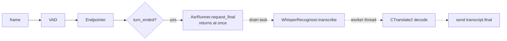

# Speech recognition (ASR)

## 1. What we built in this branch

Branch `feat/asr1`. Endpointing (day 9) hands us one finished utterance of audio, with
300 ms of pre-roll. This branch turns that audio into text and sends the browser a
`transcript.final` message (shared protocol v0.3). It can also send
`transcript.partial` while the user is still talking, but that is **off by default**,
because the measurements say it costs too much (section 5). Recognition runs on a
**worker thread**, so the server keeps taking in audio at 50 frames per second while a
transcript is being computed. We proved that with the real engine: **49.8 frames/s during a
1.25 s decode**. A turn is now one user utterance, with a `turn_id` created when speech starts.

**Known limitation: the committed default cannot do Hinglish.** `cpu/small` runs on
any laptop and in CI, but it turns Hinglish into garbage (`docs/spikes/asr-hinglish.md`).
Hinglish works only with `large-v3` on a GPU (Aryan's machine overrides the
config) or, later, a hosted recogniser. **Our headline feature currently requires
either a GPU or a hosted recogniser.**

## 2. What we used to build it

**Whisper (the weights)**
- *What it is:* OpenAI's speech recognition model. It is a trained neural network: a file of
  numbers (the "weights") that were learned from a very large amount of audio paired with its text.
- *What it does for us:* it knows how to turn sound into words, in ~100 languages.
- *Why:* it is the only free model we tried that writes Hinglish in mixed script (`large-v3`).

**CTranslate2 (the engine)**
- *What it is:* a C++ library that runs Transformer models (Whisper is one) fast on CPU or GPU.
- *What it does for us:* it does the actual maths of a decode. It also releases the GIL
  while it computes, which is the whole reason our threading works (section 5).
- *Why:* it is several times faster than running the original PyTorch Whisper, and needs no PyTorch.

**int8 quantisation (the number format)**
- *What it is:* storing each weight as an 8-bit integer plus a shared scale factor,
  instead of a 32-bit float. That is 4× less memory and faster on CPUs, which have fast int8 instructions.
- *What it does for us:* `compute_type = "int8"` makes `small` usable on a CPU. On the GPU
  we use `float16` instead (GPUs are built for it).
- *Why:* the accuracy cost is small next to the speed gain. Choosing `small` over `large-v3` costs far more accuracy than quantisation does.

**faster-whisper** joins the three: it loads Whisper weights converted for CTranslate2,
turns audio into the 30-second spectrogram windows Whisper needs, and runs the decode.
It has a built-in Silero VAD (`vad_filter`) that cuts silence out before decoding.

**`ThreadPoolExecutor`**: a fixed set of worker threads that run functions handed to
them. Ours is sized by `[asr].max_concurrent` (2). **`loop.run_in_executor`** runs a
blocking function on that pool and gives the event loop an awaitable for its result.

**`threading.Event` vs `asyncio.Event`**: both are flags that can be set and waited on.
The asyncio one is the cancellation token callers pass in (as for the LLM providers in
06-cancel-failover.md), but only the event loop's thread may touch it. The worker thread
reads a separate `threading.Event`, which is safe across threads.

**`asyncio.wait(..., timeout=)`**: waits for tasks, but **does not cancel them** when time
runs out. That is unlike `asyncio.timeout`, and it is exactly what our timeout needs (section 5).

**`functools.lru_cache`** builds the recogniser once per process. **`pytest.mark.slow`**
labels tests that need the real model; `addopts = "-m 'not slow'"` skips them by default.
**GitHub Actions `actions/cache`** keeps the downloaded model between slow-test runs.

## 3. Alternatives we rejected

| Decision | What we chose | Alternatives | Why not them | What we gave up |
|---|---|---|---|---|
| Model | `small` committed; `large-v3` by override | `large-v3` as default | It needs a GPU (≈3 GB of weights; too slow on CPU). Samyak and CI have no GPU | The default cannot do Hinglish |
| Language | Forced `hi` + romanized `initial_prompt` | Auto-detect; forced `en` | Auto returned `hi`, `ur` and `la` for one speaker. `en` **translates** | Hindi is assumed even for English speakers (works on whole utterances; breaks on cut-off audio, section 5) |
| Retries | `temperature = [0.0]`, one decode | Default `[0.0, 0.2 … 1.0]` | Up to 6 decodes. One clip took 62.5 s | A bad decode is not retried |
| Where inference runs | Our own thread pool | Inline on the event loop; `asyncio.to_thread`; a separate process | Inline freezes ingest for 1+ s (the test reads 0 frames/s). `to_thread` uses asyncio's shared default pool, whose size is not ours to set. A process means copying the model and audio across | Threads share one interpreter, so this works only because CTranslate2 releases the GIL |
| Overlapping requests | One job per session; finals queue; one waiting partial, latest wins | Queue everything; run all in parallel | A queue of stale partials delays the final. Parallel decodes let one session hog the pool | A partial can be skipped |
| Partials | Off (`partial_interval_ms = 0`) | On at 500/1000/1500 ms | Measured: a re-decode costs ~1.2 s even for 1 s of audio, on CPU (section 5) | No live text while speaking |
| Timeout | Report at `timeout_s`, keep the thread slot until the decode really ends | Cancel with `asyncio.timeout` | Cancelling would free the slot while the thread still works, so the next job would take a second thread | A session waits for its stuck decode before starting the next |
| Turn id | Created at `speech_started`, one per utterance | Keep echo's one-turn-per-session; create at `turn_ended` | Two "turn" ideas would drift apart. Created at the end, partials would have no id | Echo now only echoes speech, and its tests needed a fake VAD |
| GPU libraries | Optional `gpu` extra | Main dependencies | ~600 MB that CI and Samyak cannot use | A plain `uv sync` removes them; GPU machines must pass `--extra gpu` |

## 4. Where things live

| What | File | Function or class |
|---|---|---|
| Config values | `backend/config.toml` `[asr]`, `[asr.whisper]` | read into `AsrSettings`, `WhisperSettings` (`vaani/config.py`) |
| Recogniser interface | `vaani/asr/base.py` | `Recognizer.transcribe`, `Transcript`, `AsrError` |
| Picking the implementation (`engine`) | `vaani/asr/__init__.py` | `build_recognizer` |
| Model load, warm-up, CUDA check, Windows DLL path | `vaani/asr/whisper.py` | `WhisperRecognizer.__init__`, `_warm_up`, `_add_windows_cuda_dll_dirs` |
| `task="transcribe"`, `vad_filter=True` | `vaani/asr/whisper.py` | constants `TASK`, `VAD_FILTER`, used in `_decode` |
| The decode on a worker thread | `vaani/asr/whisper.py` | `_decode` (thread), `transcribe` (event loop) |
| One-job-at-a-time, partial dropping, timeout, abandon | `vaani/asr/runner.py` | `AsrRunner` |
| Abandoned results never sent | `vaani/asr/runner.py` | `_emit`, first lines |
| Turn open/close, partial schedule, echo | `vaani/turns.py` | `TurnPipeline.on_frame`, `_end_turn`, `_maybe_request_partial` |
| Turn state | `vaani/session.py` | `Session.open_turn`, `close_turn`, `turn_open` |
| Message shapes | `vaani/protocol.py` | `TranscriptPartial`, `TranscriptFinal`, `ErrorCode.ASR_FAILED` |
| Model loaded at startup | `vaani/app.py` | `create_app` → `app.state.recognizer` |
| Spans | `vaani/telemetry.py` | `ASR_START`, `ASR_PARTIAL`, `ASR_FINAL` |
| Logs | logger `vaani.asr` (finals, failures, discards), `vaani.turns` (turns) | — |
| Measurement | `scripts/measure_asr.py` | `main` |
| Tests | `tests/test_asr_runner.py`, `test_asr_gateway.py`, `test_asr_whisper.py`, `fake_asr.py` | — |

No database layer. Errors are raised in `whisper.py` (`AsrError`) and turned into an
`ASR_FAILED` message in `runner.py` (`_fail`).

## 5. How it works



**1. The frame loop only *asks*.** `vaani/turns.py`, `TurnPipeline.on_frame`:

```python
            was_open = self._endpointer.utterance_open
            turn = self._endpointer.push(data, speech_event)
            if turn is not None:
                await self._end_turn(turn)
            elif was_open and not self._endpointer.utterance_open:
                await self._discard_turn()  # shorter than min_utterance_ms
            # Opens on speech_started, and again straight after a forced end
            # (max_utterance_ms), where the next utterance follows at once.
            if self._endpointer.utterance_open and not self._session.turn_open:
                await self._open_turn()
```

The turn opens when the endpointer opens an utterance, so the `turn_id` exists before the
first partial. `_end_turn` calls `self._asr.request_final(...)`. That method is plain `def`, not
`async`: it adds the job to a queue, starts the runner's background task if it is idle, and returns.

**2. Off the event loop, and why that really is parallel.** `vaani/asr/whisper.py`:

```python
        work = loop.run_in_executor(self._pool, self._decode, audio, stop)
        cancelled = asyncio.ensure_future(cancel.wait())
        try:
            await asyncio.wait({work, cancelled}, return_when=asyncio.FIRST_COMPLETED)
```

The event loop is one thread doing everything for every session. Python has the **GIL**:
only one thread at a time may run Python code. So a thread usually just *takes turns* with
the loop. But CTranslate2 is C++, and it **releases the GIL** while it computes. During the
decode the worker needs no Python at all, and the loop thread runs freely. Measured with the
real engine in `test_frames_keep_flowing_during_real_inference`: **49.8 frames/s** (cpu/small,
1.25 s decode) and **49.2** (cuda/large-v3), with the longest gap between frames 21 ms. A decode
written in pure Python would hold the GIL and freeze ingest despite the thread. The same test
with the decode moved inline reads **0.0 frames/s**.

**3. Abandon and timeout.** A decode cannot be interrupted once CTranslate2 is inside it.
faster-whisper yields one segment per 30 s window, and `_decode` checks `stop` between
segments. So "abandon" means: **discard the result, and let the thread finish**. `vaani/asr/runner.py`:

```python
            await asyncio.wait({inner}, timeout=self._timeout_s)
            if not inner.done():
                await self._fail(job, f"timed out after {self._timeout_s:.1f} s")
                self._abandon(job)
                await asyncio.wait({inner})
                return
```

The user hears about the failure at `timeout_s` (5 s). But the session keeps its one slot
until the thread is truly free, so **a session never holds more than one pool thread**. Rapid
abandoned turns from one user cannot starve other sessions
(`test_abandoning_many_inferences_does_not_starve_other_sessions`). This is less severe than it
sounds. Barge-in happens while the agent is *speaking*, and by then ASR has already finished.
The real exposure is a user starting a new turn before their previous transcript lands.

`_emit` checks `job.abandoned` **directly before** the send, with no `await` in between, so
a flush or disconnect handled earlier always wins. A flushed turn gets no final at all.

**4. Why Whisper is not a streaming model, and what partials cost.** Whisper was trained on
fixed 30 s windows. Every decode pads the audio to 30 s and runs the whole encoder over it, then
writes the text from scratch. It keeps no state between calls, so there is no "add the next
200 ms" operation. A partial is just a full decode of the audio so far, and the same audio is
decoded again and again. Measured (`scripts/measure_asr.py`, preliminary clips, see below):

| Audio decoded | cpu/small | cuda/large-v3 |
|---|---|---|
| 1.0 s prefix | 1215 ms | 1384 ms |
| 3.0 s prefix | 1263 ms | 1100 ms |
| full 5.9 s clip, final | ~1330 ms | ~580 ms |
| Partials every 1000 ms, total work per 5.9 s utterance | 7.5 s | 7.5 s |

On CPU, 1 s of audio costs as much as 3 s: the fixed 30 s window dominates. Each re-decode
takes longer than the interval between them, so the partials fall behind the speaker. A partial
still running when the turn ends **delays the final** by up to a whole decode. On GPU a worse problem
appeared: cut off mid-word, forced `hi` writes English in Devanagari and loops ("कर दो कर दो
…"), which is also why those decodes were *slower* than the final (spike doc, section 4b). So
partials stay off. They can be turned on with `partial_interval_ms`.

**5. Why `language="en"` translates.** Whisper's decoder is told, with special tokens at the
start of its output, which language to *write* and which task to do. Given Hindi audio and told to
write English, the closest thing it learned is translation, so it outputs the meaning in
English and the spoken words are lost. Forced `hi` asks for Hindi text, and the romanized
prompt nudges English words to stay in Latin script.

**6. Why auto-detection said Urdu.** Hindi and Urdu are, in everyday speech, one language
(often called Hindustani), written in two scripts: Hindi in Devanagari, Urdu in Perso-Arabic.
Detection listens only to the *audio* of the first window, and the audio does not carry the
script. So "ur" is a reasonable guess for spoken Hindi, and the text then comes out in Urdu
script. The content was right; only the script was wrong. (Why it once said `la` for English, we do not know.)

**7. Why mixed-script text does not trouble speech synthesis.** The transcript goes to the
*language model*, which reads Devanagari, Latin and mixed text fine. What gets *spoken* is the
model's **reply**, and we control its script with the persona prompt. Piper never sees the transcript.

**Measured:** `turn_ended → transcript.final`, 12 runs (4 clips × 3, preliminary: 1 human + 3
TTS; Aryan's 10 Hinglish recordings are pending): **cuda/large-v3 p50 577 / p95 635 ms;
cpu/small p50 1330 / p95 1391 ms.** End-to-end via `fake_client`: 1278 and 1314 ms
(cpu/small), with the per-second frame log at 49–51 throughout. **Budget:** endpointing 980 ms + ASR
577 ms = 1,557 ms before the LLM sees a word. That is already over the 1,000 ms target, with
**−557 ms left**. See `docs/findings/perf-1-latency-budget.md`. That needs a decision.

## 6. When things go wrong

| What fails | What the code does | What the user sees |
|---|---|---|
| `device="cuda"` but no GPU | `AsrError` at startup, "refusing to fall back to CPU" | Server does not start |
| GPU libs missing on Windows | `AsrError`: run `uv sync --extra gpu` | Server does not start |
| Bad model name | faster-whisper raises in `create_app` | Server does not start |
| Decode raises | `AsrError` → `ASR_FAILED` error message (finals only) | Error, no transcript |
| Decode hangs / loops | `ASR_FAILED` at 5 s; thread finishes later, result discarded | Error at 5 s |
| Flush or disconnect mid-decode | Result discarded, never sent | Nothing |
| Silence reaches Whisper | `vad_filter` removes it; empty text | Empty final |
| Forced `hi`, cut-off audio | Devanagari English, repetition loop | Wrong partial (partials are off) |

## 7. New terms

**Beam search / `beam_size`:** decoding keeps the 5 best partial sentences at each step
instead of only one; slower, slightly more accurate. **CTranslate2:** C++ engine running
Whisper (section 2). **Code-switching:** changing language mid-sentence; for Hinglish we want Devanagari for
Hindi words and Latin for English ones. **Encoder / decoder:** Whisper's two halves; the encoder turns 30 s of
sound into a summary, the decoder writes text from it one token at a time. **GIL (Global Interpreter Lock):**
CPython's lock that lets only one thread run Python code at a time; C code may release it.
**Hallucination:** the model writing words that were never said, typically into silence.
**Hindustani:** the shared spoken base of Hindi and Urdu. **`initial_prompt`:** text given to the decoder
as if it came just before the audio; it steers style and script. **int8 / float16:** 8-bit integer
and 16-bit float number formats for weights. **Partial transcript:** a provisional transcript of an
utterance still in progress. **Quantisation:** storing weights in a smaller number format. **Re-decode:**
decoding the same, longer audio again for a new partial. **Temperature fallback:** retrying a
bad decode with more randomness. **Thread pool:** fixed worker threads reused for many jobs.
**Warm-up:** one throwaway decode at startup so the first user turn is not slow. **Weights:** the
learned numbers that make up a model.

## 8. Questions you could be asked

1. **Where is the code that stops an abandoned transcript being sent?** `AsrRunner._emit` in
   `vaani/asr/runner.py`: `job.abandoned` is checked immediately before `send`, with no `await` in between.
2. **Where is `task="transcribe"` set, and why is it not config?** `TASK` in `vaani/asr/whisper.py`.
   "translate" is never valid, and the failure would be silent. `test_task_is_transcribe_and_language_comes_from_config` asserts it.
3. **What happens if the user disconnects mid-decode?** `pipeline.close()` → `AsrRunner.close()`
   cancels the drain task. The thread finishes on its own and its result is never read.
4. **What happens if the GPU is missing?** Startup fails with `AsrError`. It never silently uses
   the CPU, because a GPU benchmark would secretly become a CPU benchmark.
5. **Why not `asyncio.to_thread`?** It uses asyncio's shared default pool. Ours is sized by config
   and used only by ASR.
6. **Why does a thread help at all, given the GIL?** CTranslate2 releases the GIL while it computes.
   Proven by 49.8 frames/s during a real decode.
7. **What does int8 mean?** Weights stored as 8-bit integers with a scale: 4× smaller and faster on CPU.
8. **Why is Whisper not streaming?** It was trained on, and always processes, whole 30 s windows,
   with no state between calls. A partial is a full re-decode.
9. **Why did it say Urdu for Hindi?** One spoken language, two scripts; detection hears no script.
10. **Hardest: we are at 1,557 ms before the LLM. What now?** Either lower endpointing (no
    threshold alone gets under 1,000 ms; it cuts more people off) or revise PERF-1 with this
    evidence. Speculative decoding at `speech_ended` could hide the 577 ms inside the 700 ms
    wait. This is the mentor's decision (findings doc).

## 9. Check yourself

1. Name the three stacked layers (weights, engine, number format) and what each contributes.
2. Explain why a 5 s timeout does not free the worker thread, and why we want that.
3. Why can mixed Devanagari/Latin ASR output not reach the speaker's voice?
