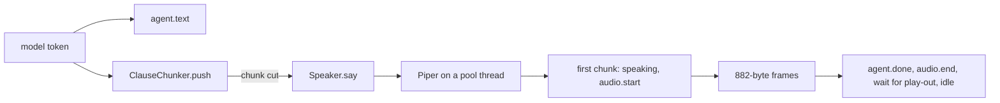

# Clause chunking and speech synthesis: the agent speaks

## 1. What we built in this branch

Branch `feat/tts`. Until day 11 the agent's reply was text only. Now the reply is cut
into **chunks** while the model is still streaming, each chunk is turned into speech by
**Piper** on the CPU, and the audio goes to the browser over the route the day-3 echo
built: `audio.start` → binary frames → `audio.end` (shared protocol v0.5). `audio.start`
now carries a `sample_rate`. The turn state `speaking` now means "audio is playing", not
"text is streaming". Echo is off by default.

**Two blocking issues (section 6).** The agent's real replies (all-Latin Hinglish) are
**unintelligible** through this Hindi voice. And the browser ignores `sample_rate`: it
plays the 22050 Hz voice as 16000 Hz, slower, lower, and about 38% longer.

## 2. What we used to build it

**Piper** (`piper-tts` 1.8.0, GPL-3.0). A local text-to-speech engine. It does two
steps: **espeak-ng** turns letters into **phonemes** (the sounds), then a **VITS**
neural network turns phonemes into audio samples, run by **ONNX Runtime** on the CPU.
*Here:* `PiperSynthesizer` in `vaani/tts/piper.py`. *Why:* no GPU, no network call, no
per-request cost, and tens of milliseconds per short chunk (section 5).

**The voice, `hi_IN-priyamvada-medium`.** One Hindi speaker. Its `.onnx` file is 63.5 MB,
so it is **not committed**; `scripts/fetch_models.py` downloads it from a URL pinned to
one repository revision and checks its **sha256** (a fingerprint of the bytes: change
one byte and it changes), checked again when the voice loads, so a truncated or swapped
voice fails at startup. Its `.onnx.json` (committed) says it outputs **22050 Hz**.

**PCM and sample rate.** PCM is audio as a plain list of numbers (16-bit integers here),
one per instant. The sample rate is how many numbers make one second. Play 22050 numbers
as if they were 16000-per-second and one second of speech lasts 1.38 s.

**Worker thread pool (`ThreadPoolExecutor`).** Synthesis takes tens to hundreds of ms;
the event loop must handle a mic frame every 20 ms. So synthesis runs on one of the
pool's threads, as Whisper does (10-asr.md). ONNX Runtime releases Python's **GIL**
while it computes, so the loop keeps running meanwhile.

**`threading.Event` vs `asyncio.Event`.** Both are flags one side sets and the other
checks. The asyncio one is the reply's cancellation token (06-cancel-failover.md) and is
only safe on the event loop's thread. The worker thread needs its own flag, so
`synthesize` creates a `threading.Event` and sets it when the token fires.

**Lock (`threading.Lock`).** Lets only one thread at a time run a piece of code. Piper
holds one around espeak-ng (section 3, `max_concurrent`).

**Regex lookahead `(?=\s)`.** "Only match if whitespace comes next", without consuming
it. The chunker uses it so `3.5` is not a sentence end: the `.` is followed by `5`.

**Smaller tools.** `functools.lru_cache` remembers a function's result, so the voice loads
once per process (tests build many apps). `httpx.stream` downloads 63.5 MB piece by
piece, not into memory. `actions/cache` keeps the voice between CI runs.

## 3. Alternatives we rejected

| Decision | What we chose | Alternatives | Why not them | What we gave up |
|---|---|---|---|---|
| Synthesiser | Piper, local CPU | XTTS (cloning model); hosted (Sarvam Bulbul, ElevenLabs) | XTTS is a larger model meant for cloning in the studio; its CPU speed on the reply path was not measured. Hosted adds a network round trip and a per-call cost to every chunk | Voice quality, and Hinglish handling (section 6) |
| When to speak | Chunk while the model streams | Wait for the whole reply | The whole reply arrives seconds after the first token. Waiting adds all of that to the time the user hears nothing | Chunk joins can be audible (prosody) |
| How to cut | By text: sentence, clause, conjunction, space | By time ("no token for 300 ms → cut"); fixed character count | A model pauses mid-sentence for its own reasons; a timer would cut "Main aapko" off. Fixed counts cut mid-word | A slow model's first chunk waits for text |
| First chunk vs later | First chunk cut at the earliest boundary ≥ 8 chars; later ones wait for a sentence end | Same rule for all chunks | Only the first chunk is waited for; later chunks synthesise while earlier audio plays (RTF ~0.03, section 5) | The first clause is synthesised alone; its effect on intonation is untested (section 5) |
| `ki` as a conjunction | Excluded | Include it | In Hinglish it is mostly possessive ("Ram ki kitaab"); cutting there splits a noun phrase (`test_ki_is_not_a_conjunction`) | Misses the rare "that"-meaning `ki` |
| Output rate | Send 22050 Hz, declare it in `audio.start` | Resample to 16000 Hz on the server | Resampling well needs a filter: a new library or hand-written DSP, run on every chunk. Declaring the rate needs one field. (The branch does not record any other reason) | The browser must read the rate. It does not yet: the blocking bug |
| When `speaking` starts | On the first audio frame sent | On the first `agent.text` | The state should mean "the user can hear the agent" | Text now arrives while still `thinking` |
| When `speaking` ends | At the estimated end of play-out | At the last frame sent | Frames go out seconds ahead of the speaker; idle at the last send would be wrong by seconds | The estimate assumes the browser plays at the declared rate (section 6) |
| Synthesis concurrency | `max_concurrent = 2` | 1 | Shown safe in the installed source (below) | Two syntheses share the CPU |
| Where synthesis runs | Inside the token loop: `await speaker.say(piece)` | A separate task fed by a queue | One task, one cancel path, no queue to drain. The unread tokens wait in the HTTP stream | The model stream is not read while a chunk synthesises |
| Voice file | Fetched + hash-checked | Commit it | 63.5 MB in git history forever | One extra setup step (`fetch_models.py`) |

**`max_concurrent = 2`, the evidence.** In the installed package,
`backend/.venv/Lib/site-packages/piper/voice.py` (piper-tts 1.8.0):

```python
_ESPEAK_PHONEMIZER_LOCK = threading.Lock()                      # line 24
...
            with _ESPEAK_PHONEMIZER_LOCK:                       # line 293
                if _ESPEAK_PHONEMIZER is None:
                    _ESPEAK_PHONEMIZER = EspeakPhonemizer(self.espeak_data_dir)
                text_part_phonemes = _ESPEAK_PHONEMIZER.phonemize(
```

So the shared espeak-ng phonemiser is used by one thread at a time. The network itself
runs at `self.session.run(` (line 547), **not** under a lock. ONNX Runtime's documentation
says one session may be run from several threads at once; we have not checked that in
ONNX Runtime's own source.

## 4. Where things live

| What | File | Function or class |
|---|---|---|
| Synthesiser interface, `TtsError` | `backend/vaani/tts/base.py` | `Synthesizer`, `TtsError` |
| Engine chosen from config, built once | `backend/vaani/tts/__init__.py` | `build_synthesizer`, `_build` |
| Piper: hash check, load, warm-up, thread pool | `backend/vaani/tts/piper.py` | `PiperSynthesizer` |
| Cutting the reply into chunks | `backend/vaani/chunker.py` | `ClauseChunker.push`, `.flush`, `._find_cut` |
| Feeding tokens to chunker and speaker | `backend/vaani/reply.py` | `Responder._answer` |
| `audio.start` / frames / `audio.end`, `speaking`, play-out wait | `backend/vaani/speaker.py` | `Speaker.say`, `.finish`, `._start` |
| `audio.flush` on a reply cancel | `backend/vaani/turns.py` | `TurnPipeline._cancel_reply` |
| Legal state moves (moved out of turns.py) | `backend/vaani/turn_state.py` | `_LEGAL`, `TurnStateMachine.move_to` |
| Echo (moved out of turns.py) | `backend/vaani/echo.py` | `Echo` |
| Wire format: `sample_rate`, `TTS_FAILED` | `backend/vaani/protocol.py` | `AudioStart`, `ErrorCode` |
| Config read | `backend/vaani/config.py`, `backend/config.toml` | `TtsSettings`, `PiperSettings`, `ChunkerSettings` |
| Voice loaded at startup | `backend/vaani/app.py` | `create_app` |
| `tts_first_audio` span and log line | `backend/vaani/speaker.py` | `Speaker._first_audio` |
| Voice download | `backend/scripts/fetch_models.py`; CI in `.github/workflows/ci.yml` | `main` |
| Measurements | `backend/scripts/measure_tts.py`, `measure_turn.py`, `hinglish_tts.py`; output in `docs/findings/tts-day12/` | |
| Tests | `tests/test_chunker.py`, `test_tts_piper.py`, `test_turn_tts.py`; fake in `tests/fake_tts.py` | |
| Database | None in this change | |

## 5. How it works



**Tokens in, chunks out.** `backend/vaani/reply.py`:

```python
                    await self._send(agent_text(turn_id, chunk.text))
                    if speaker is not None:
                        for piece in chunker.push(chunk.text):
                            await speaker.say(piece)
            if speaker is not None and (last := chunker.flush()):
                await speaker.say(last)
```

Every token is shown as text at once. The chunker returns zero or more finished chunks;
each is spoken before the next token is read. `flush()` hands over whatever is left.

**The first-chunk rule.** `backend/vaani/chunker.py`:

```python
        if self._first:
            ends = [e for kind in self._boundaries(buf) for e in kind]
            early_enough = [e for e in ends if e >= cfg.first_min_chars]
            if early_enough:
                return min(early_enough)
            return self._last_space(cfg.first_max_chars)
        sentences, _, _ = self._boundaries(buf)
        if sentences:
            return sentences[0]
```

For the first chunk any boundary counts (sentence, comma, conjunction), the earliest one
at least `first_min_chars` (8) in. "Theek hai, main kal…" is cut after "Theek hai,".
Later chunks only accept a sentence end; past `max_chars` (200) they fall back to the
last clause break, conjunction, then space.

**Synthesis off the loop, with a cancel.** `backend/vaani/tts/piper.py`:

```python
        stop = threading.Event()
        loop = asyncio.get_running_loop()
        work = loop.run_in_executor(self._pool, self._run, text, stop)
        cancelled = asyncio.ensure_future(cancel.wait())
        try:
            await asyncio.wait({work, cancelled}, return_when=asyncio.FIRST_COMPLETED)
            if cancel.is_set():
                stop.set()
                await asyncio.wait({work})
                return None
```

Two things are raced: the synthesis and the token. If the token wins, `stop` tells the
thread to quit at its next sentence, and we wait for it so the pool slot is free before
returning. Piper cannot stop **inside** a sentence: a cancelled chunk runs to its end and
its audio is thrown away.

**Sending, with the gate.** `backend/vaani/speaker.py`:

```python
        for i in range(0, len(pcm), self._frame_bytes):
            # The gate: no await between this check and the send.
            if self._cancel.is_set():
                return
            await self._send_bytes(pcm[i : i + self._frame_bytes])
```

`_frame_bytes` is `22050 * 20 // 1000 * 2 = 882`: 20 ms frames at the voice's rate. The
first chunk also moves the state to `speaking` and sends `audio.start` with
`sample_rate`. The rate comes from the voice (`self._rate = synth.sample_rate`), the same
variable `audio.start` sends, **not** a hardcoded 16000.

**The play-out estimate.**

```python
        seconds = len(pcm) / BYTES_PER_SAMPLE / self._rate
        self._playout_end = max(perf_counter(), self._playout_end) + seconds
```

This copies the browser's own queue rule: a chunk starts when the previous one ends, or
now if the queue ran dry. `finish()` waits until `_playout_end` **on the token**, so a
cancel during the wait ends it at once.

**Measured: Piper alone.** `docs/findings/tts-day12/measure_tts_20261006-111202.txt`,
Intel CPU, one synthesis at a time, median of 5 after a warm-up:

| Characters | Audio | p50 synthesis | max | RTF |
|---|---|---|---|---|
| 10 ("Theek hai,") | 0.89 s | 36 ms | 38 ms | 0.040 |
| 28 | 2.21 s | 75 ms | 79 ms | 0.034 |
| 59 | 4.96 s | 151 ms | 164 ms | 0.030 |
| 128 | 10.18 s | 316 ms | 595 ms | 0.031 |
| 215 | 16.88 s | 457 ms | 459 ms | 0.027 |

Synthesis grows with length, hence a short first chunk. **RTF** ≈ 0.03: a second of speech
takes ~30 ms, so later chunks keep ahead. The 595 ms max at 128 chars is unexplained.

Same file, one reply chunked three ways, time to the first chunk's audio: **aggressive
(`first_min_chars = 4`) 30 ms, conservative (whole first sentence) 189 ms, whole reply
325 ms.** For this reply the committed setting (8) cuts at the same place as "aggressive".

**What each WAV contains** (all in `docs/findings/tts-day12/`). The hinglish clips come
from `VARIANTS` in `backend/scripts/hinglish_tts.py`, one synthesis each:

| WAV | Script | Text |
|---|---|---|
| `hinglish_A.wav` | All Latin (what the agent actually sends) | `Theek hai, main kal subah 8 baje yaad dila doongi aur traffic ka update bhi de doongi.` |
| `hinglish_B.wav` | Mixed: Hindi words Devanagari, English words Latin | `ठीक है, मैं कल सुबह 8 बजे याद दिला दूँगी और traffic का update भी दे दूँगी।` |
| `hinglish_C.wav` | All Devanagari | `ठीक है, मैं कल सुबह 8 बजे याद दिला दूँगी और ट्रैफ़िक का अपडेट भी दे दूँगी।` |

The prosody clips are `REPLY` in `backend/scripts/measure_tts.py`, **all Latin script**:
`Theek hai, main kal subah 8 baje yaad dila doongi aur traffic ka update bhi de doongi. Agar aap chahein toh main dentist ka address bhi bhej sakti hoon.`
Chunks, from the run file above (the chunker has no randomness): **aggressive**
`Theek hai,` / `main kal … de doongi.` / `Agar aap … sakti hoon.`; **conservative**
`Theek hai, main kal … de doongi.` / `Agar aap … sakti hoon.`; **whole** one call.

**Listening verdict, Aryan's words** (line breaks restored, nothing else changed):

> listening verdict, aryan, wavs played directly (not through the browser), all six heard
> hinglish_A (all latin, what the agent actually sends): not intelligible. i could not understand anything
> hinglish_B: good
> hinglish_C: good, the best of the three
> prosody_whole, prosody_conservative, prosody_aggressive: not intelligible. i could not understand anything

**What this does and does not tell us.** The prosody clips are Latin script, like
`hinglish_A`. Their failure is the **script problem**, not chunking: `prosody_whole`, with
no chunk boundaries at all, fails too. The prosody comparison is **inconclusive**; **no
conclusion about chunking is drawn from it** until the clips are rebuilt in another script.

**Measured: the whole turn.** `docs/findings/tts-day12/measure_turn_20261006-112757.txt`
and `..._server.txt`, cuda/large-v3, Gemini, 11 answered turns of the fixture clip:

| Span | p50 | p95 |
|---|---|---|
| Last voiced frame → first audio frame (client) | **6127 ms** | 9850 ms |
| `turn_ended` → first `agent.text` (server) | 3329 ms | 3852 ms |
| `turn_ended` → first audio frame sent (server) | 5069 ms | 8769 ms |

First text → first audio had a median of **1818 ms** (162–5022), far above Piper's 36 ms.
**Not explained yet**; a likely but unverified cause is that every reply began "Hello!" (6
characters, under `first_min_chars` 8), so the first chunk waited for a later boundary.
Network and browser playback are **not measured** (perf-1-latency-budget.md, Part 2).

## 6. When things go wrong

| What fails | What the code does | What the user sees |
|---|---|---|
| Voice file missing or wrong hash | `PiperSynthesizer` raises `TtsError` in `create_app` | Server refuses to start, naming `fetch_models.py` |
| A chunk's synthesis raises | `audio.end` if audio started, then `TTS_FAILED`, then idle; no `agent.done` | Speech stops; error shown; text already sent stays on screen |
| dev.flush mid-reply | Token set; `audio.flush` sent; no more frames; buffered text never synthesised | Silence, `cancelling`, `idle` |
| Flush while a chunk is synthesising | Thread runs to its sentence end; result dropped | Nothing more is heard |
| **Browser plays at 16000 Hz (BLOCKING)** | Backend sends 22050 Hz and says so in `audio.start` | Speech at **0.726×** speed (16000 / 22050), lower in pitch, **~38% longer** (22050 / 16000 = 1.378) than the server's estimate |
| **Agent replies in all-Latin Hinglish (BLOCKING)** | espeak's Hindi voice switches whole stretches to English rules; Piper speaks them anyway | **Unintelligible speech** (Aryan's verdict, section 5). This is the agent's real output |

**The 22050 Hz bug, in detail.** `frontend/src/hooks/usePlaybackQueue.js:42` builds
every buffer as `audioCtx.createBuffer(1, sampleCount, AUDIO_SAMPLE_RATE)`, and
`frontend/src/config.js:31` fixes `AUDIO_SAMPLE_RATE = 16_000`. The playback queue never
reads `audio.start.sample_rate`. Impact: a 1.0 s chunk plays for 1.378 s. The server's
play-out estimate, which uses the declared 22050, moves to `idle` while about 27% of the
real play-out (0.378 of 1.378) is still coming out of the speaker. In that tail the
server is `idle` and will open a new turn on the user's speech while the agent is still
audible. `docs/contracts.md` §2.2 still says server audio is 16,000 Hz, so the contract
must be updated too. **The fix is frontend; the backend stays as is.**

**Hinglish: the agent's real output is unintelligible (BLOCKING).** The persona makes
the model reply in Latin script. `docs/findings/tts-day12/hinglish_phonemes.txt`: that
text had **3** stretches switched to English rules, the mixed script **2**,
all-Devanagari **0**. Whisper large-v3 read the Latin version back as
"दीख हाइट में काल सब…", and Aryan could not understand it at all; B and C were good.
Every reply the agent speaks today is in the failing script. No fix is in this branch.

**Known weak spot in the tests:** `test_speaking_lasts_until_the_audio_has_played`
accepts 0.8–2.0 s; a hardcoded 16000 would give 1.65 s and still pass.

## 7. New terms

**Chunk**: a piece of the reply text synthesised in one call.
**Clause chunking**: cutting at sentence ends, commas, conjunctions, not at fixed lengths.
**espeak-ng**: a rule-based program that turns text into phonemes; Piper's first step.
**GIL**: Python's lock that lets one thread run Python at a time; C code like ONNX Runtime can release it.
**Lookahead (regex)**: a condition on what follows a match, without including it.
**ONNX Runtime**: a library that runs neural networks saved in the ONNX format, here on CPU.
**Phoneme**: one unit of sound, e.g. the "ʈʰ" in "ठीक".
**Play-out**: the browser actually playing the audio it has queued.
**Prosody**: the melody and rhythm of speech: pitch, stress, pauses.
**RTF (real-time factor)**: synthesis time ÷ audio length; below 1 is faster than real time.
**Sample rate**: audio samples per second (16000 for the mic, 22050 for this voice).
**sha256**: a fingerprint of a file's bytes; any change gives a different value.
**Time to first byte (TTFB)**: request → first audio; for Piper, the whole chunk's synthesis.
**VITS**: the neural network type behind Piper voices.

## 8. Questions you could be asked

1. **Where is the code that decides where a chunk ends?** `ClauseChunker._find_cut` in
   `backend/vaani/chunker.py`; the boundaries come from `_boundaries`.
2. **Where is the sample rate sent to the browser, and where does it come from?**
   `Speaker._start` sends `audio_start(self._turn_id, self._rate)`; `self._rate` is
   `synth.sample_rate`, read from the voice's `.onnx.json` in `PiperSynthesizer`.
3. **What happens if Piper throws on the second chunk?** `_answer` catches `TtsError`,
   sends `audio.end` for the audio already sent, then `TTS_FAILED`, then idle.
4. **What happens if the user flushes while a chunk is being synthesised?** The token is
   set, `audio.flush` goes out, the thread finishes its sentence, the audio is dropped,
   and no frame is sent after the flush (`test_cancel_mid_reply_...`).
5. **Why not cut chunks on a timer?** The model pauses mid-sentence; a timer would split
   "Main aapko | kal subah…". Text boundaries do not depend on the model's speed.
6. **Why not resample to 16 kHz on the server?** Doing it well needs a filter (a new
   library or hand-written DSP) run on every chunk; telling the browser the rate is one
   field. The cost: the browser has to honour it, and today it does not.
7. **How do you know the speech is intelligible?** We know it is **not**, for what the
   agent sends. Aryan listened to all six WAVs directly: all-Latin Hinglish
   (`hinglish_A`, and all three prosody clips) was not intelligible at all; mixed script
   (B) and all-Devanagari (C) were good. Whisper's transcript of A agrees. Only short
   hand-written sentences were tested, not live replies through the browser.
8. **What does RTF 0.03 mean?** One second of speech takes about 30 ms to synthesise.
9. **Why is `max_concurrent` 2 and not 1?** Piper locks the only shared piece, espeak-ng
   (`piper/voice.py:24`, `:293`); ONNX Runtime documents concurrent runs as safe.
10. **Why does `speaking` last past the last frame?** Frames are sent seconds before they
   are heard; `finish()` waits for the estimated play-out.
11. **Hardest: why is the 22050 Hz bug a backend problem too, if the fix is frontend?**
    The server's play-out estimate assumes the declared rate. While the browser plays
    slow, the server goes idle ~27% early and can open a user turn over the agent's voice.

## 9. Check yourself

1. Feed "Theek hai, main kal aaungi. Aur kuch?" through the chunker by hand: what are the
   chunks, and why is the first one different?
2. Walk a dev.flush that lands while chunk 2 is on the Piper thread: which line stops
   the next frame?
3. Compute how long 2.0 s of 22050 Hz audio plays at 16000 Hz, and how early the server
   goes idle.
