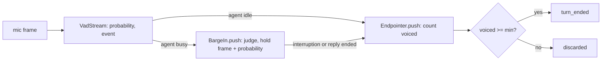

# Tuning (partial): voiced-frame counting, the first chunk, and how we measure

## 1. What we built in this branch

Branch `feat/tuning`. **A partial day:** the browser runs (A2, B), the short-answers
measurement and the real-clip baseline did not happen; section 6 lists each with what it
needs. What did land:

- **`min_utterance_ms` now counts voiced frames**, from `speech_started`, not the time span
  that included VAD's 200 ms wait. Default 40 ms: the no-regression value, so nothing
  the old rule kept is dropped (worked out in section 5). Provisional until the
  short-answers measurement.
- **The first chunk is cut at any comma.** Replies that open "जी," now start speaking
  after 3 characters instead of waiting for the whole reply.
- **Measurement tools** for the pending runs: a debug line with every judged speech's
  probabilities, `barge_in_sweep.py`, `measure_short_answers.py`, `measure_on_frame.py`,
  `replay_first_chunk.py`, and the power scheme in every run file's header.

## 2. What we used to build it

- **Voiced frame.** *What:* a 20 ms frame whose Silero speech probability is at least
  `[vad].threshold` (0.5). *Here:* `Endpointer.push` counts them. *Why:* it measures sound,
  not elapsed time, so VAD's built-in waits cannot inflate it.
- **Hysteresis** (see `08-vad.md`). VAD fires `speech_started` on the 4th voiced frame in a
  row and `speech_ended` on the 10th quiet one. Those two numbers drive all the arithmetic
  below.
- **Replay.** *What:* feeding recorded data back through the real code to see what another
  setting would have done. *Here:* `replay_first_chunk.py` replays logged model deltas
  through `ClauseChunker`; `barge_in_sweep.py` replays logged probabilities through
  `BargeIn` and `Endpointer`. *Why:* the rule is never copied into the script, so the
  script cannot drift from the code, and no new model calls are paid for.
- **A control run.** *What:* running the measurement once with the code unchanged, to prove
  the measurement itself reports "no difference" when there is none. *Here:* the first
  replay (section 5) gave 0 ms on all 12 turns before the chunker changed.
- **Power scheme (Windows).** *What:* a named set of power limits. Armoury Crate (the ASUS
  laptop tool) owns them here: "Silent", "Performance", "Turbo". *Here:* `run_log.py`
  writes `powercfg /getactivescheme` into every run file. *Why:* speed depends on it.
- **typeperf.** *What:* Windows' built-in command-line sampler of performance counters.
  *Here:* the Piper diagnostic sampled per-core load and clock once a second.
- **P-cores and E-cores.** This CPU (i7-14650HX) has 8 fast "performance" cores (logical
  processors 0-15, two threads each) and 8 slower "efficiency" cores (16-23). Windows
  decides which a thread runs on.

## 3. Alternatives we rejected

| Decision | What we chose | Alternatives | Why not them | What we gave up |
|---|---|---|---|---|
| What `min_utterance_ms` counts | Voiced frames from `speech_started` | Span minus VAD's 10-frame wait (arithmetic only) | Still counts quiet frames inside the span | A wider `push` signature: every caller passes the probability |
| Pre-roll in the count | Not counted | Count VAD's 3 confirming frames too | You asked for no pre-roll | A sound must be 3 frames longer than the number suggests |
| Default value | 40 ms (2 frames) | 300 (unchanged); 100 | 300 would need 360 ms of voice and drop a quick "haan"; 100 keeps the old 160 ms bar for an unbroken sound but drops a gap word ("o-k") the old rule kept. The rule: nothing that passed before is dropped | One unbroken sound now passes at 100 ms of voice, not 160: more short blips become turns |
| First chunk at a comma | Any length | Lower `first_min_chars` to 3 | That also lets a conjunction cut after 3 characters ("हाँ \| तो...") with no pause | `first_min_chars` now governs conjunctions only |
| "और" as a conjunction | Not added | Add it (it is "and") | It also means "more": "आपकी \| और क्या मदद" would cut mid-phrase | A long first sentence joined by "और" still waits for the 60-character fallback |
| Barge-in tuning data | Probabilities in a DEBUG line, swept offline | One live run per setting | One run gives every setting; each live run costs Gemini requests | Needs a run with `min_speech_ms=2000` so judging is not cut short |
| `on_frame` "before" | A clean HEAD worktree, same script | `git stash` | Stash touches your working tree | One extra scratch checkout |

## 4. Where things live

| What | File | Function or class |
|---|---|---|
| Voiced count and the min check | `backend/vaani/endpoint.py` | `Endpointer.push`, `Endpointer._finish` |
| `voiced_frames` on a finished turn | `backend/vaani/endpoint.py` | `TurnEnded` |
| Probability handed to the endpointer | `backend/vaani/turns.py` | `on_frame`, `_endpoint`, `_watch`, `_barge_in` |
| Held frames carry their probability | `backend/vaani/barge_in.py` | `Held`, `BargeIn.push`, `BargeIn.take` |
| Judged-speech debug line | `backend/vaani/barge_in.py` | `BargeIn._log_judged` |
| First-chunk rule | `backend/vaani/chunker.py` | `ClauseChunker._find_cut` |
| Config read | `backend/config.toml` `[endpoint]`, `[chunker]`, `[barge_in]` | `EndpointSettings` in `vaani/config.py` |
| Power scheme in run files | `backend/scripts/run_log.py` | `_power_scheme`, `RunLog` |
| Tools for pending runs | `backend/scripts/` | `barge_in_sweep.py`, `measure_short_answers.py` |
| Before/after tools | `backend/scripts/` | `measure_on_frame.py`, `replay_first_chunk.py` |
| Recording with a path | `backend/scripts/record_fixture.ps1` | `-Out`, `-Seconds` |
| Run files | `docs/findings/tuning/`, `docs/findings/reply-script/measure_tts_20261007-*` | - |

No database, no new protocol message, no new error code.

## 5. How it works



**Counting voiced frames** (`backend/vaani/endpoint.py`):

```python
        voiced = probability >= self._vad_threshold

        if self._start_frame is None:  # idle
            if event is not None and event.kind == SPEECH_STARTED:
                self._start_frame = i
                self._buffer.open(frame, with_preroll=True)
                self._voiced = int(voiced)  # the pre-roll is never counted
            ...
        self._buffer.add(frame)
        if voiced:
            self._voiced += 1
        if event is not None and event.kind == SPEECH_ENDED:
            self._ended_frame, self._ended_at = i, event.at
            self._ended_voiced = self._voiced
```

The count starts on the `speech_started` frame. `_ended_voiced` freezes it at
`speech_ended`: the 700 ms window after that is not part of the utterance unless speech
resumes. `_finish` then compares `voiced` (not the span) with `min_utterance_ms`.

**Why 40 ms: the no-regression value.** The rule is that nothing the old rule kept may be
dropped now. Frames are 20 ms. `S` is the `speech_started` frame (the 4th voiced frame in a
row), `L` the last voiced frame, `E` = `speech_ended` = L + 10.
- Before: kept when the span S..E was at least 15 frames (300 ms). E - S + 1 >= 15 means
  L + 10 - S + 1 >= 15, so **L >= S + 4**: the last voiced frame came at least 4 frames
  after `speech_started`.
- Now: the count includes S and L, both voiced. So any utterance the old rule kept has
  **at least 2** voiced frames, and 2 x 20 ms = **40 ms**. (Speech that resumed inside the
  window adds at least 4 more, since each restart needs 4 in a row.) Any higher value can
  drop something the old rule kept.
- The tightest case is a word with a gap, like "o-k": 4 voiced frames, a 3-frame dip, then
  1 voiced frame. The old span was exactly 15; the voiced count is exactly 2.
  `test_quiet_frames_inside_speech_do_not_count_as_voiced` asserts it passes at the default.
- The price, for one unbroken sound of n frames: the old rule needed n + 7 >= 15 (n >= 8,
  160 ms of voice). The new count is n - 3 >= 2, so n >= 5: **100 ms of voice**. Blips of
  100-140 ms that were ignored before now become turns.

| Value | Before | After | Source |
|---|---|---|---|
| `[endpoint] min_utterance_ms` | 300, compared with the span | 40, compared with voiced frames | The no-regression arithmetic above; provisional until the short-answers measurement (section 6, issue 1) |
| First chunk at a clause break | needed `first_min_chars` (8) | any length | `tuning/replay_first_chunk_20261007-000815.txt` (control `-000720`), `reply-script/measure_tts_20261007-103122.txt` |
| `[barge_in]` `threshold`, `min_speech_ms` | 0.5, 200 | unchanged | Not measured: runs A2 and B are pending |

**The "hmm after a barge-in" fix is not active at the default.** A barge-in needs 10 frames
from the onset, so its turn always has at least 7 voiced frames, well over 2. With the
default, a "hmm" that interrupts the agent is kept and answered, exactly as before this
branch. The voiced-frame count discards it only when `min_utterance_ms` is raised, as the
two "hmm" tests in `test_barge_in.py` do with an explicit `min_utterance_ms=300`.

**The probability travels with held frames.** While the agent speaks, `BargeIn` holds every
frame. `Held` became `(frame, event, probability)`, so a replayed frame is counted exactly
as if it had come live.

**The judged-speech line** (`backend/vaani/barge_in.py`), off unless DEBUG is on:

```python
        log.debug(
            "judged speech: %s after %d frames; probabilities %s",
            outcome,
            len(self._held),
            " ".join(f"{p:.3f}" for _, _, p in self._held),
        )
```

One line per speech heard while the agent was busy: `noise` (ended by `speech_ended`),
`interruption`, or `undecided` (the reply ended first). `barge_in_sweep.py` feeds these
probabilities through the real `BargeIn` at other settings. Three decimals, because two
would round 0.4996 to "0.50" and count it as voiced. A test pins the format.

**The first chunk** (`backend/vaani/chunker.py`):

```python
            cuts = [(e, "sentence end") for e in sentences]
            cuts += [(e, "clause break") for e in clauses]
            cuts += [
                (e, "conjunction") for e in conjunctions if e >= cfg.first_min_chars
            ]
```

Before, clause breaks also needed `first_min_chars` (8), so "जी," (3 characters) and
"ठीक है," (7) could not cut. In the day-12b log, 10 of 12 replies opened that way and all
waited for the whole reply ("end of reply").

**Measured** (every file is in `docs/findings/`; its power scheme follows the name):

- **First-chunk replay**, the 12 logged turns of
  `reply-script/measure_turn_20261006-120205_server.txt`:
  - Control, chunker unchanged: `tuning/replay_first_chunk_20261007-000720.txt` (Silent),
    0 ms difference on all 12. The replay reproduces the server.
  - After: `tuning/replay_first_chunk_20261007-000815.txt` (Silent). 10 of 12 now cut at the
    3-7 character opening. The text arrives sooner by only p50 6 ms, max 281 ms, because
    Gemini sends these short replies in two pieces.
  - The real gain is synthesis: `reply-script/measure_tts_20261007-103122.txt` (Silent)
    gives 3 characters in 37 ms and 7 in 46 ms, against 169 ms for 47 characters.
    Whole-turn numbers wait for the real-clip baseline.
- **`on_frame` cost**, 2,800 frames x 3 runs per path, p50 in µs:
  `tuning/measure_on_frame_20261007-095723.txt` (HEAD) vs `-095726.txt` (this branch), both
  Silent by the event log. Before 101.5-109.4, after 101.9-105.2, on every path. No
  regression beyond run-to-run noise. Measured before the last two edits (the default
  value and the `turn_ended` log text); neither adds per-frame work.

## 6. When things go wrong

| What fails | What the code does | What the user sees |
|---|---|---|
| A click under 100 ms | Under 2 voiced frames: discarded | Nothing |
| A blip of 100-140 ms (ignored before) | 2 or more voiced frames: kept as a turn | The agent answers a noise |
| A word with a dip inside it ("o-k") | Kept, as before | Their word is answered |
| A "hmm" over the agent | Interrupts (200 ms), then is kept as a turn (at least 7 voiced frames) | The agent stops and answers the "hmm" (as before this branch) |
| DEBUG left off in a tuning run | No judged-speech lines | The sweep has nothing to read |

**Known issues: pending work.**

1. **Short answers (sets the real `min_utterance_ms`).** Needs: run S, a browser capture in
   a quiet room. The MCI recordings cannot do it:
   - `tuning/measure_short_answers_20261007-095637.txt` (Silent by the event log): words
     about 1 s apart, so neighbours merged into 4 turns.
   - `tuning/measure_short_answers_20261007-103355.txt` (Silent): 7 utterances, not 10.
     `tuning/fixture_levels_20261007-120052.txt` (Silent) shows why: the recording peaks at
     -32.3 dBFS and only 77 of 1,747 frames reach p >= 0.5. MCI applies no gain, so
     several words never reached `speech_started`.
2. **The ambient-sound question (blocks S and A2).** `tuning/server_S_20261007-103747.txt`
   (Silent), Chrome, ASR off:
   - Session `e16844d8`, one "haan" then silence: 4 turns (980, 1800, 720, 380 ms voiced).
   - Session `989c3392`, a 12.7 s silence check, nothing playing: 10 `speech_started`, one
     80 ms blip discarded, and one utterance that never ended (486 frames at close).
   - Something in the room scores p >= 0.5. The likely amplifier is Chrome's
     `autoGainControl: true` (`useAudioCapture.js`), which raises the gain in silence.
     **Unproven:** the next step is a capture of what Chrome sends, which the scratch
     launcher can record.
   - Until this is understood, A2 cannot assume that every trigger is the agent's own voice.
3. **Runs A2 and B (`[barge_in].threshold`, the AEC verdict, the `min_speech_ms` table).**
   Needs both browser runs, with `VAANI_BARGE_IN__MIN_SPEECH_MS=2000` and DEBUG on
   `vaani.barge_in`, then `barge_in_sweep.py --echo <A2 log> --speech <B log>`. The sweep is
   checked only on synthetic lines. `threshold` stays 0.5 and `min_speech_ms` 200.
4. **The real-clip baseline.** Needs `measure_turn.py` on `hinglish_real_16k.wav`:
   large-v3 on the GPU, Armoury Crate in Performance. Note the clip is quiet too (peak
   -39.8 dBFS, `fixture_levels_20261007-120052.txt`).
5. **The "hmm after a barge-in" fix is not active at the default.** A barge-in's turn has
   at least 7 voiced frames; the default discards only under 2. Only the two tests'
   explicit `min_utterance_ms=300` shows the discard working. The short-answers
   measurement decides whether any value can keep "haan" and drop "hmm". A value above
   40 also breaks the no-regression rule, so that is a decision for you, with data.
6. **More short blips become turns.** At 40 ms one unbroken sound passes at 100 ms of
   voice (it was 160 ms). With the ambient triggers of issue 2, that can mean extra
   turns, and each one is a paid model request.
7. **Piper slowdown: intermittent, not reproduced in three runs.**
   - Slow: `reply-script/measure_tts_20261007-095734.txt` (Silent by the event log),
     47 characters in 1679 ms; `-101737.txt` (header "Performance", but see 8), 1110 ms.
   - Normal, minutes later: `tuning/piper_diag_default_20261007-103037.txt` (Silent),
     40 in a row, p50 164.5 ms; `reply-script/measure_tts_20261007-103122.txt` (Silent),
     169 ms. Day 12 had 125 ms (`reply-script/measure_tts_20261006-120108.txt`, Silent).
   - Fix (a), 8 ONNX threads: `tuning/piper_diag_threads8_20261007-103204.txt` (Silent),
     p50 135.5 ms. Faster, but not shown to cure the slow episodes. Not put in code.
   - Fix (b), Windows power throttling off: not run (needs an administrator prompt).
8. **Power mode.** `tuning/power_scheme_events_20261007-120007.txt`:
   - The scheme has been Silent since 2026-09-26 02:01. Every number in
     `perf-1-latency-budget.md` and in docs 06 to 13 is a Silent-mode number: consistent
     with each other, but not Performance-mode numbers.
   - **The run-file header alone does not prove the power mode.** `run_log.py` reads
     Windows' scheme (`powercfg /getactivescheme`). Armoury Crate sets the real limits in
     the firmware and normally writes its mode into that scheme, but anything else can
     change the scheme too. At 10:09 `powercfg.exe` set "Performance" while Armoury Crate
     still held Silent, and Armoury Crate reset it at 10:22. So
     `measure_tts_20261007-101737.txt` says "Performance" but was most likely a Silent run.
     To prove the mode, also check the event log: the last change before the run should
     come from `ArmouryCrate.UserSessionHelper.exe`. Set the mode inside Armoury Crate.
9. **History over-counts "heard"**, and **files over 300 lines** (`turns.py` 331,
   `config.py` 340): carried over from day 13.

## 7. New terms

- **Automatic gain control (AGC)**: the browser turns the mic up when it is quiet. It can
  make room noise look like speech.
- **Control run**: a measurement taken with nothing changed, to prove the method itself
  shows no difference.
- **dBFS**: loudness relative to the loudest possible sample (0 dBFS). -40 is quiet.
- **Dip**: a few quiet frames inside a word, too short for `speech_ended`.
- **P-core / E-core**: the fast and the slow cores of a hybrid Intel CPU.
- **Power scheme**: Windows' named set of power limits; Armoury Crate sets it here.
- **Replay**: logged data fed through the real code at other settings.
- **RTF (real-time factor)**: synthesis time / audio length. 0.03 means 1 s of speech in 30 ms.
- **Voiced frame**: a frame with speech probability >= `[vad].threshold`.

## 8. Questions you could be asked

1. **Where is the voiced count?** `Endpointer.push` in `backend/vaani/endpoint.py`, compared
   in `_finish`.
2. **Why 40 ms and not 100 or 300?** 40 is the only value that drops nothing the old rule
   kept (section 5). 100 would drop a gap word like "o-k"; 300 would need 360 ms of voice.
3. **What did this branch make worse?** Blips of 100-140 ms of voice now become turns
   (issue 6).
4. **What happens if a "hmm" interrupts the agent?** It stops the agent and becomes a turn,
   the same as before this branch. The discard works only under the tests' explicit
   300 ms override; at the default it is off.
5. **Why not lower `first_min_chars` instead?** It would let conjunctions cut after 3
   characters, where there is no pause.
6. **Where are the judged-speech probabilities logged?** `BargeIn._log_judged`, at DEBUG.
7. **What happens if the reply ends while speech is being judged?** `take` logs it as
   `undecided`; its frames become the user's next turn, as on day 13.
8. **Why replay instead of running each setting live?** One run then gives every setting,
   and the real class does the judging, so the script cannot drift from the code.
9. **What does a control run prove?** That the measurement reports zero when nothing
   changed. Here: 0 ms on all 12 turns.
10. **Why is the threshold still 0.5?** A2 and B did not run, and the silence check showed
    the room itself triggers VAD. Tuning on that data would tune on noise.
11. **Hardest: are the day-12 and day-13 numbers wrong?** Not wrong: all were measured in
    Silent, so they compare with each other. They are not Performance numbers, and Piper
    varied 10x within Silent today for a reason not yet found.

## 9. Check yourself

1. Work out, frame by frame, why every utterance the old 300 ms rule kept has at least
   2 voiced frames.
2. Which two pending runs set `[barge_in].threshold`, and what must the room be like first?
3. Why can a run file say "Performance" when the laptop was not in Performance mode?
