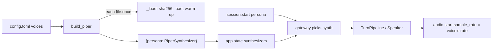

# Persona voices: one Piper voice and pace per persona

## 1. What we built in this branch

Branch `feat/persona-voices`. Before this, every persona (`default`, `tutor`, `support`)
had its own system prompt but spoke with the same voice. Now each persona has its own
**voice and pace**, chosen in `config.toml`:

- `default`: `hi_IN-priyamvada-medium` (female), its own pace.
- `tutor`: `hi_IN-pratham-medium` (male). Its prompt now tells the model to use masculine
  verb forms, because a male voice saying "मैं दूँगी" sounds wrong.
- `support`: the same female voice as `default`, but 15% slower (`length_scale = 1.15`).
  **Listening verdict (Aryan, WAVs played directly):** all four clips are clear. Support
  keeps priyamvada at 1.15 over rohan, whose licence is unsettled (section 6).

`fetch_models.py` downloads every persona's voice. CI downloads only `default`'s voice.
A persona with no voice configured stops the server at startup. **No personal names:**
the agent had called itself "rahul"; now no prompt names it, and each says "role only".

## 2. What we used to build it

- **Piper voice.** *What:* one `.onnx` file (the neural network, about 63 MB) plus one
  `.onnx.json` (its settings: sample rate, phoneme map, default pace). *Here:* we load
  two distinct voice files. *Why:* the only Hindi voices piper-voices has, and Piper is
  already our CPU synthesiser (`12-chunking-tts.md`).
- **`length_scale`.** *What:* a Piper setting that multiplies how long every sound lasts.
  1.0 is the voice's natural pace, 1.15 is about 15% slower. *Here:* `support` uses it.
  *Why:* it gives a second "voice" from a file we already load, at no memory cost.
- **`SynthesisConfig`** (from `piper`). *What:* per-call settings passed to
  `PiperVoice.synthesize`. A field left as `None` means "use the voice's own value from its
  `.onnx.json`". *Here:* each synthesiser holds one with its persona's `length_scale`.
- **One shared `ThreadPoolExecutor`.** *What:* a fixed set of worker threads that run
  jobs handed to them (`12-chunking-tts.md`). *Here:* every persona's synthesiser gets
  the same pool. *Why:* `[tts].max_concurrent = 2` must mean two syntheses at once for the
  whole process. Three pools of two would allow six.
- **The espeak-ng lock.** *What:* espeak-ng, the program that turns letters into sounds,
  keeps global state, so piper wraps every call in one process-wide lock
  (`_ESPEAK_PHONEMIZER_LOCK` in `piper/voice.py`). *Here:* two voices share it.
  `measure_voices.py` checked that two voices phonemising on two threads never mix up
  their results (400 rounds, 0 mismatches).
- **Pydantic nested model** (`PersonaVoice`). *What:* a class that checks one TOML table's
  fields and types at startup. *Here:* one per `[tts.piper.voices.<persona>]` table.
- **Environment override of one nested field.** *What:* our settings read
  `VAANI_TTS__PIPER__VOICES__SUPPORT__VOICE` as `tts.piper.voices.support.voice`
  (`__` steps one level down). *Here:* `persona_clips.py` tries the rohan voice for
  `support` without editing `config.toml`.
- **Regular expressions for verb gender** (`ask.py`). *What:* patterns that count
  first-person verb endings: `-ऊँगी`/`-ती हूँ` (feminine), `-ऊँगा`/`-ता हूँ` (masculine).
  *Why:* a number we can compare before and after a prompt change, instead of reading
  replies by ear. A second pattern, `SELF_NAME`, finds where a reply says who is
  speaking, so the name rule is checked in code too (section 5).

## 3. Alternatives we rejected

| Decision | What we chose | Alternatives | Why not them | What we gave up |
|---|---|---|---|---|
| How personas sound different | A voice and pace per persona | Keep one voice for all | Personas differ only in wording; the tutor cannot sound like a man | About 95 MB of RAM and 1.5 s of startup per extra voice file |
| When voices load | All at startup | Load a voice on the first session that needs it | That user's first reply would wait about 1.5 s for the load, on the hot path | Startup is about 1.5 s longer, and RAM is spent even on a persona nobody uses |
| Thread pools | One pool for all voices | One pool per voice | `max_concurrent` would multiply by the number of voices | A busy tutor session can make a default session wait for a thread |
| Sharing a voice file | Load once per `(voice, sha256)` pair | Load once per voice name | Keyed by name only, a wrong hash in the second persona's table would never be checked | Nothing real; two lines of code |
| `support`'s voice | priyamvada at `length_scale` 1.15 | `hi_IN-rohan-medium` (male) | Both sounded clear. rohan's licence is unsettled (its card points to a separate IIT Madras PDF), and a male voice also needs a masculine prompt | Support sounds like a slower `default`, not a different person |
| What the agent calls itself | No name; its role only (असिस्टेंट, ट्यूटर, सपोर्ट एजेंट) | Keep "You are Vaani"; or remove names from the reply text after the model writes it | A name in the prompt is a name the agent introduces itself with, and "Vaani" (a woman's name) did not even fit the male tutor. Filtering the text afterwards needs a list of every human name and runs on the hot path | The agent cannot introduce itself as the product ("Vaani"); a stubborn model can still invent a name |
| How `ask.py` checks for a name | Find every "मेरा नाम X" / "मैं (आपका) X हूँ" and require a role word in X | Search replies for a list of known names (राहुल, वाणी) | A list only catches names we already thought of; the slot check catches any name in those shapes | A name in another shape ("मैं राहुल, आपका ट्यूटर हूँ") is missed |
| Tutor's verb gender | Tell the model in the prompt | Rewrite "दूँगी" to "दूँगा" in the text before synthesis | A text rewrite cannot tell "I will give" from "she will give"; it would also change words about other people | The model can still slip; nothing at runtime catches it |
| Persona without a voice | Server refuses to start | Fall back to the default voice | The tutor would speak masculine verbs in a female voice, and nobody would notice the config gap | A config mistake is a startup failure, not a warning |
| Where each voice file is | Built from its name: `<models_dir>/<voice>.onnx`, URL in piper's own layout | A `model_path`, `config_path` and `url` per voice (the old shape) | Three fields per voice that must all agree; a typo in one breaks only that voice | A voice cannot live outside `models/` or outside piper-voices' folder layout |
| What CI downloads | `fetch_models.py default` | Every voice | 63 MB more per extra voice on a cold CI cache | CI never loads the tutor's `.onnx`; only its committed `.onnx.json` is checked |

## 4. Where things live

| What | File | Function or class |
|---|---|---|
| Which voice each persona uses | `backend/config.toml` | `[tts.piper.voices.<persona>]` |
| Config shape and validation | `backend/vaani/config.py` | `PersonaVoice`, `PiperSettings` |
| Build all synthesisers, once per process | `backend/vaani/tts/__init__.py` | `build_synthesizers`, `_build` (`lru_cache`) |
| Shared pool, load each file once | `backend/vaani/tts/piper.py` | `build_piper` |
| File check, sha256, load, warm-up | `backend/vaani/tts/piper.py` | `_load` |
| Pace per persona | `backend/vaani/tts/piper.py` | `PiperSynthesizer.__init__` (`SynthesisConfig`) |
| "Persona has no voice" check | `backend/vaani/app.py` | `create_app` |
| Picking the session's voice | `backend/vaani/gateway.py` | `session_endpoint`, after `session.start` |
| Frame size and `audio.start` rate | `backend/vaani/speaker.py` | `Speaker.__init__` (`synth.sample_rate`) |
| Masculine instruction for the tutor | `backend/config.toml` | `[personas] tutor` |
| "No personal name" rule | `backend/config.toml` | `[personas]`, all three prompts |
| Voice licences | `MODEL_CARD` per voice, at the pinned `voices_url` | cited in `config.toml` above `[tts.piper.voices.default]` |
| Download and verify voices | `backend/scripts/fetch_models.py` | `voice_url`, `fetch`, `main` |
| Measure load, RAM, lock, speed | `backend/scripts/measure_voices.py` | - |
| One listening clip per persona | `backend/scripts/persona_clips.py` | - |
| Count verb gender; find a self-given name | `backend/scripts/ask.py` | `FEMININE`, `MASCULINE`; `SELF_NAME`, `self_names` |
| Errors raised | `backend/vaani/tts/base.py` | `TtsError` |
| Load logged | `backend/vaani/tts/piper.py` | `_load` (`log.info`: voice, Hz, seconds) |
| Run files | `docs/findings/persona-voices/`, `docs/findings/reply-script/measure_tts_20261007-*` | - |

No database, no new protocol message, no new error code. `docs/contracts.md` got an
editorial note only (the rate is the persona's voice's), so no version bump.

## 5. How it works



**The config** (`backend/config.toml`). One table per persona key:

```toml
[tts.piper.voices.tutor]
voice = "hi_IN-pratham-medium"  # male: the tutor prompt speaks as a man
sha256 = "169964b0871667f6793416d4b35e97357a68ba1ad01df8580c28048989ee7693"

[tts.piper.voices.support]
voice = "hi_IN-priyamvada-medium"
sha256 = "aa63bcf2cd493b55a450f280e23cf77f03afc9af7015e6e5acd43b652f166c88"
length_scale = 1.15
```

**Building them** (`backend/vaani/tts/piper.py`, `build_piper`):

```python
    pool = ThreadPoolExecutor(max_workers=cfg.max_concurrent, thread_name_prefix="tts")
    ...
    loaded: dict[tuple[str, str], PiperVoice] = {}
    synths = {}
    for persona, pv in cfg.piper.voices.items():
        key = (pv.voice, pv.sha256)
        if key not in loaded:
            loaded[key] = _load(models_dir, pv)
        synths[persona] = PiperSynthesizer(loaded[key], pv.length_scale, pool)
    return synths
```

The pool is created once, before the loop, so every synthesiser gets the same object.
`loaded` is the "already loaded" list: `default` and `support` name the same file, so
the second one finds it there and only wraps it with a different pace. Result: three
synthesisers, two loaded networks, one pool. `test_personas_sharing_a_voice_share_one_load_and_one_pool`
checks the sharing with `is`.

**The pace** (`PiperSynthesizer.__init__`):

```python
        self._syn_config = SynthesisConfig(length_scale=length_scale)
```

and every call passes it: `self._voice.synthesize(text, self._syn_config)`. With
`length_scale=None` this is exactly piper's default config (checked in its source), so
`default` and `tutor` synthesise as before.

**Refusing a persona with no voice** (`backend/vaani/app.py`):

```python
        voiceless = settings.personas.keys() - settings.tts.piper.voices.keys()
        if voiceless:
            raise TtsError(
                f"persona(s) {sorted(voiceless)} have no [tts.piper.voices] entry"
            )
```

`keys() - keys()` is a set difference: personas that have a prompt but no voice. This
runs at startup, so the mistake shows before anyone connects.

**Choosing the session's voice** (`backend/vaani/gateway.py`), once per session, never
per turn:

```python
                synth = getattr(websocket.app.state, "synthesizers", {}).get(
                    session.persona
                )
```

`getattr(..., {})` gives an empty dict when TTS is disabled, so `.get` gives `None` and
the turn runs text-only, as before. The persona was already checked against `[personas]`
a few lines above, so with TTS on it is always in the dict.

**The rate follows the voice** (`backend/vaani/speaker.py`): `self._rate =
synth.sample_rate`, read from the voice's `.onnx.json`. All three voices are 22050 Hz
today. `test_each_persona_speaks_with_its_own_voice_and_rate` uses a 16000 Hz stand-in
for `tutor` to prove `audio.start` and the 20 ms frame size follow the persona's voice.

**The tutor's gender.** Hindi verbs change with the speaker's gender. The tutor prompt's
example now says "दूँगा" and adds: "You speak as a man: always use masculine first-person
forms such as करूँगा, गया and दूँगा". `config.toml` has a comment above `[personas]`
saying any persona moved to a male voice needs the same.

**The name rule.** No file in the repo contains "rahul" (Latin or Devanagari): the model
invented it (not reproduced; no "before" run was spent). But every prompt began "You are
Vaani", a woman's name even for the male tutor. "Vaani" is gone; each prompt now says:

```toml
You have no personal name and never give \
yourself one. If you introduce yourself or the user asks your name, say only \
your role: मैं आपकी असिस्टेंट हूँ।
```

(tutor: `मैं आपका ट्यूटर हूँ`, support: `मैं आपकी सपोर्ट एजेंट हूँ`). The exact sentence,
not just "say your role", because a model copies an example more reliably than it follows
a description; the script and gender rules carry one for the same reason.

**Checking it in code** (`backend/scripts/ask.py`). A program cannot know every human
name, so it does not look for names. It looks for the places a reply says who is
speaking, and requires a role word there:

```python
ROLES = ("असिस्टेंट", "सहायक", "ट्यूटर", "शिक्षक", "सपोर्ट", "एजेंट")
SELF_NAME = re.compile(
    r"मेरा\s+नाम\s+(\S+)"
    r"|मैं\s+(?:आपका|आपकी|तुम्हारा|तुम्हारी)\s+(\S+(?:\s+\S+)?)\s+हू[ँं]"
    r"|मैं\s+(\S+)\s+हू[ँं]"
)
```

The three shapes: "मेरा नाम X", "मैं आपका X हूँ" (X up to two words: "सपोर्ट एजेंट") and
"मैं X हूँ" (one word: "मैं राहुल हूँ"). `self_names` keeps each X with no role word. Tried
offline first on 10 sentences (scratch script, not committed), e.g. "मेरा नाम राहुल है"
flagged, "मैं आपकी मदद कर सकती हूँ" not matched: 0 failures.

**Result** (`persona-voices/ask_name_{default,tutor,support}_20261008-003117.txt`, 2
questions per persona, 6 Gemini requests): all six open with the role sentence
("मैं आपका ट्यूटर हूँ।" etc.), `self-name: ... not a role: none` on all six, and none
contains राहुल, वाणी, "rahul" or "vaani". Time to first token 804-1714 ms, the range of the
earlier tutor runs (1253-1580 ms); about 30 words per prompt, not a controlled benchmark.

**Measured** (all on the "Silent" power scheme; files in `docs/findings/`):

| What | Before | After | Source |
|---|---|---|---|
| RAM per voice file | - | first +107 MB, each extra +92-99 MB | `persona-voices/measure_voices_20261007-1221*.txt` (3 runs, load order rotated) |
| Load + warm-up per voice | about 1.5 s for one | 1.1-1.9 s each, so about 3 s for two | same |
| espeak-ng mixing two voices | - | 0 mismatches in 2 x 200 rounds | same |
| Tutor first-person verbs | 4 feminine, 0 masculine (2 replies) | 0 feminine, 3 masculine (3 replies) | `persona-voices/ask_gender_tutor_{before,after}_*.txt` |
| TTS time, `default` voice, p50 ms (3 / 7 / 24 / 47 / 107 / 185 chars) | 27 / 32 / 67 / 126 / 247 / 410 | 40 / 33 / 70 / 134 / 261 / 416 and 57 / 67 / 67 / 129 / 256 / 422 | `reply-script/measure_tts_20261007-123224.txt` vs `-152648`, `-152658` |

**The latency finding.** From 24 characters up, nothing changed. On the 3-character first
chunk ("जी,", which most replies open with), p50 went from about 27 ms to 40-57 ms. A
same-sitting A/B (scratch script, not committed; only the voices loaded differed) gave 26
and 25 ms with one voice, 53 and 48 ms with all. So **the second voice costs about 25 ms on
the first chunk**, 2.5% of the budget. Cause not established; a guess is that each ONNX
Runtime network keeps its own idle worker threads, making Windows scheduling noisier.

**Three slow runs are machine noise.** `measure_tts_20261007-124337`, `-144858` and
`-152347` (450-750 ms even for 3 characters) coincide with Piper itself running 2x slow
(`measure_voices_20261007-124533`); the same code 3 minutes later gave 40 ms. Invalid.

## 6. When things go wrong

| What fails | What the code does | What the user sees |
|---|---|---|
| A persona has a prompt but no voice table | `create_app` raises `TtsError` naming it | Server does not start |
| A voice's `.onnx` was never fetched | `_load` raises `TtsError` with the `fetch_models.py` command | Server does not start |
| A voice file has the wrong sha256 | `_load` raises `TtsError` with both hashes | Server does not start |
| `fetch_models.py tutr` (typo) | Prints "no voice for persona(s)", exits 1 | Nothing downloaded |
| A download is corrupt | `.part` file deleted, exits 1 | Nothing replaced |
| The model still says "दूँगी" as the tutor | Nothing catches it at runtime | A male voice says a feminine verb |
| The model still invents a name | Nothing catches it at runtime; only `ask.py` checks | The agent says a name, e.g. "मैं राहुल हूँ" |
| Three sessions synthesise at once | The third waits for one of the 2 pool threads | A slower first sound for that user |
| A future voice is not 22050 Hz | `audio.start` declares its rate | Plays correctly (protocol v0.6) |
| TTS disabled | `synthesizers` is never set; `synth` is `None` | Text only, as before |

**Licences, from each voice's `MODEL_CARD`** (fetched at the pinned revision,
`<voices_url>/hi/hi_IN/<name>/medium/MODEL_CARD`, 2026-10-08):

| Voice | Card says | Used |
|---|---|---|
| priyamvada, pratham | `License: http://creativecommons.org/licenses/by-nc-sa/4.0/` | default, support; tutor |
| rohan | `License: https://www.iitm.ac.in/donlab/indictts/downloads/license.pdf` (IIT Madras "Hindi Mono Male") | no |

Caution: every card lists the licence under **"Dataset"**, none separately for the model.
Read it as "non-commercial only": fine for an OJT demo, not a product. rohan stays out
until someone reads the IIT Madras PDF (its `.onnx.json` is untracked in `backend/models/`).

**Known issues.**
1. **About 25 ms on the first chunk with all voices loaded** (p50 about 26 -> 50 ms on
   3 characters, section 5): 2.5% of the 1,000 ms budget, cause not established.
2. **Groq failover is broken.** Gemini timed out once (gender "before" run) and Groq gave
   `HTTP 404: model llama-3.1-8b-instant does not exist`, so the turn failed. Not fixed here.
3. **The checks are small, and offline only.** Gender: 3 questions ("before" has 2
   replies, item 2). Names: 2 per persona. One run each; the server runs neither.
4. **The self-name check sees only its three shapes:** "मैं राहुल, आपका ट्यूटर हूँ" gets
   no flag (an English "I am Rahul" would still fail the script check).

## 7. New terms

- **CC BY-NC-SA 4.0.** A licence: free to use with credit (BY), not for commercial use
  (NC), and derived work must carry the same licence (SA). Both committed voices' model
  cards give it (section 6).
- **Dedup key.** The value used to decide "is this the same thing?". Here `(voice,
  sha256)`, so two personas share one load only when both name and hash agree.
- **Grammatical gender (Hindi).** Verbs agree with the speaker: a woman says "मैं
  करूँगी", a man "मैं करूँगा". A voice and its words must agree, or the reply sounds wrong.
- **`length_scale`.** Piper's pace multiplier. Above 1 is slower, below 1 faster.
- **Model card (`MODEL_CARD`).** A short text file published next to a model, saying what
  it was trained on, by whom, and under what licence. Our licence claims cite it.
- **ONNX Runtime session.** One loaded network ready to run. Each voice file becomes one;
  each holds its weights in memory (the ~95 MB per voice).
- **Regex alternation and groups.** In a regular expression, `a|b` matches either side,
  and `( )` captures the part inside. `SELF_NAME` has three alternatives, one group each.
- **RSS (resident set size).** How much RAM a process is really using. `measure_voices.py`
  reads it from Windows, because ONNX Runtime allocates memory Python cannot see.
- **Set difference.** `a - b` on two sets gives what is in `a` but not in `b`. Used to
  find personas with no voice.
- **Warm-up.** One throwaway synthesis at load, so espeak-ng starts and ONNX Runtime
  prepares before a user's first reply needs it.

## 8. Questions you could be asked

1. **Where is the code that picks a session's voice?** `backend/vaani/gateway.py`,
   `session_endpoint`, right after `session.start` is accepted:
   `app.state.synthesizers.get(session.persona)`. Once per session.
2. **Where is the code that makes `support` slower?** `length_scale = 1.15` in
   `config.toml`, turned into a `SynthesisConfig` in `PiperSynthesizer.__init__`
   (`backend/vaani/tts/piper.py`), passed on every `synthesize` call.
3. **What happens if someone adds a fourth persona and forgets its voice?** `create_app`
   raises `TtsError` and the server does not start. `test_every_persona_has_a_voice` also
   fails, so CI catches it before that.
4. **What happens if the tutor's `.onnx` is missing on a machine?** `_load` raises
   `TtsError` telling you to run `fetch_models.py`. The server does not start.
5. **Why not load a voice only when the first session for that persona arrives?** That
   user would wait about 1.5 s for the load before hearing anything. Latency is our main
   measure; we prefer a slower startup.
6. **Why one thread pool and not one per voice?** `max_concurrent` caps CPU work for the
   whole process. One pool per voice would multiply it by the number of voices.
7. **Why tell the model to be masculine instead of fixing the verbs ourselves?** A text
   rewrite cannot tell "I will give" from "she will give". Only the writer of the sentence
   knows who the subject is.
8. **What does `length_scale` actually change?** How long each sound lasts. Same voice,
   same pitch, slower speech. 1.5 gave clearly over 1.25x the audio in
   `test_length_scale_slows_the_voice_down`.
9. **Did this slow down the conversation?** By about 25 ms on the 3-character first chunk,
   none on longer chunks (section 5). The cause is not proven.
10. **Where did "rahul" come from, and where is the fix?** The model invented it; the
    prompts had handed it a name ("You are Vaani"). Fix: `[personas]` in `config.toml`, no
    name and "say only your role"; `self_names` in `ask.py` checks replies.
11. **Hardest: two sessions use different voices at the same moment. Can espeak-ng mix
    them up?** Piper holds one process-wide lock around espeak-ng, so only one phonemises
    at a time. `measure_voices.py` hammered two voices on two threads: 0 mismatches. The
    neural network part runs in parallel; it has no shared state.

## 9. Check yourself

1. Starting from `session.start {"persona": "tutor"}`, which functions run before the
   first `audio.start`, and where does its `sample_rate` come from?
2. `default` and `support` use the same file. How many times is it loaded, and which line
   makes that true?
3. What are three ways the server refuses to start because of a voice, and why is
   refusing better than falling back to the default voice?
