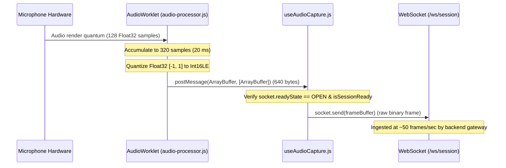

# 02 — Microphone Capture and Audio Streaming

## 1. In one minute

This implements the audio ingestion half of Vaani: capturing microphone audio
from the browser, converting it into 16 kHz mono 16-bit linear PCM (Int16LE)
inside a dedicated Web Audio `AudioWorklet`, framing it into 20 ms / 640-byte
chunks, and streaming those binary frames over a WebSocket connection to the
backend gateway. Without this, the frontend cannot provide live speech input to
the voice pipeline.

## 2. Files

| File | What it does |
|---|---|
| `frontend/public/audio-processor.js` | `AudioWorkletProcessor` running on the audio render thread; buffers 128-sample quanta into 320-sample (20 ms) frames, quantizes Float32 to Int16LE, and posts `ArrayBuffer` to main thread. |
| `frontend/src/hooks/useAudioCapture.js` | Custom React hook coordinating `getUserMedia`, `AudioContext`, `AudioWorkletNode`, WebSocket session lifecycle, frame metrics, and teardown. |
| `frontend/src/config.js` | Central audio parameters (`AUDIO_SAMPLE_RATE = 16000`, `AUDIO_FRAME_MS = 20`, `AUDIO_FRAME_SAMPLES = 320`) and WebSocket endpoints. |
| `frontend/src/pages/ConversationPage.jsx` | Conversation UI exposing Start/Stop controls, live capture indicators, sent frame counters, and rolling FPS gauge. |
| `docs/contracts.md` | Formal contract specifying the 640-byte binary frame format, 16 kHz mono Int16LE encoding, and `session.start` lifecycle messages. |

## 3. How it works



### Capture Pipeline Steps

1. **Request User Media**: The browser requests microphone access with hardware constraints matching our speech backend:
```javascript
// frontend/src/hooks/useAudioCapture.js
const stream = await navigator.mediaDevices.getUserMedia({
  audio: {
    channelCount: 1,
    sampleRate: AUDIO_SAMPLE_RATE,
    echoCancellation: true,
    noiseSuppression: true,
    autoGainControl: true,
  },
  video: false,
});
```

2. **Initialize AudioContext at 16 kHz**: We construct an `AudioContext` pinned to 16,000 Hz with `latencyHint: 'interactive'` so the browser's native audio engine handles any hardware sample rate conversion upfront:
```javascript
// frontend/src/hooks/useAudioCapture.js
const audioCtx = new AudioContextClass({
  sampleRate: AUDIO_SAMPLE_RATE,
  latencyHint: 'interactive',
});
if (audioCtx.state === 'suspended') {
  await audioCtx.resume();
}
```

3. **Load and Connect AudioWorklet**: The static processor module is registered into the context's audio worklet thread. To prevent the user's microphone from playing directly back into their speakers (acoustic feedback loop) while still forcing the Web Audio clock to render frames, we route the worklet through a muted `GainNode`:
```javascript
// frontend/src/hooks/useAudioCapture.js
await audioCtx.audioWorklet.addModule('/audio-processor.js');

const sourceNode = audioCtx.createMediaStreamSource(stream);
const workletNode = new AudioWorkletNode(audioCtx, 'vaani-audio-processor');

const muteNode = audioCtx.createGain();
muteNode.gain.value = 0;

sourceNode.connect(workletNode);
workletNode.connect(muteNode);
muteNode.connect(audioCtx.destination);
```

4. **Frame Accumulation and Quantization**: In `frontend/public/audio-processor.js`, Web Audio delivers chunks in 128-sample quanta. We buffer them until 320 samples (20 ms at 16 kHz) accumulate, clamp the Float32 values to `[-1.0, 1.0]`, quantize them into signed 16-bit integers (`Int16`), and transfer the `ArrayBuffer` without memory copies:
```javascript
// frontend/public/audio-processor.js
while (this.bufferedCount >= FRAME_SAMPLES) {
  const pcm16 = new Int16Array(FRAME_SAMPLES);

  for (let i = 0; i < FRAME_SAMPLES; i++) {
    const s = Math.max(-1, Math.min(1, this.buffer[i]));
    pcm16[i] = s < 0 ? s * 0x8000 : s * 0x7fff;
  }

  // Zero-copy transfer of the ArrayBuffer
  this.port.postMessage(pcm16.buffer, [pcm16.buffer]);

  const remaining = this.bufferedCount - FRAME_SAMPLES;
  for (let i = 0; i < remaining; i++) {
    this.buffer[i] = this.buffer[FRAME_SAMPLES + i];
  }
  this.bufferedCount = remaining;
}
```

5. **Session Handshake and Audio Streaming**: Once the WebSocket opens, the client sends `session.start` declaring its audio format. When the server replies with `session.started`, `isSessionReadyRef` is set to true and every 640-byte frame arriving from the worklet is dispatched over the socket:
```javascript
// frontend/src/hooks/useAudioCapture.js
workletNode.port.onmessage = (event) => {
  const frameBuffer = event.data; // ArrayBuffer (640 bytes)
  if (
    socketRef.current &&
    socketRef.current.readyState === WebSocket.OPEN &&
    isSessionReadyRef.current
  ) {
    socketRef.current.send(frameBuffer);
    frameCountRef.current += 1;
    framesSinceLastFpsRef.current += 1;
    setFramesSent(frameCountRef.current);
  }
};
```

## 4. New concepts

- **AudioWorklet** — A modern Web Audio API feature that runs user-defined audio processing code in a dedicated, low-latency audio rendering thread off the main UI JavaScript thread.
- **Audio Quantum** — The standard 128-sample block that the Web Audio engine processes per render slice (~8 ms at 16 kHz, or ~2.6 ms at 48 kHz).
- **Int16LE (Linear PCM)** — Uncompressed pulse-code modulation with signed 16-bit integers (-32768 to 32767) stored in little-endian byte order. The standard raw format expected by Silero VAD, Whisper, and speech models.
- **Zero-copy Transfer** — Passing ownership of an `ArrayBuffer` across threads using the second argument of `postMessage([buffer])`, avoiding memory copying overhead on the 50 Hz frame path.
- **Acoustic Feedback Loop** — Loudspeaker output being picked up by the microphone and re-amplified. Prevented here by terminating the worklet graph into a zero-gain (`muteNode`) node before `audioCtx.destination`.

## 5. Why this and not that

| Decision | What we chose | Alternatives | Why not them | What we gave up |
|---|---|---|---|---|
| Audio processing thread | `AudioWorkletNode` | `ScriptProcessorNode` | `ScriptProcessorNode` runs on the main UI thread and drops audio frames whenever UI renders or layout calculations occur; it is also deprecated | Slightly more complex setup requiring a static script in `public/` |
| Sample rate | 16 kHz native `AudioContext` | 44.1/48 kHz context + JS resampler | Creating the context at 16 kHz delegates hardware resampling to the browser's C++ audio pipeline, saving CPU cycles | Reliance on browser native sample rate conversion |
| Frame duration | 20 ms (320 samples / 640 bytes) | 10 ms or 100 ms | 10 ms doubles WebSocket message overhead (100 msgs/s); 100 ms introduces 100 ms latency before VAD can inspect speech. 20 ms is the standard VAD/telecom window | None |
| Frame transport | Raw binary WebSocket frames | Base64-encoded JSON | Base64 inflates payload size by 33% and incurs JSON parse/serialize CPU cost on every 20 ms frame | JSON metadata attached to individual audio frames |
| Audio destination connection | Muted gain node (`gain.value = 0`) | Disconnect from destination | Web Audio engines in some browsers stop pulling render quanta through nodes that do not connect to `destination` | An extra node in the audio graph |

## 6. Where things live

| What | File | Function or class |
|---|---|---|
| Frame chunking and PCM quantization | `frontend/public/audio-processor.js` | `VaaniAudioProcessor.process()` |
| Worklet registration | `frontend/public/audio-processor.js` | `registerProcessor('vaani-audio-processor', ...)` |
| Microphone permission & Web Audio graph | `frontend/src/hooks/useAudioCapture.js` | `startCapture()` Step A, B, C, D |
| WebSocket lifecycle & binary streaming | `frontend/src/hooks/useAudioCapture.js` | `startCapture()` Step E, F |
| Rolling FPS calculation | `frontend/src/hooks/useAudioCapture.js` | `startCapture()` Step G (`setInterval`) |
| Resource teardown | `frontend/src/hooks/useAudioCapture.js` | `stopCapture()` & `useEffect` unmount cleanup |
| Audio format constants | `frontend/src/config.js` | `AUDIO_SAMPLE_RATE`, `AUDIO_FRAME_MS`, `AUDIO_FRAME_SAMPLES` |
| Wire protocol specification | `docs/contracts.md` | §2.1 Client → Server: Audio Frames |

## 7. When things go wrong

| What fails | What the code does | What the user sees |
|---|---|---|
| User denies mic permission | Catches `NotAllowedError`, sets `micStatus = 'denied'` | Error banner: "Microphone access was denied. Please allow microphone permissions in your browser." |
| Browser lacks `getUserMedia` | Detects missing API upfront, sets `micStatus = 'error'` | Error banner: "Browser does not support microphone audio capture." |
| WebSocket server down or refuses | `socket.onerror` fires, sets `wsStatus = 'error'` | Error banner: "WebSocket connection failed. Ensure Aryan's backend is running." |
| Browser autoplay blocks AudioContext | Checks `audioCtx.state === 'suspended'` and calls `audioCtx.resume()` | Handled transparently during the click gesture without user intervention |
| User stops capture or leaves page | `stopCapture()` halts media tracks, disconnects nodes, closes context, sends `session.end` | Mic indicator LED turns off immediately; UI resets to Idle |

## 8. Questions you could be asked

1. **Why does the frontend send 640-byte binary messages instead of JSON?**
   Each 20 ms frame contains 320 samples at 16-bit depth (2 bytes/sample). 320 × 2 = 640 bytes. Sending raw binary avoids the 33% payload inflation and serialization overhead of Base64 JSON 50 times every second.
2. **Why use an `AudioWorklet` instead of a standard worker or main thread?**
   Audio rendering demands real-time priority. The main thread is frequently blocked by DOM rendering and JavaScript garbage collection. `AudioWorklet` runs on a high-priority OS audio thread, ensuring frames are never dropped due to UI activity.
3. **Why do we connect `workletNode` to a `muteNode` with gain 0?**
   The Web Audio API optimizes power consumption: if an audio graph is not connected to `audioCtx.destination`, the engine may suspend rendering. Connecting through a gain of 0 keeps the rendering clock running without playing mic audio back into the user's speakers.
4. **How do we convert Float32 Web Audio samples to Int16?**
   Web Audio provides samples in the range `[-1.0, 1.0]`. We clamp to that range and multiply negative values by `0x8000` (32768) and non-negative values by `0x7fff` (32767), mapping the range symmetrically into signed 16-bit integers.
5. **What happens if the microphone input arrives in 128-sample chunks but we need 320?**
   `VaaniAudioProcessor` maintains an accumulation buffer `Float32Array(FRAME_SAMPLES * 2)`. It appends the 128 incoming samples on each quantum and only slices out and emits a 320-sample frame when enough samples have accumulated.
6. **How does the client know when to start streaming audio frames?**
   Audio frames are gated by `isSessionReadyRef`. The client connects, sends `session.start`, and only begins streaming binary frames when the server replies with `session.started`.
7. **What is the purpose of the rolling FPS counter in the UI?**
   Frames arrive every 20 ms, which equals 50 frames per second (1000 ms / 20 ms = 50). The rolling FPS counter displays instantaneous throughput, providing visual confirmation that the capture pipeline is healthy.
8. **(Hardest) What happens if the user's audio interface runs natively at 48 kHz or 96 kHz?**
   Constructing `new AudioContext({ sampleRate: 16000 })` directs the browser's underlying platform audio stack to resample the microphone hardware clock to 16 kHz before invoking our worklet, ensuring our code always receives 16 kHz samples.

## 9. Check yourself

1. Calculate the exact byte size of a 20 ms audio frame at 16 kHz mono with 16-bit linear PCM.
2. Why is zero-copy transfer (`postMessage(buffer, [buffer])`) preferred for passing audio frames between the worklet and the main thread?
3. What is the role of `session.start` and `session.started` before audio frames are allowed on the WebSocket?
