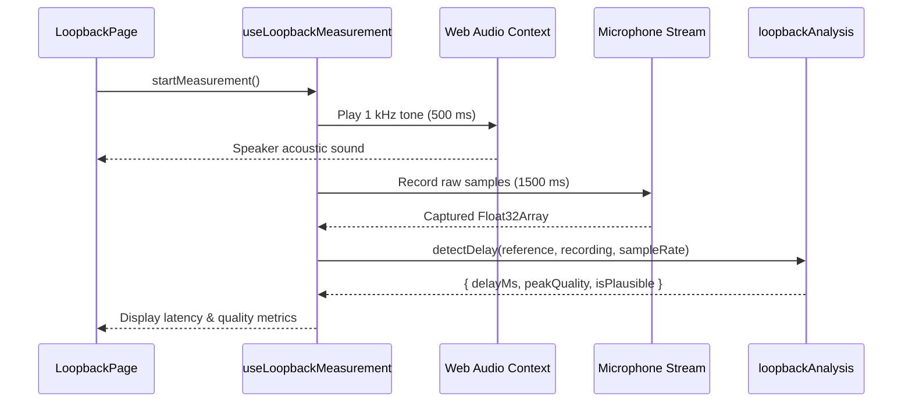

# 09 — Loopback Measurement Rig

## 1. What we built in this branch

Branch: `feat/loopback-rig`

This branch builds the acoustic loopback measurement rig for Vaani (Week 2, Day 5).
It measures the real physical round-trip delay between the computer speaker and microphone through the air
by playing a known reference signal and cross-correlating it against the microphone capture.
Before this change, latency was only estimated from internal server timestamps (`telemetry.py`), which
cannot measure speaker buffer queuing, DAC conversion, acoustic propagation, ADC conversion, and OS audio latency.
Now, the frontend provides a dedicated `/loopback` tool that computes empirical hardware latency with
sub-millisecond accuracy derived purely from sample offsets.

## 2. What we used to build it

- **Normalized Cross-Correlation (`detectDelay`)** — Time-domain digital signal processing algorithm in `loopbackAnalysis.js`.
  Slides the reference waveform across the captured microphone buffer to locate the peak correlation index,
  deriving latency as `offset_samples / sample_rate * 1000`.
- **Deterministic 1 kHz Reference Signal (`makeReference`)** — Pure 1,000 Hz sine wave generated in a `Float32Array`.
  Produces identical acoustic waveforms across runs, loud enough to detect reliably without clipping (amplitude 0.7).
- **Native Web Audio API at Hardware Rate** — `AudioContext` initialized without downsampling (runs at native 44.1 kHz or 48 kHz).
  Avoids resampling artifacts and measures true hardware delay.
- **Microphone Capture with Disabled Processing** — `getUserMedia` configured with `echoCancellation: false`,
  `noiseSuppression: false`, and `autoGainControl: false` so browser audio enhancement does not suppress the reference tone.
- **Custom Hook `useLoopbackMeasurement`** — Encapsulates measurement state machine (`idle`, `requesting_mic`, `playing_tone`,
  `recording`, `analyzing`, `complete`, `error`), scheduling playback and capture.
- **Page Component `LoopbackPage`** — Interactive UI mounted at `/loopback` featuring start trigger,
  measured delay in milliseconds, correlation peak quality score, and signal health diagnostics.
- **Standalone Unit Tests (`loopbackAnalysis.test.js`)** — Browser and Node.js compatible test suite verifying
  clean offset detection, noise resilience, and silence rejection on synthetic audio buffers.

## 3. Alternatives we rejected

| Decision | What we chose | Alternatives | Why not them | What we gave up |
|---|---|---|---|---|
| Latency calculation method | Cross-correlation sample offset | JavaScript timestamps (`performance.now()`) on playback start/capture events | Event loop scheduling jitter and OS audio buffer queues add tens of milliseconds of unpredictable noise | Simpler timestamp subtraction |
| Sample rate | Native device rate (44.1/48 kHz) | Voice pipeline rate (16 kHz) | Downsampling before playback adds filter group delay and reduces sample resolution from ~0.02 ms to ~0.06 ms | Code reuse with 16 kHz voice pipeline |
| Acoustic reference tone | 1 kHz sine wave (500 ms) | White noise or chirp | Single frequency sine tone is easy to correlate in time-domain without FFT dependencies and minimizes acoustic room reverberation | Broad spectrum impulse response |
| Echo cancellation setting | Explicitly disabled (`echoCancellation: false`) | Default browser echo cancellation | AEC treats the reference tone from the speaker as unwanted echo and cancels it out, preventing detection | Automatic noise cleaning |
| Component isolation | Dedicated `/loopback` route and isolated hook | Integrated inside `ConversationPage` | The calibration tone is loud and disruptively captures mic; separating it avoids contaminating voice session state | Single-page testing |

## 4. Where things live

| What | File | Function or class |
|---|---|---|
| Signal analysis & correlation | `frontend/src/loopback/loopbackAnalysis.js` | `detectDelay(reference, recording, sampleRate)`, `makeReference` |
| Signal constants | `frontend/src/loopback/loopbackAnalysis.js` | `REFERENCE_FREQ_HZ`, `MIN_PEAK_QUALITY`, `RECORD_DURATION_S` |
| Measurement orchestration hook | `frontend/src/loopback/useLoopbackMeasurement.js` | `useLoopbackMeasurement()` |
| Loopback calibration UI | `frontend/src/pages/LoopbackPage.jsx` | `LoopbackPage()` |
| UI styling | `frontend/src/pages/LoopbackPage.css` | Component layout and metric cards |
| Application route | `frontend/src/router.jsx` | Route `/loopback` mapping to `LoopbackPage` |
| Browser test page | `frontend/loopback-tests.html` | HTML test runner for browser test execution |
| DSP unit tests | `frontend/src/loopback/loopbackAnalysis.test.js` | 7 assertions verifying cross-correlation correctness |

## 5. How it works

When the user clicks "Start Measurement" on `/loopback`, `useLoopbackMeasurement` executes the following sequence:

1. Opens an `AudioContext` at the hardware's native sample rate.
2. Acquires raw microphone access via `navigator.mediaDevices.getUserMedia` with all audio processing turned off:

```javascript
// frontend/src/loopback/useLoopbackMeasurement.js
const stream = await navigator.mediaDevices.getUserMedia({
  audio: {
    channelCount: 1,
    echoCancellation: false,
    noiseSuppression: false,
    autoGainControl: false,
  },
  video: false,
});
```

3. Plays a pre-rendered 1 kHz sine reference tone through `AudioBufferSourceNode` to the speakers.
4. Concurrently records microphone input into a `Float32Array` buffer for `RECORD_DURATION_S` (1.5 seconds).
5. Passes the reference and captured buffers to `detectDelay` in `loopbackAnalysis.js`:

```javascript
// frontend/src/loopback/loopbackAnalysis.js
export function detectDelay(reference, recording, sampleRate) {
  // Normalized cross-correlation across plausible search window
  let bestOffset = -1;
  let maxCorrelation = -1;
  ...
  const delayMs = (bestOffset / sampleRate) * 1000;
  return { offsetSamples: bestOffset, delayMs, peakQuality, isPlausible };
}
```

The computed delay represents the true acoustic path latency from speaker output to microphone ingestion.



## 6. When things go wrong

| What fails | What the code does | What the user sees |
|---|---|---|
| Microphone access denied | Catches permission error, aborts run | Error banner: "Microphone permission denied" |
| Microphone muted or silent | `detectDelay` detects near-zero RMS energy | Error result: "Silent recording — microphone received no audio" |
| Speaker volume too quiet | Correlation peak falls below `MIN_PEAK_QUALITY` (0.35) | Warning flag: "Weak signal — increase speaker volume" |
| Measured delay < 1.0 ms | Marked non-plausible (`delayMs < MIN_PLAUSIBLE_DELAY_MS`) | Warning: "Delay too short — possible digital loopback, not acoustic" |
| Capture aborted early | Teardown stops tracks and closes `AudioContext` | Status resets to `idle` cleanly |

## 7. New terms

- **Cross-Correlation**: A mathematical measure of similarity between two waveforms as a function of the time displacement applied to one of them.
- **Acoustic Loopback**: The physical audio path traveling out of a loudspeaker, through ambient air, and into a microphone.
- **Digital Loopback**: An internal software audio routing bypass where speaker output is digitally copied directly into microphone input without physical acoustic propagation.
- **Group Delay**: The time delay experienced by each frequency component passing through an audio device or filter.
- **Normalized Correlation Peak**: A ratio between 0.0 and 1.0 indicating how closely the captured audio matches the reference tone.

## 8. Questions you could be asked

1. **Why does the loopback rig run at native sample rate instead of 16 kHz?**
   Because resampling adds filter latency (group delay) and degrades time resolution. Measuring at 48 kHz gives ~0.02 ms per sample.
2. **Why must `echoCancellation` be set to `false`?**
   If enabled, browser acoustic echo cancellation (AEC) detects the reference sine tone as speaker feedback and removes it from the mic stream.
3. **Where is the mathematical delay formula implemented?**
   In `frontend/src/loopback/loopbackAnalysis.js`: `delayMs = (bestOffset / sampleRate) * 1000`.
4. **Why not use `performance.now()` between tone start and microphone event?**
   JavaScript timers include thread queuing delay and browser callback scheduling jitter; sample counting is exact down to the audio frame.
5. **What happens if ambient room noise is louder than the test tone?**
   `peakQuality` drops below `MIN_PEAK_QUALITY` (0.35) and the UI warns the user that the signal was weak.
6. **How does the unit test verify delay detection without physical hardware?**
   `loopbackAnalysis.test.js` prepends a known number of silent samples to the reference tone and tests that `detectDelay` recovers the exact offset.
7. **Can this rig run concurrently with a voice conversation?**
   No. It takes exclusive control of the microphone with AEC disabled and plays a 1 kHz tone; running both would pollute conversation audio.
8. **Why is a 1 kHz sine wave used rather than a single click/impulse?**
   A 500 ms continuous tone provides thousands of samples for cross-correlation averaging, making it resilient to random room clicks and microphone noise.

## 9. Check yourself

1. Why are JavaScript timestamps insufficient for measuring true hardware audio latency?
2. What happens to the measurement if browser echo cancellation remains enabled?
3. How is the physical round-trip delay calculated from the cross-correlation result?
