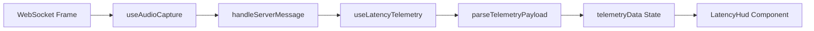

# 10 — Latency HUD

## 1. What we built in this branch

Branch: `feat/latency-hud`

This branch adds the real-time Latency Heads-Up Display (HUD) to the Vaani conversation interface.
It reads incoming WebSocket telemetry frames (`SHARED PROTOCOL v0.5`) and visualises one discrete latency
measurement per pipeline stage as conversation turns progress.
Before this change, telemetry spans were only recorded and logged internally on the server (`gateway.py`
and `telemetry.py`); the browser had no mechanism to observe stage timings.
Now, the conversation screen displays live timings for Voice Activity Detection (VAD), Endpointing Wait,
Speech Recognition (ASR), LLM First Token, Speech Synthesis (TTS), and Web Audio Playback scheduling,
alongside the cumulative turn latency compared against the PERF-1 target (P50 < 1,000 ms).

## 2. What we used to build it

- **React `useState` & `useCallback`** — React state management and memoization hooks.
  `useLatencyTelemetry` tracks the current turn telemetry payload, updates without screen flicker,
  and provides stable handler identities for WebSocket message routing.
- **Contract Parser `parseTelemetryPayload`** — Pure JavaScript validation and normalization module.
  Sanitizes incoming WebSocket JSON control frames, maps aliases and raw backend span names to
  canonical stages, validates numeric values, and rejects malformed payloads without fabricating data.
- **Stage Definitions Schema `STAGE_DEFINITIONS`** — Centralized schema declaring the official
  six pipeline stages (`vad`, `endpointing`, `asr`, `llm`, `tts`, `playback`), matching the span constants
  in `backend/vaani/telemetry.py` and the budget stages in `docs/findings/perf-1-latency-budget.md`.
- **Heads-Up Display Component `LatencyHud`** — Semantic, accessible UI component (`role="region"`,
  `aria-live="polite"`). Displays discrete stage cards, live update status badges, turn identifiers,
  and total latency with budget comparison.
- **Automated ESM Unit Suite `latencyTelemetry.test.js`** — Node.js runnable test suite verifying
  all 8 required contract and edge-case parsing rules across 56 distinct assertions.

## 3. Alternatives we rejected

| Decision | What we chose | Alternatives | Why not them | What we gave up |
|---|---|---|---|---|
| Latency measurement origin | Read server telemetry payload | Compute client-side timestamps via `performance.now()` | Browser timestamps cannot measure internal server stages (ASR decode, LLM token generation); simulating durations violates ownership rules | Measuring with zero backend support |
| Stage missing value representation | Display `'—'` (null state) | Fallback to hardcoded/previous stage averages | Fabricating numbers masks backend timing failures and produces fake metrics | Dense UI with numbers in every slot |
| WebSocket message routing | Single `onServerMessage` callback in `useAudioCapture` | Open separate WebSocket channel for telemetry | Adding a second WebSocket connection wastes server sockets and risks out-of-sync turns | Decoupled telemetry socket lifecycle |
| Stage schema architecture | Config-driven array of stage objects | Hardcoded inline JSX rows in component | Adding or reordering pipeline stages would require rewriting component DOM nodes | Minor indirection in render loop |
| Telemetry message payload shape | Normalized object with `stages` map or array | Ad-hoc free-form keys on root payload | Strict schemas allow rigorous schema validation and prevent field collisions with other control frames | Permissive schema allowing any key |

## 4. Where things live

| What | File | Function or class |
|---|---|---|
| Stage definitions & schema | `frontend/src/telemetry/latencyTelemetry.js` | `STAGE_DEFINITIONS`, `STAGE_KEY_ALIASES` |
| Wire message parser | `frontend/src/telemetry/latencyTelemetry.js` | `parseTelemetryPayload(rawMessage)` |
| Duration formatter | `frontend/src/telemetry/latencyTelemetry.js` | `formatLatencyMs(value)` |
| Telemetry state hook | `frontend/src/hooks/useLatencyTelemetry.js` | `useLatencyTelemetry()` |
| HUD presentation component | `frontend/src/components/LatencyHud.jsx` | `LatencyHud({ telemetryData, wsStatus, isCapturing })` |
| HUD styling | `frontend/src/components/LatencyHud.css` | Component styles, pulse badges, stage grid |
| Page integration & message dispatch | `frontend/src/pages/ConversationPage.jsx` | `ConversationPage()`, `handleServerMessage` |
| Protocol specification | `docs/contracts.md` | §2.6 Telemetry (`SHARED PROTOCOL v0.5`) |
| Unit test suite | `frontend/src/telemetry/latencyTelemetry.test.js` | 56 assertions covering 8 test requirements |

## 5. How it works

When the user clicks **Connect**, `ConversationPage` invokes `startCapture` and supplies `handleServerMessage`.
Whenever the WebSocket receives text messages, `useAudioCapture` parses the JSON and routes it to `handleServerMessage`:

```javascript
// frontend/src/pages/ConversationPage.jsx
const handleServerMessage = useCallback((msg) => {
  if (!msg || typeof msg !== 'object') return;

  if (msg.type === 'transcript.partial') {
    updatePartial(msg.text);
  } else if (msg.type === 'transcript.final') {
    finalizeTurn(msg.text);
  }

  processTelemetryMessage(msg);
}, [updatePartial, finalizeTurn, processTelemetryMessage]);
```

`useLatencyTelemetry` inspects message types (`telemetry`, `telemetry.spans`, `telemetry.turn`) and delegates to `parseTelemetryPayload`.
The parser validates types and extracts stage measurements (`frontend/src/telemetry/latencyTelemetry.js`):

```javascript
export function parseTelemetryPayload(rawMessage) {
  if (!rawMessage || typeof rawMessage !== 'object' || Array.isArray(rawMessage)) {
    return { valid: false, error: 'Payload must be a non-null JSON object.' };
  }

  const { type } = rawMessage;
  if (type !== 'telemetry' && type !== 'telemetry.spans' && type !== 'telemetry.turn') {
    return { valid: false, error: `Unrecognised message type: ${type}` };
  }

  const stages = { vad: null, endpointing: null, asr: null, llm: null, tts: null, playback: null };
  // Normalizes both object maps ({ vad: 280 }) and array schemas ([{ name: 'vad', duration_ms: 280 }])
  ...
  return { valid: true, turnId, stages, totalMs, hasData, isPartial };
}
```

The resulting state drives `LatencyHud.jsx`. If telemetry is missing or not yet sent by the server, stages render `'—'` with a `Waiting for telemetry…` status badge. When telemetry arrives, the HUD live-updates in-place without page refresh.



## 6. When things go wrong

| What fails | What the code does | What the user sees |
|---|---|---|
| Backend sends malformed/non-JSON message | Catches in `useAudioCapture`, warns to console | No UI crash; diagnostics remain intact |
| Message type is not `telemetry` | `parseTelemetryPayload` ignores message and returns `valid: false` | Normal handling of other messages (transcripts, errors) |
| Missing individual stage in telemetry | Sanitizer sets that stage to `null`; `isPartial` flag set | Present stages display ms; missing stage displays `'—'` |
| Negative or NaN latency duration | `sanitizeDuration` drops invalid value to `null` | Displays `'—'`, never corrupts total or UI |
| Session disconnects or errors | Status badge transitions to `No conversation active` or `Connection dropped` | Last recorded turn remains visible; badge explains status |
| New session started | `resetTelemetry()` called on Connect | Telemetry resets cleanly for the fresh session |

## 7. New terms

- **Latency HUD**: Heads-Up Display showing instantaneous real-time metrics during an active session.
- **Telemetry Payload**: Structured JSON message carrying per-stage timing measurements for a speech turn.
- **Span**: A named timestamp marking a milestone in processing (`backend/vaani/telemetry.py`), e.g., `asr_final`.
- **Stage Duration**: Elapsed time (in milliseconds) spent executing a discrete component of the voice pipeline.
- **Partial Telemetry**: A telemetry payload received before all downstream stages have settled (e.g. ASR finished but LLM still generating).

## 8. Questions you could be asked

1. **Where is the telemetry wire contract specified?**
   In `docs/contracts.md` under section §2.6 (`SHARED PROTOCOL v0.5`).
2. **Where does the code map backend span names to HUD stages?**
   In `frontend/src/telemetry/latencyTelemetry.js` in `STAGE_KEY_ALIASES`.
3. **What happens if the backend sends an empty stages object?**
   `parseTelemetryPayload` marks `hasData: false`, all stages remain `null`, and the HUD displays the waiting state.
4. **Does the HUD fabricate numbers if the backend has not emitted telemetry?**
   Never. All stage values evaluate strictly to `null` and format as `'—'`.
5. **How are live updates triggered without polling?**
   Via the WebSocket push event flow. `socket.onmessage` dispatches directly through `handleServerMessage` to React state.
6. **Why are both dictionary and array stage formats supported?**
   To support flexible backend payloads (`stages: { vad: 280 }` or `stages: [{ name: 'vad', duration_ms: 280 }]`).
7. **What happens to the HUD when a user disconnects?**
   The last turn's recorded timings remain displayed, and the badge switches to `Session ended (last turn)`.
8. **Why are backend files not touched in this change?**
   Samyak owns browser code. Aryan owns backend telemetry. Modifying `backend/` violates project ownership rules.

## 9. Check yourself

1. What are the six official stages shown in the Latency HUD?
2. What does the HUD display when no telemetry has arrived yet?
3. How does the HUD prevent stale telemetry from bleeding into a new conversation session?
