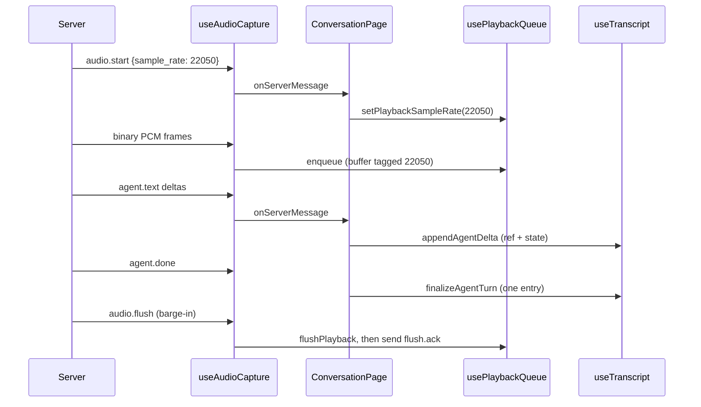

# 12 - Demo wiring: playback rate, single transcript lines, turn pill, error codes

## 1. What we built in this branch

Branch: `feat/frontend-demo` (from `dev`, uncommitted).

Samyak's `fb3c6b6` already wired every v0.7 server message into the
browser. This branch fixes what stood between that code and a live demo:
agent speech now plays at full quality at the rate `audio.start`
declares; each user and agent line appears once, not twice; Hindi has a
named Devanagari font; a small pill shows the live `turn.state`; and
server errors show their code (`LLM_FAILED: ...`) and clear on the next
turn. Barge-in and the persona picker were already correct and are
unchanged. Locally (not committed), `backend/.env` makes Groq the
primary model with Gemini as failover.

## 2. What we used to build it

- **Web Audio `AudioContext`** - the browser's audio engine. It owns a
  clock and an output sample rate. *Here:* plays the agent's PCM.
  *Why:* already Samyak's playback base (`03-playback-queue.md`).
- **`AudioBuffer` with its own sample rate** - a block of samples tagged
  with the rate they were recorded at. When played, the browser
  resamples it to the context's rate. *Here:* each chunk is tagged with
  `audio.start.sample_rate` (22050 for every Piper voice today). *Why:*
  pitch and speed are correct whatever the device rate is.
- **React `useState` and updater functions** - `setX(prev => next)`
  passes a function React calls to compute the new state. React expects
  that function to be *pure*: no side effects. *Here:* the old transcript
  code broke that rule. *Why it matters:* see StrictMode below.
- **React `StrictMode`** - a development-only wrapper (`main.jsx`) that
  deliberately calls updater functions twice to expose impure ones. It
  does nothing in a production build. *Here:* it is what doubled lines.
- **React `useRef`** - a box (`ref.current`) that survives re-renders and
  can be read and written immediately, without scheduling a render.
  *Here:* holds the in-flight user and agent text. *Why:* reading a ref
  is a plain read, so a commit happens exactly once.
- **CSS font fallback** - `font-family` is a list; for each character the
  browser uses the first font in the list that has that glyph. *Here:*
  Inter for Latin, then Nirmala UI (ships with Windows) or Noto Sans
  Devanagari for Hindi.
- **pydantic-settings env override** - the backend's settings loader
  reads `VAANI_`-prefixed variables; `__` reaches into a section, so
  `VAANI_LLM__PROVIDER_ORDER` overrides `[llm] provider_order`. *Here:*
  Groq first, only in the gitignored `backend/.env`.

No new library was added.

## 3. Alternatives we rejected

| Decision | What we chose | Alternatives | Why not them | What we gave up |
|---|---|---|---|---|
| Playback context rate | No `sampleRate` option: device rate | Keep 16 kHz; recreate the context at each `audio.start` rate | 16 kHz downsamples 22050 Hz speech (dull top end). Recreating the context per turn adds teardown code and a resume step for no audible gain | Nothing measurable; the browser now resamples up instead of down |
| Fixing doubled lines | Refs mirror the in-flight text; commits happen outside updaters | Rewrite `useTranscript` as one `useReducer`; remove `StrictMode` | A reducer is cleaner but rewrites Samyak's hook wholesale on demo day. Removing StrictMode hides the bug and loses its checks everywhere | Two refs that must be kept in step with two state values |
| Turn-state display | Small pill with the raw state word | Rely on the orb title only | The orb title turned into "Connection Issue" on any error, hiding the state | The pill duplicates the orb when nothing is wrong |
| Error code display | Prefix the code into the existing message string | A separate `errorCode` state field | One string keeps one state value and one banner; a field means new props through the page | The code is not separately styled |
| When the banner clears | On the next `turn.state listening` | Manual dismiss only; a timer | Manual-only leaves a stale error over a working turn; a timer can hide an error before it is read | An error stays up until you speak again |
| Groq primary | `.env` override | Edit `config.toml` | Committed config stays as reviewed; the demo choice is local | Others running `dev` still get Gemini first |

## 4. Where things live

| What | File | Function or class |
|---|---|---|
| Playback context creation | `frontend/src/hooks/usePlaybackQueue.js` | `getAudioContext` |
| Rate per chunk | `frontend/src/hooks/usePlaybackQueue.js` | `pcm16ToAudioBuffer`, `setPlaybackSampleRate` |
| `audio.start` routed to the rate | `frontend/src/pages/ConversationPage.jsx` | `handleServerMessage` |
| `audio.flush` stop + `flush.ack` (unchanged) | `frontend/src/hooks/useAudioCapture.js`, `usePlaybackQueue.js` | `socket.onmessage`, `flushPlayback` |
| Transcript state and commits | `frontend/src/hooks/useTranscript.js` | `finalizeTurn`, `appendAgentDelta`, `finalizeAgentTurn`, `interruptAgentTurn`, `makeEntry` |
| Devanagari font | `frontend/src/index.css` | `--font-ui` |
| Turn pill | `frontend/src/pages/ConversationPage.jsx` + `.css` | `turn-pill`, `.turn-<state>` |
| Error text and clearing | `frontend/src/hooks/useAudioCapture.js` | `socket.onmessage` |
| Error wording per code (unchanged) | `frontend/src/turnState/turnContracts.js` | `formatServerError` |
| Provider order override | `backend/.env` (gitignored) | read by `Settings` in `backend/vaani/config.py` |
| Config, database, logging | No new config keys, no database, no new logs in this change | - |

## 5. How it works



**Playback rate.** Reading `sample_rate` was already there; the context
was the problem:

```js
// frontend/src/hooks/usePlaybackQueue.js
audioCtxRef.current = new AudioContextClass({
  latencyHint: 'interactive',
});
```

Before, `sampleRate: AUDIO_SAMPLE_RATE` (16000) forced the context to
16 kHz. Each buffer was still tagged 22050, so speed was right, but the
browser squeezed it down to 16 kHz and cut everything above 8 kHz. Now the
context runs at the device rate and the buffer is resampled up. The ~27%
slow playback you heard matches what happens if 22050 Hz samples are
played *as* 16000 Hz (16000 / 22050 = 0.73). That was the behaviour
before `fb3c6b6` started reading `sample_rate`. That is my best guess for
what you heard; I did not reproduce it.

**Doubled lines.** The old code appended an entry from inside another
state's updater:

```js
// before (useTranscript.js)
setCurrentPartialTranscript((currentPartial) => {
  ...
  setFinalTranscriptEntries((prev) => [...prev, entry]);
  return null;
});
```

StrictMode calls that outer function twice, so the inner append is
queued twice: two identical lines under `npm run dev`. The fix reads the
in-flight text from a ref and commits once:

```js
// frontend/src/hooks/useTranscript.js
const finalizeTurn = useCallback((text) => {
  const finalText = text !== undefined ? text : userPartialRef.current;
  userPartialRef.current = null;
  setCurrentPartialTranscript(null);
  if (typeof finalText === 'string' && finalText.trim()) {
    setFinalTranscriptEntries((prev) => [...prev, makeEntry('user', finalText)]);
  }
}, []);
```

The remaining updater `prev => [...prev, entry]` is pure, so running it
twice still gives one line. `appendAgentDelta` updates the ref first
and then copies it into state, so the streaming text and the text that
`interruptAgentTurn` saves are the same string:

```js
// frontend/src/hooks/useTranscript.js (appendAgentDelta)
agentPartialRef.current = (agentPartialRef.current ?? '') + delta;
setCurrentAgentPartial(agentPartialRef.current);
```

**Turn pill and orb.** The pill renders `turnState` as-is when connected.
The orb now only gets the error when it is a mic or connection failure:

```js
// frontend/src/pages/ConversationPage.jsx
errorMessage={isMicDenied || isConnectionDropped || wsStatus === 'error' ? errorMessage : null}
```

**Errors.** `setErrorMessage(msg.code ? `${msg.code}: ${formatted}` : formatted)`
puts the code first. A later `turn.state listening` clears it. That is
safe because every server error code is non-fatal (contracts.md 2.3):
once you start a new turn, the old error is stale.

**Barge-in (no change, and why it was already right).** On `audio.flush`
the hook calls `flushPlayback` and then sends `flush.ack` with
`msg.turn_id` from the flush message itself, so it acks the flushed turn
even when a newer turn is current. `flushPlayback` stops every source
still in `activeSourcesRef`, and sources stay there until they finish
playing. That covers flush after `audio.end` or `agent.done`. With no
prior `audio.start` there is no context yet, so it returns early, and
the ack is still sent.

## 6. When things go wrong

| What fails | What the code does | What the user sees |
|---|---|---|
| Committed CPU ASR (`small` / `cpu` / `int8`) on this machine | The server's 5.0 s `[asr].timeout_s` fired on a 4.7 s clip, twice out of two runs | Banner `ASR_FAILED: ...`; orb back to idle; no reply. The default config cannot complete a turn here. The GPU env vars (`large-v3` / `cuda` / `float16`, set in the shell) worked |
| `LLM_FAILED`, `TTS_FAILED`, `INPUT_REJECTED` | Banner with the code; orb keeps the turn state | Banner until the next turn starts |
| `TTS_FAILED` after text streamed | `clearActivePartial` drops the streamed text (skipped, see below) | The reply text disappears; banner stays |
| Barge-in on speakers | Untested. The agent's own voice may reach the mic and count as a barge-in | The reply may cut itself off. Use headphones |
| Socket drops | Unchanged: "Connection Dropped" banner, orb shows the error | Reconnect button |
| Appending to `backend/.env` | The file had no trailing newline, so `>>` glued the new line onto the end of the API-key line, corrupting both; a check then printed that line | Fixed by inserting the newline. Lesson: check the last byte before appending, and never print lines from a secrets file. The key is being rotated |

**Skipped gap-list items (known, not built):** no `telemetry` (backend
does not send it); `UNSUPPORTED_FORMAT` leaves the UI on "Connecting";
messages are not filtered by `turn_id`; a barge-in after `agent.done`
is not marked "Interrupted"; `TTS_FAILED` loses the streamed text;
`language` and `duration_ms` are not shown; the "Frontend gap" note in
contracts.md 2.2 is stale.

**Verified:** `npm run build`, frontend tests (56 + 52 passed), ruff,
backend pytest (239 passed). fake_client `--barge-in-after 300` against a
real server (GPU ASR) got transcript, `audio.start` at 22050, flush,
ack, cancelling, then listening with a new turn_id, in 290 ms
client-side. `provider_order` resolved to `['groq', 'gemini']`.
**Not verified in a browser:** sound, single lines, Devanagari, pill,
banner.

## 7. New terms

- **Device sample rate** - the rate the sound card runs at (often 44.1
  or 48 kHz). An `AudioContext` without a `sampleRate` option uses it.
- **Downsampling / upsampling** - converting audio to a lower / higher
  sample rate. Down loses high frequencies; up loses nothing.
- **Glyph** - the drawn shape of a character in one font. Inter has none
  for Devanagari, so the next font in the list draws those.
- **Pure function** - same inputs, same output, no side effects. React
  updaters must be pure because React may call them more than once.
- **Ref (`useRef`)** - a mutable box that survives re-renders; changing
  it does not re-render.
- **StrictMode** - React's development checker; double-calls updaters
  and effects to reveal impure code. Off in production builds.
- **Trailing newline** - a final `\n` at the end of a text file.
  Without it, the next appended text joins the last line.
- **Updater function** - the `prev => next` form of a state setter.

## 8. Questions you could be asked

1. *Where is the code that sets the playback rate?* `usePlaybackQueue.js`:
   `setPlaybackSampleRate` stores it, `pcm16ToAudioBuffer` tags each
   buffer, `getAudioContext` no longer forces 16 kHz.
2. *Why did every line appear twice?* StrictMode double-calls updater
   functions, and the old updater appended an entry inside itself.
3. *Would production have shown doubles?* No. StrictMode only acts in
   development. The fix is still right: the code broke a React rule.
4. *What happens if `audio.flush` arrives before any audio?* No context
   exists, `flushPlayback` returns early, and `flush.ack` is still sent.
5. *What happens if the flush comes after `audio.end`?* Sources still
   playing stay in `activeSourcesRef`, so they are faded and stopped.
6. *Why not just remove StrictMode?* It hides this bug and every future
   impure updater. Fixing the hook keeps the check.
7. *What does "resample" mean here?* Converting the 22050 Hz buffer to
   the device rate at playback; the browser does it.
8. *Why does the banner clear on `listening`?* Server errors are
   non-fatal, so once a new turn starts the old one is stale.
9. *Why can't the default config finish a turn on this laptop?* CPU
   Whisper `small` took longer than `[asr].timeout_s` (5.0 s) on a 4.7 s
   clip. This is measured twice, not explained.
10. *How do you know Groq is primary?* The resolved settings and the
    chain built from them list `groq, gemini`. The server log does not
    name the provider on a successful turn.
11. *Hardest: is the barge-in path proven in the browser?* No. It is
    proven by fake_client against a real server and by reading the
    browser code. Speakers and browser echo cancellation are untested.

## 9. Check yourself

1. Why did forcing the playback context to 16 kHz dull the voice but not
   slow it down?
2. Explain in two sentences why reading a ref fixed the doubled lines.
3. Name three cases of `audio.flush` v0.7 added, and what stops the
   audio in each.
