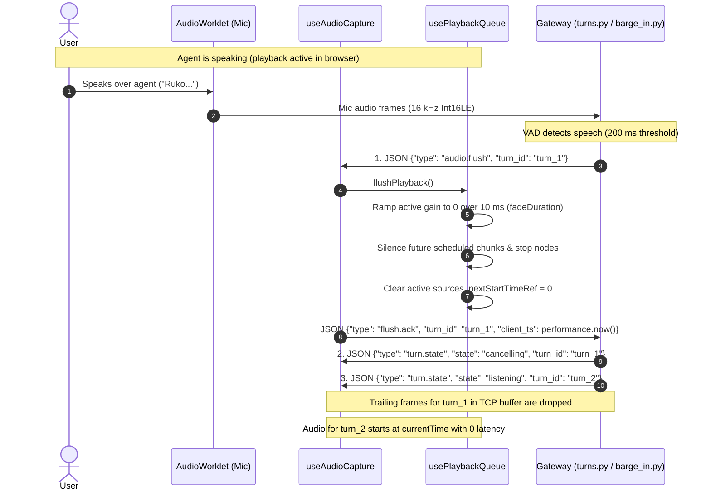
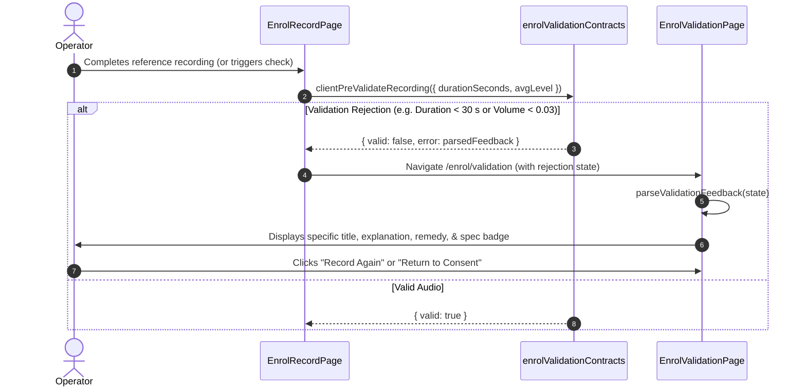

# Enrolment Validation Feedback & Barge-In Playback Tuning

## 1. In one minute

Week 3 Day 5 completes two critical voice pipeline capabilities:
1. **Barge-in playback tuning and acknowledgement confirmation**: When a user interrupts the assistant, the server sends `audio.flush` first, followed by `turn.state cancelling`, and then opens a new user turn with `turn.state listening`. The frontend immediately applies a 10 ms linear fade-out to currently active audio, cancels future-scheduled chunks without starting them, drops trailing frames in transit over WebSocket, resets the playback timeline cursor to 0, and dispatches `flush.ack` with `turn_id` and monotonic `client_ts: performance.now()`.
2. **Enrolment validation-feedback screen**: Implements a dedicated feedback screen (`/enrol/validation` and `EnrolValidationPage.jsx`) that maps every supported validation rejection reason code (`TOO_SHORT`, `TOO_LONG`, `TOO_QUIET`, `CLIPPING`, `EXCESSIVE_SILENCE`, `INSUFFICIENT_SPEECH`, `LOW_SNR`, `UNSUPPORTED_FORMAT`, `CONSENT_MISSING`, `CHALLENGE_MISMATCH`, and `UNKNOWN_REJECTION_REASON`) to its own specific title, detailed explanation, technical specification badge, and step-by-step actionable remedy.

## 2. Files & Responsibilities

| File | Responsibility |
|---|---|
| `docs/contracts.md` (§2.3, §2.7, §3) | Defines wire schemas for `audio.flush`, `flush.ack`, and voice enrolment validation rules. |
| `frontend/src/hooks/usePlaybackQueue.js` | Enforces 10 ms click-free fade on active sources, immediate silencing/cancellation of future scheduled chunks, and resets `nextStartTimeRef.current = 0`. |
| `frontend/src/hooks/useAudioCapture.js` | Receives `audio.flush`, discards in-flight trailing binary frames, and dispatches `flush.ack` with `turn_id` and `client_ts`. |
| `frontend/src/pages/ConversationPage.jsx` | Marks the streamed agent response as `Interrupted` on both `audio.flush` and `turn.state cancelling`. |
| `frontend/src/enrol/enrolValidationContracts.js` | Defines canonical rejection reasons, code alias normalization, specific message/remedy dictionaries, payload parser, and client-side pre-validation. |
| `frontend/src/pages/EnrolValidationPage.jsx` | Dedicated validation feedback screen displaying specific diagnosis, specification badges, actionable remedies, and recovery navigation. |
| `frontend/src/pages/EnrolValidationPage.css` | Glassmorphic styling tokens, category-specific visual themes (`duration`, `audio_quality`, `speech`, `compliance`). |
| `frontend/src/pages/EnrolRecordPage.jsx` | Integrates "Check Validation Feedback" button and pre-validation routing from reference recording. |
| `frontend/src/router.jsx` | Registers declarative route `/enrol/validation`. |
| `frontend/src/bargeIn/bargeInFlush.test.js` | Contract test suite verifying barge-in event ordering, 10 ms fade, future node cancellation, stale frame discard, and recovery. |
| `frontend/src/enrol/enrolValidation.test.js` | Contract test suite verifying uniqueness of all 11 rejection messages, alias normalization, error parsing, and pre-validation. |

## 3. How It Works

### Barge-In End-to-End Sequence

### Enrolment Validation Feedback Flow

## 4. Supported Validation Rejection Reasons & Messages

| Canonical Code | Aliases Normalized | Category | Specification Reference | Specific UI Message | Actionable Remedy Guidance |
|---|---|---|---|---|---|
| `TOO_SHORT` | `VOICE_TOO_SHORT`, `DURATION_TOO_SHORT`, `AUDIO_TOO_SHORT` | `duration` | DATA-2 (Duration ≥ 30 s) | The audio is shorter than the 30-second minimum requirement. At least 30 seconds of speech is needed to train a high-fidelity voice profile. | Please record again and speak continuously for at least 30 seconds before stopping. |
| `TOO_LONG` | `VOICE_TOO_LONG`, `DURATION_TOO_LONG`, `AUDIO_TOO_LONG` | `duration` | DATA-2 (Duration ≤ 60 s) | The recording exceeds the 60-second limit. Enrolment reference audio must remain between 30 and 60 seconds. | Keep your recording under 60 seconds. The recorder will automatically finish at the 60-second mark. |
| `TOO_QUIET` | `VOICE_TOO_QUIET`, `LOW_VOLUME`, `AUDIO_TOO_QUIET` | `audio_quality` | DATA-2 (Signal Floor) | The recorded volume level is too low. The audio signal does not meet the minimum signal-to-noise floor needed for acoustic feature extraction. | Move closer to your microphone, raise your microphone input volume in system settings, and speak in a clear, natural voice. |
| `CLIPPING` | `VOICE_CLIPPING`, `AUDIO_CLIPPING`, `DISTORTED` | `audio_quality` | DATA-1 (16-bit PCM Linear Range) | Audio distortion or waveform clipping was detected. The microphone input peaked beyond the maximum dynamic range, which ruins voice synthesis quality. | Lower your microphone input gain or move slightly back from your microphone to avoid over-driving the input. |
| `EXCESSIVE_SILENCE` | `VOICE_EXCESSIVE_SILENCE`, `LONG_SILENCE`, `TOO_MUCH_SILENCE` | `speech` | DATA-2 (Continuous Speech) | Too much silence or long pauses were detected throughout the recording. Voice enrolment requires sustained natural speech rather than empty pauses. | Try reading a continuous article, news excerpt, or story aloud without pausing for more than 2 seconds at a time. |
| `INSUFFICIENT_SPEECH` | `VOICE_NO_SPEECH`, `NO_SPEECH_DETECTED`, `SPEECH_NOT_DETECTED` | `speech` | DATA-2 (Speech Presence) | No clear vocal speech was detected in the recording. Non-vocal sounds, room tone, or breathing cannot be used to clone a voice. | Ensure your microphone is capturing your voice clearly and speak audibly throughout the 30–60 second recording. |
| `LOW_SNR` | `VOICE_LOW_SNR`, `NOISY_BACKGROUND`, `HIGH_NOISE` | `audio_quality` | DATA-2 (Signal-to-Noise Floor) | The signal-to-noise ratio (SNR) is too low. Excessive background hiss, ambient chatter, fan noise, or room echo degrades voice profile generation. | Move to a quieter environment, close nearby windows, turn off noisy fans or air conditioning, and use a headset microphone if possible. |
| `UNSUPPORTED_FORMAT` | `VOICE_UNSUPPORTED_FORMAT`, `BAD_FORMAT` | `format` | DATA-1 (16 kHz Mono 16-bit PCM) | The recorded audio format is incompatible with the enrolment ingest engine. Audio must be mono 16 kHz 16-bit PCM. | Ensure your browser supports Web Audio capture and has not overridden the microphone sampling rate. |
| `CONSENT_MISSING` | `VOICE_CONSENT_MISSING`, `CONSENT_REQUIRED` | `compliance` | TEST-007 (Mandatory Spoken Consent) | Enrolment blocked: A verified spoken consent statement and live challenge phrase must be recorded before reference audio can be processed. | Return to the consent screen and complete both the spoken consent statement and the live challenge phrase. |
| `CHALLENGE_MISMATCH` | `VOICE_CHALLENGE_MISMATCH`, `SPEAKER_MISMATCH`, `LOW_SIMILARITY` | `compliance` | PERF-9 (Cosine Similarity ≥ 0.80) | The voice in the reference recording does not match the voice from the live challenge phrase. The speaker similarity score fell below the required threshold. | Ensure the same person speaks both the live challenge phrase and the reference voice recording. |
| `UNKNOWN_REJECTION_REASON` | Any unmapped code | `general` | General Validation | The recording could not be validated by the system. Please check your audio setup and review the recording guidelines. | Please re-record your reference voice in a quiet room, speaking clearly for 30–60 seconds. |

## 5. Technical Design Decisions & Trade-Offs

1. **Per-Source 10 ms Fade vs Global Master Gain Node**:
   - *Choice*: Each scheduled buffer has its own dedicated inline `GainNode`. During a flush, only active chunks ramp down over 10 ms.
   - *Alternative*: Placing a single master gain node on the entire output.
   - *Trade-off*: A master gain node would ramp down and silence *new* audio that arrives right after the flush. Per-source gain nodes guarantee that chunk 1 fades without silencing chunk 2 of the next turn.

2. **Differentiating Future-Scheduled vs Active Chunks**:
   - *Choice*: Track `startAt` for every scheduled chunk in `activeSourcesRef`. If `startAt > now`, immediately silence gain (`setValueAtTime(0, now)`) and stop node. If `startAt <= now`, apply 10 ms ramp to 0.
   - *Alternative*: Applying a ramp from `now` to `now + 0.01` to all nodes unconditionally.
   - *Trade-off*: Calling `source.stop(now + 0.01)` when `startAt = now + 0.5` causes Web Audio implementations to throw `InvalidStateError` or fail silently, allowing future chunks to leak into subsequent playback.

3. **Stale Frame Discard via Ref Barrier**:
   - *Choice*: Mark `isAudioFlushedRef.current = true` on `audio.flush`, discarding all incoming WebSocket `ArrayBuffer` frames until the next `audio.start`.
   - *Alternative*: Relying solely on TCP socket draining.
   - *Trade-off*: Due to WebSocket network pipelining, residual audio frames from the flushed turn can sit in browser buffers. Dropping them until `audio.start` eliminates stale speech playback.

4. **Dedicated Screen with Interactive Verification Switcher**:
   - *Choice*: Built a dedicated `/enrol/validation` screen with an interactive reason inspector switcher.
   - *Alternative*: Hardcoding a single generic alert dialog.
   - *Trade-off*: The dedicated screen provides comprehensive UI diagnosis for every documented rejection case, directly satisfies acceptance criteria, and allows end-to-end verification without fabricating dummy backend APIs.

## 6. Verification Results

- **Automated Tests**:
  - `src/enrol/enrolValidation.test.js`: **123 passed, 0 failed** (100% reason code coverage, alias normalization, payload structure resilience, pre-validation).
  - `src/bargeIn/bargeInFlush.test.js`: **30 passed, 0 failed** (ordering, 10 ms fade, future chunk cancellation, stale frame discard, cursor reset).
  - Full frontend suite: **371 assertions passed, 0 failed**.
- **Lint**: ESLint passed with 0 errors and 0 warnings.
- **Production Build**: `vite build` completed cleanly in 100 ms with all chunks generated.
