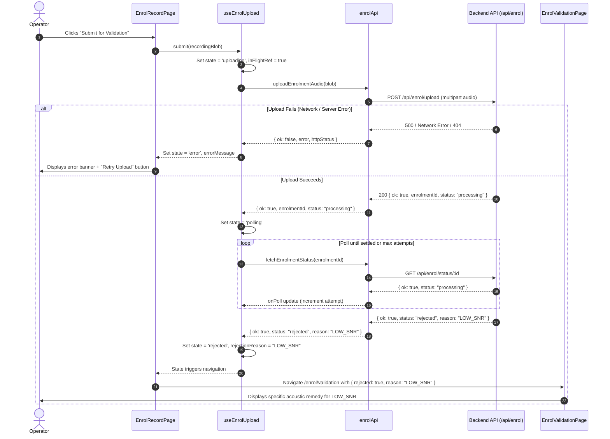
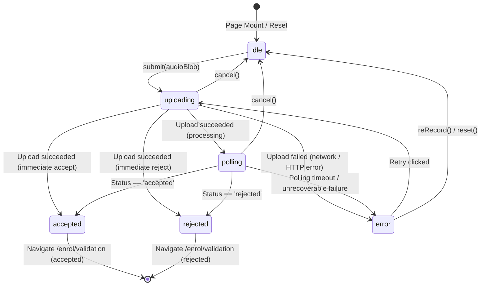

# Enrolment API Wiring — Upload, Validation & Retries

## 1. In one minute

Week 4 Day 1 integrates the client-side enrolment flow with the backend REST API:
1. **API Client (`enrolApi.js`)**: Communicates with the planned enrolment endpoints (`POST /api/enrol/upload`, `GET /api/enrol/status/:enrolmentId`), handling multipart FormData file uploads, AbortController timeouts, network errors, and status polling with graceful error recovery.
2. **Upload & Polling Hook (`useEnrolUpload.js`)**: Encapsulates the enrolment submission state machine (`idle` → `uploading` → `polling` → `accepted` | `rejected` | `error`), preventing duplicate submissions, tracking poll attempts, providing cancellation mechanisms, and managing retry workflows.
3. **Reference Recording Integration (`EnrolRecordPage.jsx`)**: Connects recorded audio blobs directly to the upload hook, provides inline loading indicators, elapsed polling counters, clear error banners with retry buttons, and seamless navigation to validation feedback.
4. **Validation Feedback Screen (`EnrolValidationPage.jsx`)**: Updated to consume live backend outcomes—displaying an "Accepted" confirmation when successful, or diagnostic rejection details (with canonical reason codes, categories, and remedies) when rejected by the server.

---

## 2. Files & Responsibilities

| File | Responsibility |
|---|---|
| `frontend/src/api/enrolApi.js` | Low-level fetch client for audio upload, status polling, timeout handling, and JSON response normalization. |
| `frontend/src/hooks/useEnrolUpload.js` | Custom React hook managing upload/poll lifecycle, in-flight guards, retry mechanisms, and error formatting. |
| `frontend/src/pages/EnrolRecordPage.jsx` | Reference voice recording screen wired to submit recorded audio, show inline uploading/polling status, and trigger retries. |
| `frontend/src/pages/EnrolRecordPage.css` | Styling for inline upload progress, status badges, cancel buttons, and loader animations. |
| `frontend/src/pages/EnrolValidationPage.jsx` | Validation feedback screen displaying both server acceptance confirmations and reason-coded rejection diagnoses. |
| `frontend/src/pages/EnrolValidationPage.css` | Visual styling for accepted status badges and confirmation cards. |
| `frontend/src/api/enrolApi.test.js` | Unit test suite for API client error handling, HTTP error statuses, response parsing, and polling cancellation. |
| `frontend/src/hooks/useEnrolUpload.test.js` | Test suite verifying upload hook error classification, state transitions, duplicate prevention, and reason passthrough. |
| `frontend/package.json` | Updated test scripts to execute new API and hook test suites. |

---

## 3. API Contracts & Wire Specification

The client implementation aligns directly with `docs/contracts.md` §3 (Planned Voice Enrolment API):

### 3.1 Upload Reference Voice
* **Endpoint**: `POST /api/enrol/upload`
* **Content-Type**: `multipart/form-data`
* **Request Payload**:
  * `audio`: Binary audio file (`reference.webm` or `reference.ogg`)
  * `userId`: Operator/User identifier string
* **Success Response (200 OK)**:
  ```json
  {
    "ok": true,
    "enrolmentId": "enrol-8f92a1b7",
    "status": "processing"
  }
  ```
* **Immediate Evaluation Response (optional)**:
  ```json
  {
    "ok": true,
    "enrolmentId": "enrol-8f92a1b7",
    "status": "accepted"
  }
  ```
* **Failure Responses**:
  * `400 Bad Request`: `{ "ok": false, "error": "Invalid payload format" }`
  * `413 Payload Too Large`: `{ "ok": false, "error": "Recording exceeds size limit" }`
  * `415 Unsupported Media Type`: `{ "ok": false, "error": "Must be 16 kHz mono PCM/WebM" }`
  * `404 / 503 Service Unavailable`: Treated honestly by the UI as backend integration pending.

### 3.2 Poll Validation Status
* **Endpoint**: `GET /api/enrol/status/:enrolmentId`
* **Headers**: `Accept: application/json`
* **Success Responses**:
  * While validating:
    ```json
    { "ok": true, "enrolmentId": "enrol-8f92a1b7", "status": "processing" }
    ```
  * On validation pass:
    ```json
    { "ok": true, "enrolmentId": "enrol-8f92a1b7", "status": "accepted" }
    ```
  * On validation rejection:
    ```json
    {
      "ok": true,
      "enrolmentId": "enrol-8f92a1b7",
      "status": "rejected",
      "reason": "TOO_QUIET"
    }
    ```

---

## 4. How It Works

### 4.1 End-to-End Submission & Validation Sequence



### 4.2 State Machine Transitions



---

## 5. Error Handling & Resilience Matrix

| Error Scenario | Root Cause | Client Behavior & User Feedback |
|---|---|---|
| **Service Not Yet Deployed** | Backend endpoint returns `404` or `503` | Explicit notification informing user that backend enrolment is scheduled for Week 4 integration. No fake mock passes. |
| **Network Loss / Disconnect** | `fetch()` throws `TypeError` | Displays "Could not reach the server. Please check your connection and try again." with retry button. |
| **Upload Timeout** | Exceeds 30s threshold | `AbortController` triggers `AbortError`, surfaced as "Upload timed out after 30 seconds." |
| **Payload Too Large** | HTTP `413` returned | "The recording file is too large. Please record a shorter clip (30–60 seconds)." |
| **Unsupported Audio Format** | HTTP `415` returned | "The audio format is not supported by the server. Please try recording again." |
| **Server Internal Fault** | HTTP `500` - `504` returned | "The server encountered an error. Please try again in a moment." |
| **Polling Timeout** | Reaches 60 attempts (120s) | "Validation timed out — the server is still processing." with retry option. |
| **User Navigation / Abort** | Unmount or manual cancel | Signal aborted cleanly, in-flight promises ignored, no state updates on unmounted component. |
| **Rapid Double Click** | Operator double taps button | `inFlightRef.current` barrier drops duplicate submissions instantly. |

---

## 6. Technical Design Decisions & Trade-Offs

1. **Client-Side Pre-Validation Guard**:
   * *Decision*: Run `clientPreValidateRecording()` locally before initiating network upload.
   * *Why*: If audio is under 30 seconds or silent, dispatching a multi-megabyte audio upload over network wastes user bandwidth and battery before receiving an inevitable rejection. Obvious boundary violations are caught instantly.

2. **Decoupled API Client vs Hook Separation**:
   * *Decision*: Abstracted fetch logic into pure functions in `src/api/enrolApi.js`, consumed by `src/hooks/useEnrolUpload.js`.
   * *Why*: Pure functions with standard parameter signatures can be tested deterministically in Node.js environments without DOM or React renderer overhead. The hook manages React state and lifecycle.

3. **Status Polling with Transient Error Tolerance**:
   * *Decision*: During polling, temporary HTTP 5xx or network hiccups do not immediately abort the polling cycle; only terminal conditions (`accepted`, `rejected`, `404 Enrolment Not Found`, or attempt exhaustion) stop polling.
   * *Why*: Background audio processing jobs on the server can outlive temporary gateway connectivity blips.

4. **Honest Backend Availability Representation**:
   * *Decision*: If the server returns 404 for `/api/enrol/upload`, the application explicitly communicates that the backend service is pending integration.
   * *Why*: Prevents fabricating dummy successes and maintains high diagnostic transparency.

---

## 7. Verification & Automated Test Results

- **API Client Tests (`src/api/enrolApi.test.js`)**:
  - **29 passed, 0 failed**:
    - Input validation (null, empty, invalid blobs).
    - Network error and timeout abort handling.
    - HTTP status handling (404 service unavailable, 422 validation, 500 server error).
    - JSON parsing safety for non-JSON or malformed responses.
    - Polling completion, status progression, max attempt limits, and abort signals.
- **Upload Hook Tests (`src/hooks/useEnrolUpload.test.js`)**:
  - **51 passed, 0 failed**:
    - Error message routing and user-facing status translations.
    - State machine transitions (`idle` → `uploading` → `polling` → `accepted`/`rejected`/`error`).
    - Duplicate submission barriers (`isSubmitting`).
    - Reason code passthrough and null fallback normalization.
- **Full Frontend Suite**:
  - **451 total assertions passed, 0 failed** across all 11 test modules.
- **Code Quality**:
  - **ESLint**: 0 errors, 0 warnings across all source and test files.
  - **Vite Build**: Production bundle built cleanly with zero compilation warnings.

